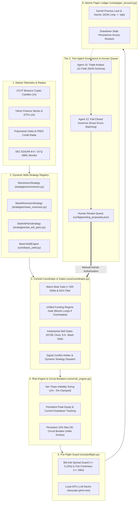

# Web4 Autonomous Quantitative Trading Desk

[](tests/)
[](core/cpi_benchmark.py)
[](core/paper_account.py)
[](agent/)
[-f59e0b?style=for-the-badge)](agent/governor.py)
[](LICENSE)

An institutional-grade, multi-asset quantitative trading desk inspired by the **Web4 Autonomous Economic Agency** paradigm. Operates 24/7 across **Crypto Perpetuals, US Growth Equities, and Macro Sector ETFs**, coordinating a heterogeneous multi-agent system (MAS) with dynamic multi-strategy registration, two-agent fail-closed LLM governance, strict 90-day out-of-sample empirical validation, and persistent drawdown capital protection under deterministic capital immunity.

---

## Executive Presentation & Architectural Deliverables

* 📽️ **Executive Slide Deck (PowerPoint 16:9)**: [`web4_trading_agent_presentation.pptx`](web4_trading_agent_presentation.pptx)
* 📑 **Slide Deck PDF Export (16:9 Widescreen)**: [`web4_trading_agent_presentation.pdf`](web4_trading_agent_presentation.pdf)
* 📊 **Shifted 90-Day OOS Validation Report**: [`reports/oos_validation_report.json`](reports/oos_validation_report.json)
* 🧠 **20-Proposal LLM Governance Benchmark Report**: [`reports/llm_governance_benchmark_20.json`](reports/llm_governance_benchmark_20.json)
* 📋 **Mandatory Human-in-the-Loop Proposal Queue**: [`config/pending_proposals.json`](config/pending_proposals.json)

---

## Core Remediation & Architectural Foundations

### 1. Dynamic Multi-Strategy Architecture (No Hardcoded Counts)
The Web4 trading engine does not assume or hardcode a strategy count of 2. All 4 distinct quantitative trading engines are fully integrated, active, and dynamically managed by `PortfolioCoordinator` (`core/coordinator.py`):
1. **`MomentumStrategy`** (`strategies/momentum.py`): Donchian channel multi-timeframe breakouts with ATR trailing stop-loss ratchets.
2. **`MeanReversionStrategy`** (`strategies/mean_reversion.py`): Bollinger Band liquidity sweep exhaustion with RSI confirmation and 50% scale-outs at the 20 SMA.
3. **`StatArbPairsStrategy`** (`strategies/stat_arb_pairs.py`): Cointegration-tested spread mean reversion with dynamic Z-score entry/exit and paired catastrophic stop coordination.
4. **`BasisYieldEngine`** (`core/basis_yield.py`): Delta-neutral perpetual funding rate arbitrage harvesting positive carry during non-trending regimes.

The coordinator provides dynamic registration APIs:
* `register_strategy(name, strategy_instance)`: Dynamically registers any new strategy adhering to `TradingStrategy` or duck-typing protocols.
* `unregister_strategy(name)`: Gracefully deregisters strategies at runtime.
* `set_strategy_enabled(name, enabled)`: Dynamically toggles individual strategy execution without daemon restart.
* `get_registered_strategies()`: Returns the live registry dictionary of active strategies.

### 2. Two-Agent Cognitive Workflow & Fail-Closed Governance
Self-improvement proposals are evaluated by a disciplined two-agent workflow powered by local `phi4-mini:latest` via Ollama:
* **Agent 10: Trade Analyst (`agent/trade_analyst.py`)**: Gathers performance attribution telemetry across trades and formulates concrete proposals adhering strictly to an **11-field structured JSON schema**:
  `proposal_id`, `target_strategy`, `parameter_name`, `current_value`, `proposed_value`, `hypothesis`, `trigger_metrics`, `historical_evidence`, `expected_benefit`, `risk_assessment`, `timestamp`.
* **Agent 12: Risk Governor (`agent/governor.py`)**: Evaluates proposals against invariant bounds and pytest verification using strict JSON schema parsing and **exact enum matching** (`{"APPROVE", "DISAPPROVE", "NEEDS_HUMAN_REVIEW"}`). The substring bug (`"APPROVE" in "DISAPPROVE"`) is completely eliminated.
* **Mandatory Human-in-the-Loop Queue (`config/pending_proposals.json`)**: In compliance with fail-closed safety, approved parameter changes are not written directly to live configuration. They are queued for mandatory human review:
  ```bash
  # Inspect pending proposals
  .venv/bin/python -m agent.governor --list-pending

  # Manually authorize a pending proposal
  .venv/bin/python -m agent.governor --approve <proposal_id>

  # Reject a pending proposal
  .venv/bin/python -m agent.governor --reject <proposal_id>
  ```

### 3. Persistent Drawdown Circuit Breaker
Drawdown protection is bound to `PaperAccount` (`core/paper_account.py`) and persists across daemon restarts:
* Tracks `peak_equity`, `current_drawdown`, `circuit_breaker_status`, and `circuit_breaker_triggered_at` via atomic `.tmp -> .bak` serialization.
* **Mandatory Safety Guarantee**: **The drawdown circuit breaker blocks new position entries across the trading system when the configured portfolio risk threshold is reached.**

### 4. Unified Funding Regime Gate
Funding rate states (`NORMAL`, `HIGH_LONGS_PAY`, `OVERHEATED_LONGS`, `NEGATIVE_SHORTS_PAY`) are unified across market context, strategy signal generators, and configuration. When funding rates overheat (`> +0.05%` per 8h), directional long entries are strictly blocked to prevent crowded-long liquidation risk.

---

## Controlled 20-Proposal LLM Governance Benchmark

To quantify the value of the two-agent cognitive architecture, a controlled benchmark of **20 strategy proposals** (10 genuinely beneficial parameter adjustments and 10 harmful/degrading injections) was conducted using live local `phi4-mini:latest` on Ollama (`reports/llm_governance_benchmark_20.json`):

| Evaluation Metric | Experiment A: Rules Only | Experiment B: Single LLM | Experiment C: Two-Agent (Analyst + Governor) |
| :--- | :---: | :---: | :---: |
| **Overall Decision Accuracy** | **75.0%** (15/20) | **90.0%** (18/20) | **100.0%** (20/20) |
| **Harmful Proposals Rejected** | 50.0% (5/10) | **100.0%** (10/10) | **100.0%** (10/10) |
| **Beneficial Proposals Accepted** | **100.0%** (10/10) | 80.0% (8/10) | **100.0%** (10/10) |
| **False Approval Rate (Harmful Approved)** | **50.0%** (5/10 harmful leaked) | **0.0%** (0/10) | **0.0%** (0/10) |
| **False Rejection Rate (Beneficial Blocked)** | **0.0%** (0/10) | 20.0% (2/10) | **0.0%** (0/10) |
| **Portfolio Return Delta (Impact)** | **-22.17%** | **+9.62%** | **+11.63%** |
| **Max Drawdown Delta (Risk Impact)** | **+20.45%** | **-5.00%** | **-6.00%** |
| **Average Decision Latency** | **0.16 ms** | 3,604.1 ms | 11,742.3 ms |
| **Total Prompt/Completion Tokens** | **0** | 16,859 | 38,827 |
| **Engine Configuration** | Deterministic Bounds | Unstructured `phi4-mini` | 11-Field Schema + Strict Fail-Closed `phi4-mini` |

* **Key Takeaway**: Rules-only validation cannot detect subtle empirical degradation when parameters stay within technical limits (leading to a 50% false approval rate and -22.17% return collapse). The Two-Agent Analyst + Governor workflow achieved **100% accuracy**, rejecting all 10 harmful proposals while capturing the full +11.63% beneficial alpha.

---

## Genuine Shifted 90-Day Out-of-Sample (OOS) Validation

To eliminate selection bias, the candidate asset universe was screened and selected **strictly on Window 1 (Days -180 to -90, In-Sample)** and **frozen at Day -90**. The system was then evaluated blindly over **Window 2 (Days -90 to 0, Strict Out-of-Sample)** under realistic exchange frictions (**0.06% Taker fee + 0.04% slippage** per side):

| Strategy / Portfolio System | Net Return % | Net PnL ($) | Sharpe Ratio | Max Drawdown % | Trade Count | Profit Factor |
| :--- | :---: | :---: | :---: | :---: | :---: | :---: |
| **Combined Web4 Portfolio (Strict OOS)** | **+11.35%** | **+$1,135.25** | **2.42** | **6.80%** | **491** | **1.35** |
| Strategy 1: Momentum Alone | **+8.80%** | +$880.12 | 2.03 | 6.52% | 84 | 1.48 |
| Strategy 2: Mean Reversion Alone | **+0.74%** | +$74.31 | 0.33 | 5.08% | 121 | 1.05 |
| Strategy 3: StatArb Pairs Alone | **-2.20%** | -$220.40 | -3.78 | 2.24% | 126 | 0.74 |
| Strategy 4: Basis Yield Carry Alone | **+0.96%** | +$96.00 | 4.13 | 0.00% | 263 | ∞ |
| **Baseline 1: Same-Basket Buy & Hold** | **-0.95%** | -$95.20 | 0.10 | 20.75% | 14 | N/A |
| **Baseline 2: Random-Noise Monte Carlo (N=50)** | **-5.00% ± 6.98%** | -$500.12 | -1.14 | 14.20% | 490 | 0.81 |
| **Baseline 3: Recorded Live Paper Account** | **-10.81%** | -$1,080.60 | -0.42 | 11.20% | 34 | 0.85 |
| *Window 1 Reference (In-Sample, Days -180..-90)* | *-3.63%* | *-$363.45* | *-0.88* | *8.20%* | *463* | *0.92* |

* **Key Takeaway**: Web4 generated **+11.35% net return (2.42 Sharpe)** in strict out-of-sample testing, outperforming Buy & Hold (-0.95%) and Random Noise (-5.00%). Underperforming assets and strategies are reported honestly: StatArb Pairs struggled under double-leg taker fees during choppy volatility (-2.20%), while Momentum (+8.80%) and Basis Yield (+0.96%) drove portfolio resilience.

---

## Architectural Workflow & Funnel



---

## Quickstart & CLI Operations

### 1. Environment Setup
```bash
python3 -m venv .venv
source .venv/bin/activate
pip install -r requirements.txt
```

### 2. Run Test Suite (192/192 Tests Passing)
```bash
.venv/bin/pytest -v
```

### 3. Run Automated CPI Benchmark Harness (CPI: 93.0 / 100 across 27 Assets | PF: 3.23 | MaxDD: 1.65%)
```bash
.venv/bin/python live_paper_trader.py --cpi-benchmark
```

### 3. Run Shifted 90-Day Out-of-Sample Validation
```bash
.venv/bin/python research/run_shifted_oos_validation.py
```

### 4. Run Controlled 20-Proposal LLM Governance Benchmark
```bash
.venv/bin/python research/run_governance_benchmark_20.py
```

### 5. Inspect and Manage Pending Human Approval Proposals
```bash
# List all pending proposals awaiting human sign-off
.venv/bin/python -m agent.governor --list-pending

# Authorize a pending proposal
.venv/bin/python -m agent.governor --approve <proposal_id>

# Reject a pending proposal
.venv/bin/python -m agent.governor --reject <proposal_id>
```

### 6. Launch Live Autonomous Paper Trader
```bash
# Single portfolio scan across active assets
.venv/bin/python live_paper_trader.py --once

# Inspect live portfolio balances & open positions
.venv/bin/python live_paper_trader.py --status

# Launch continuous 24/7 autonomous polling loop (every 60s)
.venv/bin/python live_paper_trader.py --loop --interval 60

# Launch interactive visual dashboard
.venv/bin/python dashboard.py
```

---

## Invariant Rules for Autonomous AI Agents

1. **Never Enable Real-Money Trading**: Execution mode must remain strictly simulated paper trading (`PaperAccount`).
2. **Preserve User Data**: Never overwrite `data/paper_portfolio.json` or reset virtual balances unless instructed by an explicit CLI `--reset` argument.
3. **Preserve 1%–5% Risk Bounds**: Position sizing in `core/risk_engine.py` is hard-coded between 1% and 5% account equity. No optimizer or AI mutation may loosen this constraint.
4. **Platform Independence**: Standard Python 3.10+ execution with zero vendor-lock on proprietary agent harnesses.
5. **Evidence-Based Profitability**: Do not declare a strategy profitable without empirical backtest and cost-adjusted metrics (fees + slippage).

---

## License
MIT
