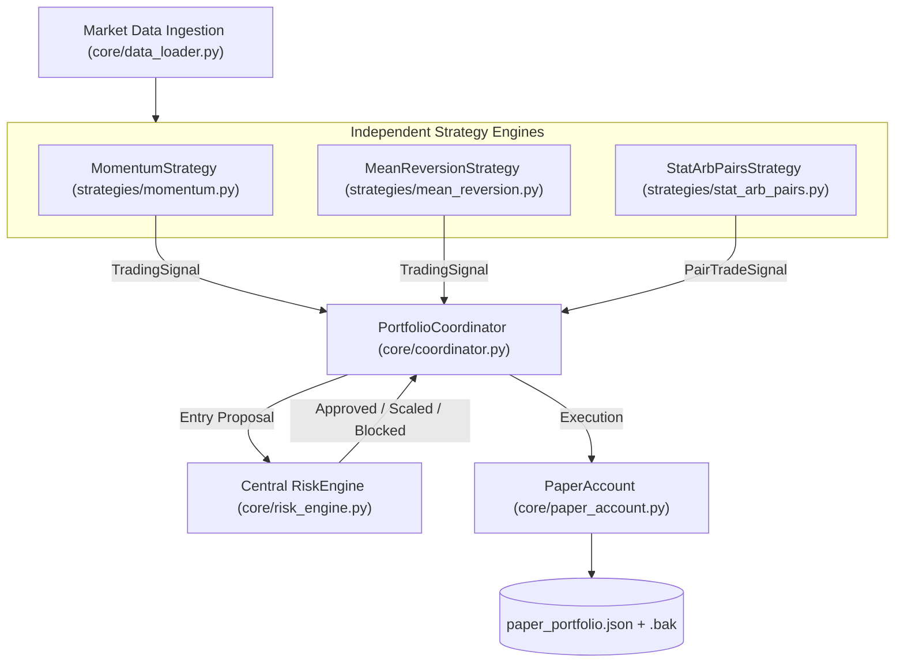

# Web4 Autonomous Trading Agent

An autonomous, self-improving quantitative trading system inspired by the Web4 / Automaton blueprint. Operates with live market data feeds across Crypto and US Equities, coordinating independent trading strategies under strict deterministic risk management and simulated execution.

---

## Architecture Overview

Detailed architectural and mathematical documentation is available in [The 3 Levels of Web4 Autonomy](docs/web4-autonomous-levels.md).



### The 3 Levels of Web4 Autonomy
1. **Level 1: Autonomous Perception & Reasoning**: Ingests multi-venue market telemetry, identifies order flow liquidation absorption wicks, monitors derivatives perp funding rates, and reconciles strategy signals with multi-timeframe confluence.
2. **Level 2: Deterministic Governance & Self-Immunity**: Hard-clamps risk strictly between 1% and 5% using Van Tharp R-risk equations, moves to cash defense via Macro Bear and Chop Gates, triggers real-time circuit breakers (5% daily loss, 15% max drawdown), and guarantees atomic zero-corruption state persistence.
3. **Level 3: Self-Optimization & Meta-Learning**: Adapts sizing via Half-Kelly compounding, groups correlated assets using Hierarchical Risk Parity (HRP), extracts market-neutral alpha via cointegrated statistical arbitrage pairs, and runs automated walk-forward optimization.

### Core Components
1. **Market Ingestion (`core/data_loader.py`)**: Free OHLCV price feeds from Binance (crypto via CCXT) and Yahoo Finance (stocks/ETFs via yfinance) with local CSV caching, timestamp validation, gap detection, and staleness checks.
2. **Standard Signal Contract (`core/signals.py`)**: Standardized `TradingSignal` dataclass encapsulating strategy decisions, indicator snapshots, risk boundaries, and no-trade rationales.
3. **Dual Strategy Engines**:
   - **Momentum / Trend Following (`strategies/momentum.py`)**: Donchian channel breakout combined with EMA macro trend filter, dynamic ATR trailing stops, and scale-out take-profit.
   - **Mean Reversion (`strategies/mean_reversion.py`)**: Bollinger Band reversion with RSI oversold/overbought confirmations and ADX trend suppression filter.
4. **Portfolio Coordinator (`core/coordinator.py`)**: Authoritative central reconciler resolving thesis conflicts (e.g. opposing signals rejected to avoid trading ambiguous states), managing asset capacity, and ordering executions.
5. **Central Risk Engine (`core/risk_engine.py`)**:
   - Dynamic Van Tharp position sizing hard-bounded strictly between **1% and 5% account risk**.
   - Portfolio exposure caps: total portfolio ($\le 80\%$), single asset ($\le 35\%$), per strategy ($\le 60\%$).
   - Emergency circuit breakers: daily loss limit ($\ge 5\%$) and max drawdown ($\ge 15\%$) kill switches.
6. **Paper Execution & Accounting (`core/paper_account.py`)**:
   - Realistic execution simulation with 0.06% exchange fees and 0.04% slippage model.
   - Multi-asset position management for both LONG and SHORT trades.
   - Atomic disk persistence with automatic `.bak` backup recovery.
7. **Profitability Research Pipeline (`research/backtest_compare.py`)**: Multi-asset baseline evaluation comparing Momentum, Mean Reversion, and Buy-and-Hold with cost-adjusted metrics.
8. **Performance Engineering Suite (`research/benchmark.py`)**: Sub-second latency benchmark suite measuring end-to-end pipeline execution across universes up to 1,000 symbols.

---

## Quickstart & Operations

### 1. Installation
```bash
# Set up Python environment
python3 -m venv .venv
source .venv/bin/activate
pip install -r requirements.txt
```

### 2. Run Tests
```bash
pytest -v
```

### 3. Run Live Paper Trading
```bash
# Single portfolio scan across watchlist
python live_paper_trader.py --once

# Inspect current paper portfolio status
python live_paper_trader.py --status

# Continuous monitoring loop
python live_paper_trader.py --loop --interval 60
```

### 4. Run Profitability Research & Benchmarks
```bash
# Multi-strategy comparative research
python research/backtest_compare.py

# Local computational latency benchmark (100, 500, 1000 symbols)
python research/benchmark.py
```

---

## License
MIT
