# Web4 Autonomous Quantitative Trading Desk

[](tests/)
[](core/paper_account.py)
[](agent/)
[-f59e0b?style=for-the-badge)](core/preflight.py)
[](LICENSE)

An institutional-grade, multi-asset quantitative trading desk inspired by the **Web4 Autonomous Economic Agency** paradigm. Operates 24/7 across **Crypto Perpetuals, US Growth Equities, and Macro Sector ETFs**, coordinating a 12-agent heterogeneous multi-agent system (MAS) with zero-prelist dynamic market discovery, automated post-trade forensics, and centralized risk governance under deterministic capital immunity.

---

## Executive Presentation & Architectural Docs

* 📊 **Interactive Pitch Deck (Browser Slides)**: [`docs/presentation.html`](docs/presentation.html)
* 📄 **Executive Presentation Source**: [`PRESENTATION.md`](PRESENTATION.md)
* 🧠 **The 3 Levels of Web4 Autonomy**: [`docs/web4-autonomous-levels.md`](docs/web4-autonomous-levels.md)
* 📈 **180-Day Empirical Research Audit**: [`data/profitability_research.json`](data/profitability_research.json)

---

## Architectural Overview

```mermaid
flowchart TD
    subgraph Data["Market Telemetry & Radars"]
        D1["CCXT Binance Crypto Candles (1h)"]
        D2["Yahoo Finance Stocks & ETFs (1h)"]
        D3["Polymarket Binary Macro Odds (Gamma API)"]
        D4["FRED VIX & Credit Spread Radar"]
        D5["Google News RSS Headlines"]
    end

    subgraph Strategies["Independent Strategy Engines"]
        S1["MomentumStrategy (strategies/momentum.py)"]
        S2["MeanReversionStrategy (strategies/mean_reversion.py)"]
        S3["BasisYieldEngine (core/basis_yield.py)"]
        S4["StatArbPairsStrategy (strategies/stat_arb_pairs.py)"]
    end

    subgraph Arbiter["Central Coordinator (core/coordinator.py)"]
        C1["Macro Bear Gate (< 200 EMA)"]
        C2["Multi-Timeframe Trend Anchor (>= 0.70 Confluence)"]
        C3["Crash Contagion Cooldown (3h)"]
        C4["50% Staged Take-Profit & Break-Even Lock"]
    end

    subgraph Risk["Risk Governor (core/risk_engine.py)"]
        R1["Van Tharp Volatility Sizing (1% - 5% Clamped)"]
        R2["Dynamic Volatility Targeting (Risk Parity)"]
        R3["5% Daily Loss & 15% Max DD Circuit Breakers"]
    end

    subgraph Preflight["Pre-Flight Execution Guard (core/preflight.py)"]
        P1["Bid-Ask Spread Guard (<= 0.15%)"]
        P2["Tick Staleness Guard (<= 180s)"]
        P3["Liquidity Depth Guard (<= 2.0% Vol)"]
        P4["Local GPU LLM Devil's Advocate (phi4-mini: 0.7s)"]
    end

    subgraph Ledger["Atomic Execution Ledger (core/paper_account.py)"]
        L1["Post-Only Maker Routing (0.02% Fee, 0 Slippage)"]
        L2["Atomic Persistence (.tmp -> fsync -> .bak)"]
        L3["Decision Journal & 24h Alpha Settlement"]
    end

    Data --> Strategies
    Strategies --> Arbiter
    Arbiter --> Risk
    Risk --> Preflight
    Preflight --> Ledger
```



---

## The 8 Specialized Quantitative Internal Agents

The desk operates in an autonomous 60-second real-time loop orchestrated across 8 collaborating modular agents:

1. **Data Scout Agent (`core/data_loader.py`)**: Ingests multi-venue feeds, filters unclosed bars to prevent repainting, checks timestamp gaps, and invalidates stale caches.
2. **Momentum Hunter Agent (`strategies/momentum.py`)**: Captures multi-day breakout waves using Donchian channels, EMA trend filters, dynamic ATR trailing stops, and $50\%$ staged take-profits.
3. **Mean Reversion Agent (`strategies/mean_reversion.py`)**: Exploits rubber-band extremes, buying oversold liquidity sweeps (RSI $< 30$ below lower Bollinger Band) and taking $50\%$ profit at the 20 SMA.
4. **Basis Yield Engine (`core/basis_yield.py`)**: Harvests market-neutral perpetual funding rates ($8\% - 18\%$ APY floor) with $0.0$ delta price exposure during sideways chop.
5. **Coordinator Arbiter Agent (`core/coordinator.py`)**: Central authority reconciling signals, resolving thesis conflicts, enforcing the 200 EMA Macro Gate, and managing sector exposure.
6. **Risk Governor Agent (`core/risk_engine.py`)**: Fixed-fractional volatility sizing strictly clamped to $[1\%, 5\%]$ account equity, with automated daily and drawdown circuit breakers.
7. **Execution & Ledger Agent (`core/paper_account.py`)**: Smart Maker limit routing ($0.02\%$ fees, $0.00\%$ slippage), kernel-level PID lockfiles, and zero-corruption atomic `.bak` state persistence.
8. **Local GPU Devil's Advocate Agent (`core/preflight.py`)**: Sub-second qualitative news screener running local `phi4-mini` via Ollama on GPU VRAM (0.70s) to veto proposed entries on black-swan headlines (SEC lawsuits, hacks, exploits). Supported by the offline **Meta-Optimizer Agent (`agent/optimizer.py`)** for walk-forward parameter arena tuning.

---

## The 21-Asset Multi-Sector Universe

To eliminate correlation risk, capital is distributed across **4 distinct, uncorrelated asset classes**:

| Asset Profile | Instruments | Strategic Focus |
| :--- | :--- | :--- |
| **`crypto_micro_swing`** | `BTC`, `SOL`, `SUI`, `TAO`, `DOGE`, `NEAR`, `AVAX`, `LINK` | High-beta volatility capture, 16-bar Donchian, $2.0\times\text{ATR}$ stops, $50\%$ scale-out at $+2.5\times\text{ATR}$. |
| **`crypto_macro`** | `ETH`, `BNB` | Directional crypto anchors, 20-bar Donchian, 50 EMA filter, $2.25\times\text{ATR}$ stops. |
| **`stocks_growth`** | `NVDA`, `AMD`, `AAPL`, `PLTR`, `TSLA` | US institutional tech trends, 24-bar lookback, 50 EMA filter, $2.5\times\text{ATR}$ stops. |
| **`macro_hedges`** | `SPY`, `QQQ`, `GLD` (Gold), `SLV` (Silver), `TLT` (Bonds), `XLE` (Energy) | Non-correlated macro anchors, 100 EMA trend filter, capital-preservation orientation. |

---

## Empirical 180-Day Backtest Results

Conducted across all 21 assets using realistic frictions (**0.06% fees + 0.04% slippage**, next-open bar execution):

| Symbol | Category | Buy & Hold Return | Strategy Return (MR / Mom) | Strategy Max DD | Buy & Hold Max DD | MR Win Rate % | Profit Factor |
| :--- | :--- | :---: | :---: | :---: | :---: | :---: | :---: |
| **`BNB/USDT`** | Crypto Anchor | $+10.13\%$ | **+5.34%** (MR) | **2.59%** | $26.73\%$ | **84.8%** | **2.28** |
| **`TAO/USDT`** | AI Crypto | $-24.53\%$ | **+3.46%** (MR) | **2.20%** | $43.44\%$ | **79.3%** | **1.46** |
| **`AVAX/USDT`** | Layer-1 | $-9.85\%$ | **+2.64%** (MR) | **5.44%** | $43.53\%$ | **73.3%** | **1.25** |
| **`LINK/USDT`** | Oracle / DeFi | $+12.80\%$ | **+2.25%** (MR) | **2.32%** | $35.08\%$ | **83.3%** | **1.41** |
| **`AAPL`** | Mega-Cap Tech | $+14.21\%$ | **+1.57%** (MR) | **0.08%** | $12.89\%$ | **83.3%** | **304.99** |
| **`AMD`** | Semiconductors | $+15.56\%$ | **+0.87%** (MR) | **1.03%** | $28.81\%$ | **75.0%** | **1.90** |
| **`QQQ`** | Tech Index ETF | $-2.03\%$ | **+1.21%** (Mom) | **0.64%** | $11.37\%$ | **75.0%** | **1.37** |
| **`XLE`** | Energy Sector | $+20.82\%$ | **+3.65%** (Mom) | **3.66%** | $14.12\%$ | **66.7%** | **1.52** |
| **`NEAR/USDT`**| High-Beta L1 | $+162.49\%$ | **+4.12%** (Mom) | **4.91%** | $49.46\%$ | **70.0%** | **1.09** |
| **`SPY`** | S&P 500 ETF | $+2.68\%$ | $-0.40\%$ (MR) | **1.61%** | $4.53\%$ | **75.0%** | **0.93** |
| **`GLD`** | Safe Haven Gold| $-17.73\%$ | $-2.02\%$ (MR) | **2.02%** | $18.66\%$ | **72.7%** | **0.64** |
| **`BTC/USDT`** | Crypto Anchor | $-2.34\%$ | $-5.33\%$ (MR) | **5.48%** | $29.10\%$ | **66.7%** | **0.72** |
| **`SOL/USDT`** | High-Beta L1 | $+6.38\%$ | $-7.72\%$ (MR) | **8.35%** | $38.00\%$ | **65.7%** | **0.59** |

---

## Quickstart & CLI Operations

### 🖥️ Local Hardware Requirements

The bot is engineered to be lightweight, running efficiently on standard local PCs or cloud VPS instances with zero mandatory cloud API costs:

| Resource | Bare Minimum Spec (Headless / Rule-Based) | Recommended Spec (Local GPU AI Screener) |
| :--- | :--- | :--- |
| **CPU** | 2 Cores (2.0 GHz+) | **4 to 8 Cores** (AMD Ryzen / Intel i5/i7) *(12 threads active)* |
| **System RAM** | 4 GB DDR4 (Process uses ~300 MB) | **16 GB DDR4/DDR5** *(15 GB active)* |
| **GPU (AI Reasoning)** | None (CPU inference or rule-based fallback) | **NVIDIA GPU with 6 GB+ VRAM** *(GTX 1660 Ti active)* |
| **Storage (SSD)** | 10 GB SSD (Project files use ~480 MB) | **25 GB–50 GB NVMe SSD** (includes 2.5 GB `phi4-mini` model) |
| **Operating System** | Linux (Ubuntu/Debian), macOS, or Windows 10/11 | **Linux (Ubuntu 22.04/24.04 LTS)** or Windows 11 with WSL2 |
| **Network** | Standard broadband (10 Mbps+) | **Stable broadband / fiber** with 24/7 continuous uptime |
| **Monthly Operating Cost**| **$0.00 / month** local (or ~$6/mo budget VPS) | **$0.00 / month** (100% local GPU execution, zero API keys) |

---

### 1. Setup Environment
```bash
python3 -m venv .venv
source .venv/bin/activate
pip install -r requirements.txt
```

### 2. Run Test Suite
```bash
# Run all 84 unit tests
.venv/bin/pytest -v
```

### 3. Launch Live Autonomous Trader
```bash
# Single portfolio scan across active 21 assets
.venv/bin/python live_paper_trader.py --once

# Inspect live portfolio balances & open positions
.venv/bin/python live_paper_trader.py --status

# Launch continuous 24/7 autonomous polling loop (every 60s)
.venv/bin/python live_paper_trader.py --loop --interval 60

# Launch interactive visual dashboard
.venv/bin/python dashboard.py
```

### 4. Run Profitability Research & Benchmarks
```bash
# 180-day multi-asset comparative research audit
.venv/bin/python research/backtest_compare.py

# Latency and throughput benchmark across 1,000 synthetic symbols
.venv/bin/python research/benchmark.py
```

---

## Invariant Rules for Autonomous AI Agents

1. **Never Enable Real-Money Trading**: Execution mode must remain strictly simulated paper trading (`PaperAccount`).
2. **Preserve User Data**: Never overwrite `data/paper_portfolio.json` or reset virtual balances unless instructed by an explicit CLI `--reset` argument.
3. **Preserve 1%–5% Risk Bounds**: Position sizing in `core/risk_engine.py` is hard-coded between 1% and 5% account equity. No optimizer or AI mutation may loosen this constraint.
4. **Platform Independence**: Standard Python 3.10+ execution with zero vendor-lock on proprietary agent harnesses.
5. **Evidence-Based Profitability**: Do not declare a strategy profitable without empirical backtest and cost-adjusted metrics (fees + slippage).

---

## License
MIT
