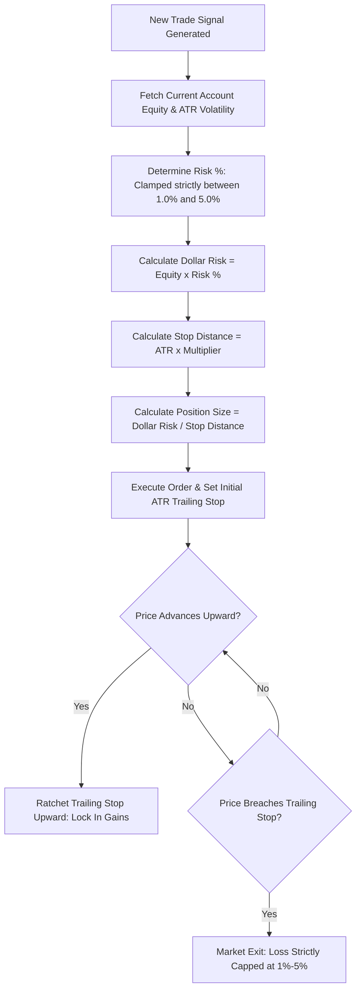

# Agent Optimization & Trading Workflow

This document illustrates the complete end-to-end architecture, the agent tournament lifecycle, and the risk engine guardrails.

---

## 1. The Autonomous Self-Improvement Tournament

```mermaid
flowchart TD
    A[Current Active Agent: active_config.json] --> B[DNA Mutation: Generate 480 Candidate Agents]
    
    subgraph Round 1: Training Arena (70% Past Data)
        B --> C[Simulate each candidate on 3,024 hourly bars]
        C --> D{Max Drawdown < 12% & Beats Baseline Sharpe?}
        D -- No --> E[Discard Candidate]
        D -- Yes --> F[Crown In-Sample Champion]
    end

    subgraph Round 2: The Unseen Crucible (30% Future Data)
        F --> G[Test Champion on 1,296 Unseen Bars]
        G --> H{Out-of-Sample Return > 0 & Drawdown Safe?}
        H -- Failed / Overfit --> I[Discard Candidate & Keep Current Agent]
        H -- Verified Robust --> J[Promote to Production]
    end

    subgraph Deployment: Web4 Survival
        J --> K[Overwrites active_config.json]
        K --> L[Run Unit Tests: Verify 1%-5% Risk Limits]
        L -- Pass --> M[Git Auto-Commit & Push to GitHub]
    end
```

---

## 2. Dynamic 1%–5% Risk Engine Sizing



---

## 3. Stage-by-Stage Breakdown

| Stage | Process | Purpose |
| :--- | :--- | :--- |
| **1. Data Ingestion** | CCXT / Yahoo Finance | Fetches free historical OHLCV data and caches locally in `data/`. |
| **2. Indicator Computation** | Donchian Breakout + 200 EMA + ATR | Identifies macro trend direction and entry breakouts. |
| **3. Risk Calculation** | Volatility-Adjusted Sizing | Guarantees that any stopped-out trade never loses more than 1% to 5% of portfolio equity. |
| **4. Backtest Simulation** | Event-Driven Engine | Deducts exchange fees (0.06%) and slippage (0.04%) on every bar. |
| **5. AI Tournament** | `agent/optimizer.py` | Tests hundreds of strategy variations across training data. |
| **6. Anti-Overfitting Gate**| `agent/validator.py` | Tests winning candidates on unseen data; rejects curve-fitted strategies. |
| **7. Git Auto-Deployment** | Git CLI Automation | Overwrites config, verifies unit tests, and commits winning code directly to GitHub. |
