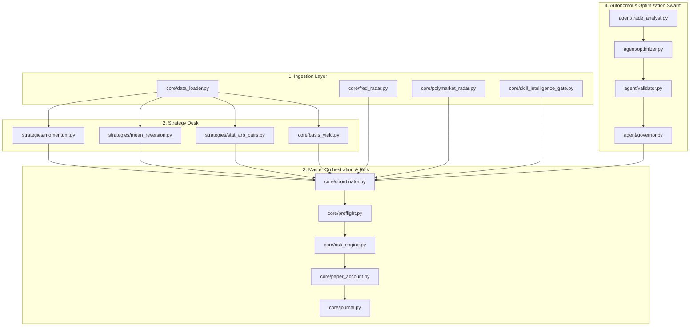

# Web4 Trading Agent: Repository File Map & Component Directory

This document provides a component-by-component dependency map for every file in the **Web4 Autonomous Trading Agent** repository. For each file, it specifies:
- **WHAT**: Its exact role and function in the system.
- **USED BY**: Which caller, engine, daemon, or test suite invokes it.
- **WHY NEEDED**: The architectural purpose it serves and what would break if it was omitted.

---

## Complete Annotated Repository Tree

```text
web4-trading-agent/
│
├── live_paper_trader.py       # WHAT: Live daemon heartbeat loop ticking every 60s
│                              # USED BY: Master background process launched via CLI; ticks coordinator.py
│                              # WHY NEEDED: Heartbeat of the bot; without it, no live market scans or trades happen
│
├── dashboard.py               # WHAT: Real-time ANSI curses-style terminal monitor
│                              # USED BY: Terminal monitor run by the user; reads live_status.json & portfolio
│                              # WHY NEEDED: Visualizes P&L, open positions & pairs gauges with zero risk of database locks
│
├── AGENTS.md                  # WHAT: Constitutional safety rulebook for autonomous AI agents
│                              # USED BY: Read by AI coding agents (Antigravity/Claude/Gemini) before running any tasks
│                              # WHY NEEDED: Enforces immutable laws: paper-only trading, 1%-5% sizing, and data preservation
│
├── FUTURE_DEVELOPMENT_NOTES.md# WHAT: Architectural roadmap and backlog for future upgrades
│                              # USED BY: Developers & AI agents when planning new institutional features
│                              # WHY NEEDED: Retains design ideas across restarts so long-term engineering memory is never lost
│
├── config/
│   ├── active_config.json     # WHAT: Live parameters, active symbols, strategy thresholds & risk toggles
│   │                          # USED BY: coordinator.py, risk_engine.py, strategies, and agent/governor.py
│   │                          # WHY NEEDED: Decouples logic from settings; allows tuning parameters without altering code
│   │
│   └── pending_proposals.json # WHAT: Staging sandbox holding candidate parameter upgrades found by AI
│                              # USED BY: Written by optimizer.py; evaluated by validator.py & governor.py
│                              # WHY NEEDED: Quarantines AI experiments so unverified parameters can never reach production
│
├── core/
│   ├── coordinator.py         # WHAT: Multi-strategy conflict arbiter & execution orchestrator
│   │                          # USED BY: Called by live_paper_trader.py on every tick, and by backtest_engine.py
│   │                          # WHY NEEDED: Prevents conflicting orders, resolves multi-strategy collisions & routes fills
│   │
│   ├── risk_engine.py         # WHAT: 1%-5% ATR equity sizing, portfolio heat caps & circuit breakers
│   │                          # USED BY: Called by coordinator.py before any buy or short order is placed
│   │                          # WHY NEEDED: Prevents account ruin by capping sizing and locking trading on 4% daily drawdowns
│   │
│   ├── paper_account.py       # WHAT: Simulated ledger tracking balance, fills, fees (0.06%) & slippage (0.05%)
│   │                          # USED BY: coordinator.py; reads and writes persistent state to paper_portfolio.json
│   │                          # WHY NEEDED: Replicates real-world exchange friction so paper results match live market reality
│   │
│   ├── preflight.py           # WHAT: 5 execution safety guards & LLM devil's advocate screener
│   │                          # USED BY: Executed by coordinator.py at the exact moment a trade signal fires
│   │                          # WHY NEEDED: Blocks bad fills during wide spreads, illiquid books, stale feeds, or panic spikes
│   │
│   ├── journal.py             # WHAT: Decision telemetry logging & 24h settlement engine
│   │                          # USED BY: coordinator.py on every tick; appends to decision_journal.jsonl
│   │                          # WHY NEEDED: Full transparency; records exactly why every trade was executed or rejected
│   │
│   ├── backtest_engine.py     # WHAT: Event-driven backtesting engine with realistic fees & slippage
│   │                          # USED BY: Used by optimizer.py, validator.py, and all research test suites
│   │                          # WHY NEEDED: Accurately tests strategies over historical data without lookahead bias
│   │
│   ├── basis_yield.py         # WHAT: Delta-neutral funding rate carry harvest engine (spot long + perp short)
│   │                          # USED BY: coordinator.py during market scans; streams telemetry to live_status.json
│   │                          # WHY NEEDED: Harvests 8-hour perp funding yields during quiet or sideways market regimes
│   │
│   ├── data_loader.py         # WHAT: Multi-source market candle fetcher (CCXT crypto + Yahoo equities/ETFs)
│   │                          # USED BY: coordinator.py, backtest_engine.py, and asset_selector.py
│   │                          # WHY NEEDED: Pulls, validates, and locally caches OHLCV data to prevent API rate-limit bans
│   │
│   ├── fred_radar.py          # WHAT: St. Louis Fed / VIX Macro Crash Defense Radar
│   │                          # USED BY: coordinator.py before evaluating trade signals
│   │                          # WHY NEEDED: Cuts position sizing by 50% or vetos long entries when the VIX spikes above 30
│   │
│   ├── polymarket_radar.py    # WHAT: Polymarket decentralized prediction market odds radar
│   │                          # USED BY: coordinator.py and preflight.py
│   │                          # WHY NEEDED: Injects crowd probability to pause aggressive trading before volatile macro events
│   │
│   ├── institutional_stress_tester.py # WHAT: DSR, PSR, Ulcer Index & 1x-5x friction stress sweeps
│   │                          # USED BY: validator.py and research stress suites
│   │                          # WHY NEEDED: Mathematically proves a strategy isn't lucky and won't fail if trading fees rise
│   │
│   ├── skill_intelligence_gate.py # WHAT: 13F whale radar, Pelosi tracker, drift rebalancer & SEC 8-K veto
│   │                          # USED BY: coordinator.py and preflight.py
│   │                          # WHY NEEDED: Vetos trades on adverse SEC filings and optimizes tax efficiency (wash-sale rules)
│   │
│   ├── process_lock.py        # WHAT: Linux OS-level file locking via `fcntl.flock` PID tracking
│   │                          # USED BY: Acquired by live_paper_trader.py; checked by dashboard.py
│   │                          # WHY NEEDED: Prevents duplicate bot instances from running simultaneously and doubling risk
│   │
│   ├── strategy.py            # WHAT: Base abstract class defining the trading strategy interface (`BaseStrategy`)
│   │                          # USED BY: Inherited by all strategy bots in strategies/
│   │                          # WHY NEEDED: Enforces uniform methods across strategies so the coordinator can run any bot
│   │
│   └── signals.py             # WHAT: Type-safe dataclass schemas for signals, trade directions & metadata
│                              # USED BY: Shared across all strategies, coordinator.py, and paper_account.py
│                              # WHY NEEDED: Eliminates runtime bugs by standardizing how trade instructions pass between modules
│
├── strategies/
│   ├── momentum.py            # WHAT: Donchian channel breakout trend bot with ADX and EMA trend filters
│   │                          # USED BY: coordinator.py and backtest_engine.py
│   │                          # WHY NEEDED: Captures major multi-day bull/bear trend waves using dynamic ATR trailing stops
│   │
│   ├── mean_reversion.py      # WHAT: Bollinger Bands + RSI swing bot with 50% partial take-profit
│   │                          # USED BY: coordinator.py and backtest_engine.py
│   │                          # WHY NEEDED: Generates steady returns during ranging markets where trend strategies suffer chop
│   │
│   └── stat_arb_pairs.py      # WHAT: Cointegrated statistical arbitrage pairs bot (e.g. GLD:SLV spread)
│                              # USED BY: coordinator.py to execute hedged dual-leg pair trades
│                              # WHY NEEDED: Provides pure market-neutral alpha by trading mean-reverting valuation spreads
│
├── agent/
│   ├── governor.py            # WHAT: 4-Gate auto-approval constitutional gatekeeper
│   │                          # USED BY: Invoked after validator.py tests proposed parameter mutations
│   │                          # WHY NEEDED: Enables safe self-improving autonomy by strictly blocking underperforming changes
│   │
│   ├── optimizer.py           # WHAT: In-sample parameter exploration engine searching for optimal settings
│   │                          # USED BY: Research suites & background tuning jobs; writes pending_proposals.json
│   │                          # WHY NEEDED: Adapts strategy parameters to shifting market volatility instead of static numbers
│   │
│   ├── validator.py           # WHAT: Out-of-sample walk-forward verification engine
│   │                          # USED BY: Called automatically between the optimizer and the governor
│   │                          # WHY NEEDED: Protects against curve-fitting by verifying candidates on unseen market data
│   │
│   ├── asset_selector.py      # WHAT: Dynamic universe discovery & toxic drag pruning engine
│   │                          # USED BY: Run periodically to rank and update the active watchlist
│   │                          # WHY NEEDED: Prevents capital allocation into illiquid, unvolatlie, or persistently losing assets
│   │
│   ├── trade_analyst.py       # WHAT: Post-trade forensic diagnosis & root-cause analyst
│   │                          # USED BY: Triggered when trades close; creates trade_forensic_report.json
│   │                          # WHY NEEDED: Diagnoses why trades failed so the AI optimizer knows what weaknesses to target
│   │
│   └── llm_client.py          # WHAT: Zero-dependency local Ollama (phi4-mini) LLM client
│                              # USED BY: trade_analyst.py and preflight.py Devil's Advocate
│                              # WHY NEEDED: Delivers qualitative reasoning completely offline with zero cloud API costs
│
├── research/
│   ├── run_shifted_oos_validation.py # WHAT: 90-day shifted out-of-sample multi-strategy validation suite
│   │                          # USED BY: Quant researchers before committing major parameter upgrades
│   │                          # WHY NEEDED: Verifies whether strategy performance holds up across non-overlapping market periods
│   │
│   └── run_institutional_stress_suite.py # WHAT: Historical crisis simulation runner (2020 COVID, 2022 rate hikes)
│                              # USED BY: Risk auditors and developers testing worst-case resilience
│                              # WHY NEEDED: Verifies that circuit breakers and drawdown locks survive market flash crashes
│
├── data/
│   ├── paper_portfolio.json   # WHAT: Persistent virtual ledger: cash, equity, open positions & closed fills
│   │                          # USED BY: Written by paper_account.py; read by dashboard.py & coordinator.py
│   │                          # WHY NEEDED: Preserves account state across restarts so positions and stops are never wiped
│   │
│   ├── decision_journal.jsonl # WHAT: Immutable audit log recording every single tick decision and rejection
│   │                          # USED BY: Written by journal.py; read during trade forensics and audits
│   │                          # WHY NEEDED: Provides full proof and debugging records of why trades were accepted or vetoed
│
│   ├── live_status.json       # WHAT: Real-time IPC telemetry state file (PID, timestamp, pairs & scan feed)
│   │                          # USED BY: Written by live_paper_trader.py; read continuously by dashboard.py
│   │                          # WHY NEEDED: Powers the live terminal dashboard with instant zero-lag updates without db locks
│   │
│   └── trade_forensic_report.json # WHAT: AI forensic report diagnosing recent closed trades
│                              # USED BY: Written by trade_analyst.py; read by optimizer.py and the trader
│                              # WHY NEEDED: Identifies recurring pattern mistakes to prevent repeating the same losses
│
├── reports/
│   └── oos_validation_report.json # WHAT: Empirical 90-day out-of-sample backtest report across all bots
│                              # USED BY: Governor, developers, and users to confirm strategy profitability
│                              # WHY NEEDED: Provides verifiable mathematical proof that strategies beat transaction friction
│
├── docs/
│   ├── SYSTEM_WALKTHROUGH.md  # WHAT: Master 540+ line documentation of all formulas, rules, and architecture
│   │                          # USED BY: Engineers, quants, and AI agents onboarding to the repository
│   │                          # WHY NEEDED: The single source of truth for the system's quantitative and software design
│   │
│   ├── REPOSITORY_FILE_MAP.md # WHAT: Granular file-by-file dependency and purpose directory (THIS FILE)
│   │                          # USED BY: Developers, code reviewers, and AI agents looking up component interactions
│   │                          # WHY NEEDED: Provides instant reference for caller-callee relationships and failure impacts
│   │
│   └── web4-autonomous-levels.md # WHAT: Specification of autonomous agent levels (Level 1 to Level 5)
│                              # USED BY: Project planners and architectural governance
│                              # WHY NEEDED: Establishes the clear milestone roadmap for full self-improving algorithmic trading
│
└── tests/                     # WHAT: 25 automated pytest suites comprising 152 regression tests
                               # USED BY: Executed via `pytest` before any code changes are deployed
                               # WHY NEEDED: Ensures mathematical accuracy, zero real-money leaks, and 100% safety compliance
```

---

## High-Level Execution Pipeline Flow


