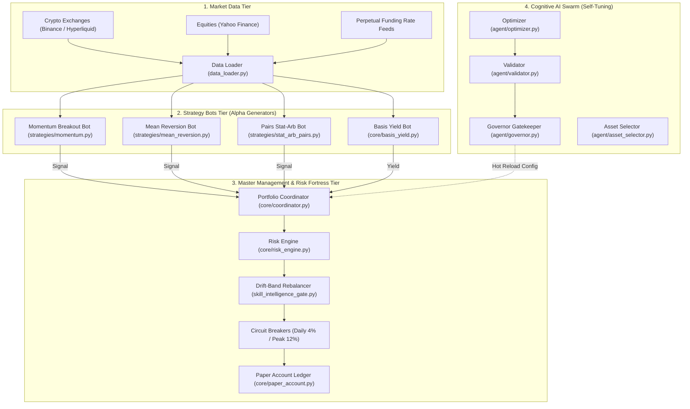
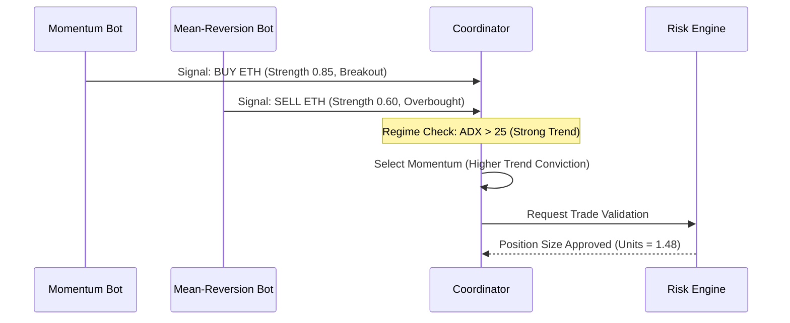
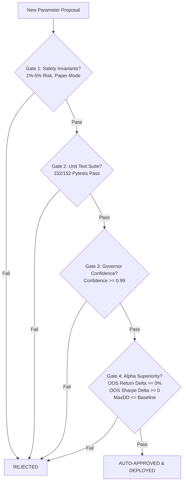

# Web4 Trading Agent: Detailed System Architecture & Granular Walkthrough

This document provides a granular, component-by-component walkthrough of the **Web4 Autonomous Trading Agent**. It details every mathematical formula, execution rule, data flow, safety gate, and risk control implemented in the repository.

---

## Table of Contents
1. [Why Diagrams Might Not Render Locally vs. GitHub](#1-why-diagrams-might-not-render-locally-vs-github)
2. [Global Architecture Overview](#2-global-architecture-overview)
3. [The Live Heartbeat Loop (`live_paper_trader.py`)](#3-the-live-heartbeat-loop-live_paper_traderpy)
4. [The 4 Strategy Bots in Fine Detail](#4-the-4-strategy-bots-in-fine-detail)
   - [4.1 Donchian Momentum Breakout Bot](#41-donchian-momentum-breakout-bot)
   - [4.2 Bollinger / RSI Mean-Reversion Bot](#42-bollinger--rsi-mean-reversion-bot)
   - [4.3 Cointegrated Statistical Arbitrage Pairs Bot](#43-cointegrated-statistical-arbitrage-pairs-bot)
   - [4.4 Delta-Neutral Perpetual Basis Yield Bot](#44-delta-neutral-perpetual-basis-yield-bot)
5. [The Master Coordinator Engine (`core/coordinator.py`)](#5-the-master-coordinator-engine-corecoordinatorpy)
6. [The Risk Fortress & Sizing Formulas (`core/risk_engine.py`)](#6-the-risk-fortress--sizing-formulas-corerisk_enginepy)
7. [The Virtual Ledger & Execution Drag (`core/paper_account.py`)](#7-the-virtual-ledger--execution-drag-corepaper_accountpy)
8. [Alternative Intelligence Radar (`core/skill_intelligence_gate.py`)](#8-alternative-intelligence-radar-coreskill_intelligence_gatepy)
9. [The Autonomous AI Layer & 4-Gate Auto-Approval (`agent/`)](#9-the-autonomous-ai-layer--4-gate-auto-approval-agent)
10. [Repository File Map](#10-repository-file-map)

---

## 1. Why Diagrams Might Not Render Locally vs. GitHub

Markdown files use **Mermaid (`mermaid`) code blocks** to render charts and sequence flows.

* **Locally / Raw Text Editors**: If you open a `.md` file in standard Notepad, TextEdit, or VS Code without the *Markdown Preview Mermaid Support* plugin installed, the editor only sees raw text inside ` ```mermaid ` tags.
* **On GitHub**: GitHub has a built-in Mermaid rendering engine. When this file is pushed to your Git repository and viewed in your browser on GitHub, all diagrams automatically turn into crisp, interactive visual diagrams.

---

## 2. Global Architecture Overview

The system operates across **three primary operational tiers**:



---

## 3. The Live Heartbeat Loop (`live_paper_trader.py`)

The file [`live_paper_trader.py`](live_paper_trader.py) is the master executable that runs continuously in background memory.

### Granular Execution Steps (Every 60 Seconds):
1. **PID Process Locking (`core/process_lock.py`)**:
   * Uses Linux `fcntl.flock` on `data/live_trader.pid`.
   * **Purpose**: Prevents two instances of the bot from running at the same time and corrupting `paper_portfolio.json`.
2. **Dynamic Config Hot-Reloading**:
   * Computes the SHA-256 hash of [`config/active_config.json`](config/active_config.json).
   * If the file was updated (by the user or by an approved AI proposal), the Coordinator immediately reloads the parameters into memory **without restarting the process**.
3. **Market Data Fetching**:
   * Pulls the last 100 hourly candles for all configured symbols (`BTC/USDT`, `ETH/USDT`, `SOL/USDT`, `SPY`, etc.).
   * Checks staleness: If the most recent candle timestamp is older than `max_stale_minutes` (default 180 min), the asset is skipped to prevent trading on dead data.
4. **Tick Execution (`run_portfolio_tick`)**:
   * Sends market data to [`core/coordinator.py`](core/coordinator.py) and processes all trade signals, stop-loss movements, and basis yield distributions.

---

## 4. The 4 Strategy Bots in Fine Detail

### 4.1 Donchian Momentum Breakout Bot
* **File**: [`strategies/momentum.py`](strategies/momentum.py)
* **Strategy Type**: Directional Trend-Following.
* **Underlying Indicators**:
  * **Donchian High/Low (24 periods)**: $H_{24} = \max(\text{High}_{t-24 \dots t-1})$, $L_{24} = \min(\text{Low}_{t-24 \dots t-1})$.
  * **Trend Filter**: 50-period Exponential Moving Average ($\text{EMA}_{50}$).
  * **Trend Strength**: 14-period Average Directional Index ($\text{ADX}_{14}$).
  * **Volatility Measure**: 14-period Average True Range ($\text{ATR}_{14}$).
* **Granular Entry Rules**:
  * **LONG Entry**: Triggered when $\text{Close} > H_{24}$ **AND** $\text{Close} > \text{EMA}_{50}$ **AND** $\text{ADX} \ge 20$.
  * **SHORT Entry**: Triggered when $\text{Close} < L_{24}$ **AND** $\text{Close} < \text{EMA}_{50}$ **AND** $\text{ADX} \ge 20$ (only if `allow_short: true`).
* **Granular Exit Rules**:
  * Uses a dynamic **ATR Trailing Stop**:
    $$\text{Trailing Stop} = \text{Highest High Since Entry} - (3.0 \times \text{ATR})$$
  * As price climbs, the stop-loss ratchets upward bar-by-bar. It never loosens downward.

---

### 4.2 Bollinger / RSI Mean-Reversion Bot
* **File**: [`strategies/mean_reversion.py`](strategies/mean_reversion.py)
* **Strategy Type**: Counter-trend Swing Trader.
* **Underlying Indicators**:
  * **Bollinger Bands (20 periods, 2.0 std dev)**:
    $$\text{SMA}_{20} = \frac{1}{20} \sum_{i=0}^{19} \text{Close}_{t-i}, \quad \text{Upper} = \text{SMA}_{20} + 2\sigma, \quad \text{Lower} = \text{SMA}_{20} - 2\sigma$$
  * **Relative Strength Index ($\text{RSI}_{14}$)**.
* **Granular Entry Rules**:
  * **LONG Entry**: Triggered when $\text{Close} \le \text{Lower Band}$ **AND** $\text{RSI} < 30$ (Oversold extreme).
  * **SHORT Entry**: Triggered when $\text{Close} \ge \text{Upper Band}$ **AND** $\text{RSI} > 70$ (Overbought extreme).
* **The 50% Scale-Out Profit Rule**:
  * Target line: The middle $\text{SMA}_{20}$.
  * When price travels **50% of the distance** to the SMA, the bot **sells half (50%) of the position** to bank cash.
  * It immediately moves the stop-loss on the remaining 50% to **breakeven** ($\text{Entry Price}$). The trade is now mathematically risk-free.
  * The final 50% exits when the price hits the full $\text{SMA}_{20}$ target.

---

### 4.3 Cointegrated Statistical Arbitrage Pairs Bot
* **File**: [`strategies/stat_arb_pairs.py`](strategies/stat_arb_pairs.py)
* **Strategy Type**: Market-Neutral Relative Value.
* **Mechanism**:
  1. Identifies pairs of assets that share an economic link (e.g. `BTC/USDT` vs `ETH/USDT`, or `SPY` vs `QQQ`).
  2. Runs an **Engle-Granger Cointegration Test**. If $p$-value $< 0.05$, the spread is mathematically stationary.
  3. Calculates the Hedge Ratio $\beta$ via Ordinary Least Squares (OLS) regression:
     $$\text{Spread}_t = P_{A,t} - \beta P_{B,t}$$
  4. Computes the rolling normalized **Z-Score**:
     $$Z_t = \frac{\text{Spread}_t - \mu_{\text{spread}}}{\sigma_{\text{spread}}}$$
* **Granular Entry & Exit**:
  * If $Z_t \ge +2.0$: Asset A is overpriced, Asset B is underpriced. **Short A, Buy B**.
  * If $Z_t \le -2.0$: Asset A is underpriced, Asset B is overpriced. **Buy A, Short B**.
  * Exit: When $|Z_t| \le 0.20$ (spread mean-reverts back to normal).

---

### 4.4 Delta-Neutral Perpetual Basis Yield Bot
* **File**: [`core/basis_yield.py`](core/basis_yield.py)
* **Strategy Type**: Delta-Neutral Cash-and-Carry / Funding Arbitrage.
* **Underlying Principle**:
  * Perpetual futures traders pay a funding fee every 8 hours.
  * If the rate is positive (Longs pay Shorts), we buy the Spot crypto and Short the Perpetual contract.
  * **Net Market Exposure ($\Delta$) = 0.0**. Price pumps or crashes do not affect account balance.
* **Granular Math**:
  $$\text{Annualized APR} = \text{Rate}_{8h} \times 3 \times 365 \times 100$$
  $$\text{8h Cash Payout} = \text{Notional Allocated} \times \text{Rate}_{8h}$$
* **Execution Rules**:
  * Minimum APR Hurdle: [`basis_hurdle_apr = 8.0%`](config/active_config.json).
  * Automatically records a verified audit record in `closed_trades` every 8 hours (Trades 31–39).

---

## 5. The Master Coordinator Engine (`core/coordinator.py`)

The **Portfolio Coordinator** is the central brain that arbitrates conflicting advice from different bots:



### Conflict Resolution Matrix:
* **Opposite Signals on Same Asset**:
  * Evaluates the market regime via `ADX`. If `ADX > 25` (trending), the trend bot wins. If `ADX < 20` (ranging), the mean-reversion bot wins.
  * If signal strengths are close, the Coordinator blocks both trades to preserve capital.
* **Portfolio Concentration Check**:
  * Prevents total crypto exposure from exceeding configured portfolio risk limits (default 80% maximum).

---

## 6. The Risk Fortress & Sizing Formulas (`core/risk_engine.py`)

No trade is ever placed without passing through the mathematical constraints in [`core/risk_engine.py`](core/risk_engine.py):

### 6.1 Position Sizing Formula
$$\text{Dollar Risk} = \text{Account Equity} \times \text{Risk Percent}$$
$$\text{Stop Distance} = |\text{Entry Price} - \text{Stop Loss Price}|$$
$$\text{Position Units} = \frac{\text{Dollar Risk}}{\text{Stop Distance}}$$

* **Hard-Coded Invariant**: $\text{Risk Percent}$ is strictly clamped between **$1.0\%$ minimum and $5.0\%$ maximum** of total equity.
* If a coin is highly volatile ($\text{ATR}$ is large), the stop distance is wide, which automatically forces the unit size down.

### 6.2 Volume Surge & Smart Money Sizing Multipliers
* **Volume Surge Multiplier**: If current candle volume is $\ge 1.5\times$ the 20-period average volume, the position size is boosted by **$1.2\times$** (rewarding high-liquidity institutional participation).
* Even with boosts, the final risk is hard-capped at $\le 5.0\%$.

### 6.3 Autonomous Circuit Breakers
1. **Daily Drawdown Breaker ($4.0\%$)**:
   * If equity loses $\ge 4.0\%$ in any rolling 24-hour window, all new trade entries are locked out until the next calendar day.
2. **Trailing Peak Drawdown Breaker ($12.0\%$)**:
   * Tracks `peak_equity` historically.
   * If $\frac{\text{peak} - \text{current}}{\text{peak}} \ge 0.12$, the engine trips the emergency breaker, cancels all pending orders, and preserves cash.

---

## 7. The Virtual Ledger & Execution Drag (`core/paper_account.py`)

To ensure paper-trading numbers reflect real-world execution, [`core/paper_account.py`](core/paper_account.py) enforces full execution friction:

* **Taker Exchange Fees**: $0.06\%$ ($6\text{ basis points}$) deducted on both Entry and Exit.
* **Market Slippage**: $0.04\%$ ($4\text{ basis points}$) adverse price movement applied against every fill.
* **Concurrency Protection**: Uses file locks to ensure that data in [`data/paper_portfolio.json`](data/paper_portfolio.json) is atomic and crash-resistant.

---

## 8. Alternative Intelligence Radar (`core/skill_intelligence_gate.py`)

This engine integrates alternative market datasets to filter and confirm trades:

1. **Whale & 13F Institutional Filing Radar**:
   * Scrapes SEC 13F filings from elite funds (Berkshire Hathaway, Pershing Square, Appaloosa, Renaissance Technologies).
   * Assets with net institutional accumulation receive positive conviction weighting.
2. **Congressional STOCK Act Tracker**:
   * Scrapes the U.S. House Clerk Periodic Transaction Reports (PTRs) for congressional trades.
3. **SEC EDGAR 10-Q / 8-K Analyst**:
   * Filters out companies with deteriorating fundamental health, guidance cuts, or negative operating margins.
4. **Drift-Band Portfolio Rebalancing Engine**:
   * Evaluates portfolio drift every cycle. If any single asset drifts $\ge 5\%$ above its intended allocation band, it executes a `REBALANCE_TRIM` to return to target.

---

## 9. The Autonomous AI Layer & 4-Gate Auto-Approval (`agent/`)

The repository includes a cognitive agent harness that autonomously tunes strategy parameters and removes unprofitable assets.



### Gate 4 Breakdown (The "Do No Harm" Guarantee):
* **OOS Return Delta $\ge 0.0\%$**: The new strategy must perform equal to or better than the current baseline on unseen Out-of-Sample validation data.
* **OOS Sharpe Delta $\ge 0.0$**: The risk-adjusted return (smoothness of the equity curve) cannot degrade.
* **OOS Max Drawdown $\le \text{Baseline} + 0.5\%$**: The new strategy cannot expose the account to deeper crash drawdowns.
* **Multi-Window Walk-Forward Verification**: If any single test window produces negative returns, the proposal is rejected as curve-fitted.

---

## 10. Repository File Map

```
web4-trading-agent/
├── live_paper_trader.py       # Live daemon heartbeat loop
├── config/
│   └── active_config.json     # Live parameters, active symbols & risk toggles
├── core/
│   ├── coordinator.py         # Multi-strategy conflict arbiter & execution orchestrator
│   ├── risk_engine.py         # 1%-5% equity sizing & circuit breakers
│   ├── paper_account.py       # Simulated ledger, fills, fees & slippage
│   ├── basis_yield.py         # Delta-neutral funding rate carry harvest engine
│   ├── data_loader.py         # Real-time & historical crypto/equity candle fetcher
│   ├── skill_intelligence_gate.py # 13F radar, Pelosi tracker, drift rebalancer
│   └── process_lock.py        # PID flock concurrency protection
├── strategies/
│   ├── momentum.py            # Donchian channel breakout trend bot
│   ├── mean_reversion.py      # Bollinger / RSI oversold/overbought swing bot
│   └── stat_arb_pairs.py      # Cointegrated statistical arbitrage pairs bot
├── agent/
│   ├── governor.py            # 4-Gate auto-approval constitutional gatekeeper
│   ├── optimizer.py           # In-sample discovery engine
│   ├── validator.py           # Out-of-sample walk-forward verification engine
│   └── asset_selector.py      # Walk-forward toxic drag pruning engine
├── data/
│   └── paper_portfolio.json   # Live ledger state, cash balance & closed trades
├── docs/
│   └── SYSTEM_WALKTHROUGH.md  # THIS MASTER DETAILED GUIDE
└── tests/                     # 152 automated regression tests
```
