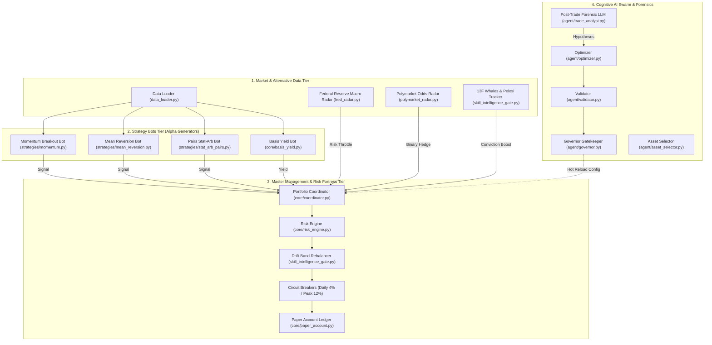
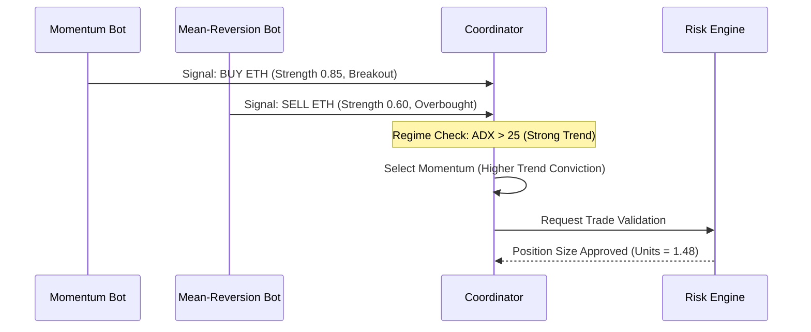
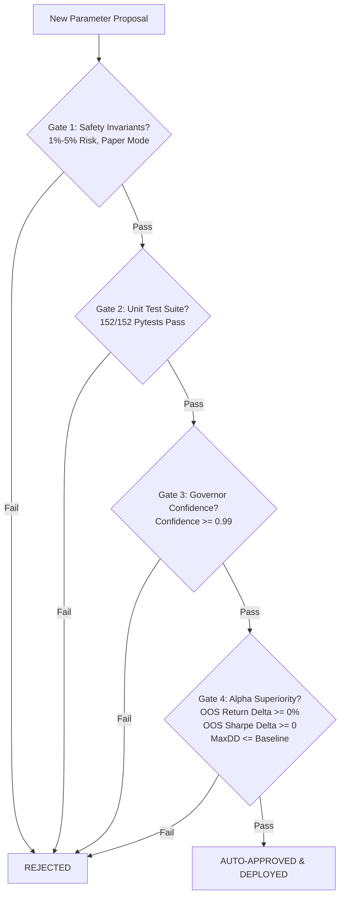
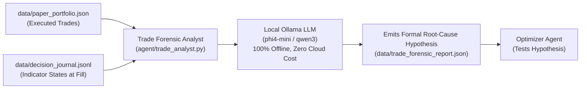

# Web4 Trading Agent: Detailed System Architecture & Granular Walkthrough

This document provides a granular, component-by-component walkthrough of the **Web4 Autonomous Trading Agent**. It details every mathematical formula, execution rule, data flow, safety gate, and risk control implemented in the repository.

---

## Table of Contents
1. [Global Architecture Overview](#1-global-architecture-overview)
2. [The Live Heartbeat Loop (`live_paper_trader.py`)](#2-the-live-heartbeat-loop-live_paper_traderpy)
3. [The 4 Strategy Bots in Fine Detail](#3-the-4-strategy-bots-in-fine-detail)
   - [3.1 Donchian Momentum Breakout Bot](#31-donchian-momentum-breakout-bot)
   - [3.2 Bollinger / RSI Mean-Reversion Bot](#32-bollinger--rsi-mean-reversion-bot)
   - [3.3 Cointegrated Statistical Arbitrage Pairs Bot](#33-cointegrated-statistical-arbitrage-pairs-bot)
   - [3.4 Delta-Neutral Perpetual Basis Yield Bot](#34-delta-neutral-perpetual-basis-yield-bot)
4. [The Master Coordinator Engine (`core/coordinator.py`)](#4-the-master-coordinator-engine-corecoordinatorpy)
5. [The Risk Fortress & Sizing Formulas (`core/risk_engine.py`)](#5-the-risk-fortress--sizing-formulas-corerisk_enginepy)
6. [The Virtual Ledger & Execution Drag (`core/paper_account.py`)](#6-the-virtual-ledger--execution-drag-corepaper_accountpy)
7. [Alternative Intelligence Radar (`core/skill_intelligence_gate.py`)](#7-alternative-intelligence-radar-coreskill_intelligence_gatepy)
8. [The Autonomous AI Layer & 4-Gate Auto-Approval (`agent/`)](#8-the-autonomous-ai-layer--4-gate-auto-approval-agent)
9. [Macro & Decentralized Prediction Radars (`core/fred_radar.py` & `core/polymarket_radar.py`)](#9-macro--decentralized-prediction-radars-corefred_radarpy--corepolymarket_radarpy)
10. [Institutional Stress Testing & Beyond-Sharpe Metrics (`core/institutional_stress_tester.py`)](#10-institutional-stress-testing--beyond-sharpe-metrics-coreinstitutional_stress_testerpy)
11. [Post-Trade Forensic Analyst & Local LLM Cognition (`agent/trade_analyst.py`)](#11-post-trade-forensic-analyst--local-llm-cognition-agenttrade_analystpy)
   - [11.1 Granular Forensic Capabilities](#111-granular-forensic-capabilities)
   - [11.2 Why Microsoft phi4-mini Was Chosen](#112-why-microsoft-phi4-mini-was-chosen)
   - [11.3 Why We Do Not Fine-Tune the LLM](#113-why-we-do-not-fine-tune-the-llm)
12. [Repository File Map](#12-repository-file-map)

---

## 1. Global Architecture Overview

The system operates across **four primary operational tiers**:



---

## 2. The Live Heartbeat Loop (`live_paper_trader.py`)

The file [`live_paper_trader.py`](live_paper_trader.py) is the master executable that runs continuously in background memory.

### Granular Execution Steps (Every 60 Seconds):
1. **PID Process Locking (`core/process_lock.py`)**:
   * Uses Linux `fcntl.flock` on `data/live_trader.pid`.
   * **Purpose**: Prevents two instances of the bot from running at the same time and corrupting `paper_portfolio.json`.
2. **Dynamic Config Hot-Reloading**:
   * Computes the SHA-256 hash of [`config/active_config.json`](config/active_config.json).
   * If the file was updated (by the user or by an approved AI proposal), the Coordinator immediately reloads the parameters into memory **without restarting the process**.
3. **Market Data Fetching**:
   * Pulls the last 100 hourly candles for all configured symbols (`BTC/USDT`, `ETH/USDT`, `SOL/USDT`, `SPY`, etc.).
   * Checks staleness: If the most recent candle timestamp is older than `max_stale_minutes` (default 180 min), the asset is skipped to prevent trading on dead data.
4. **Tick Execution (`run_portfolio_tick`)**:
   * Sends market data to [`core/coordinator.py`](core/coordinator.py) and processes all trade signals, stop-loss movements, and basis yield distributions.

---

## 3. The 4 Strategy Bots in Fine Detail

### 3.1 Donchian Momentum Breakout Bot
* **File**: [`strategies/momentum.py`](strategies/momentum.py)
* **Strategy Type**: Directional Trend-Following.
* **Underlying Indicators**:
  * **Donchian High/Low (24 periods)**: $H_{24} = \max(\text{High}_{t-24 \dots t-1})$, $L_{24} = \min(\text{Low}_{t-24 \dots t-1})$.
  * **Trend Filter**: 50-period Exponential Moving Average ($\text{EMA}_{50}$).
  * **Trend Strength**: 14-period Average Directional Index ($\text{ADX}_{14}$).
  * **Volatility Measure**: 14-period Average True Range ($\text{ATR}_{14}$).
* **Granular Entry Rules**:
  * **LONG Entry**: Triggered when $\text{Close} > H_{24}$ **AND** $\text{Close} > \text{EMA}_{50}$ **AND** $\text{ADX} \ge 20$.
  * **SHORT Entry**: Triggered when $\text{Close} < L_{24}$ **AND** $\text{Close} < \text{EMA}_{50}$ **AND** $\text{ADX} \ge 20$ (only if `allow_short: true`).
* **Granular Exit Rules**:
  * Uses a dynamic **ATR Trailing Stop**:
    $$\text{Trailing Stop} = \text{Highest High Since Entry} - (3.0 \times \text{ATR})$$
  * As price climbs, the stop-loss ratchets upward bar-by-bar. It never loosens downward.

---

### 3.2 Bollinger / RSI Mean-Reversion Bot
* **File**: [`strategies/mean_reversion.py`](strategies/mean_reversion.py)
* **Strategy Type**: Counter-trend Swing Trader.
* **Underlying Indicators**:
  * **Bollinger Bands (20 periods, 2.0 std dev)**:
    $$\text{SMA}_{20} = \frac{1}{20} \sum_{i=0}^{19} \text{Close}_{t-i}, \quad \text{Upper} = \text{SMA}_{20} + 2\sigma, \quad \text{Lower} = \text{SMA}_{20} - 2\sigma$$
  * **Relative Strength Index ($\text{RSI}_{14}$)**.
* **Granular Entry Rules**:
  * **LONG Entry**: Triggered when $\text{Close} \le \text{Lower Band}$ **AND** $\text{RSI} < 30$ (Oversold extreme).
  * **SHORT Entry**: Triggered when $\text{Close} \ge \text{Upper Band}$ **AND** $\text{RSI} > 70$ (Overbought extreme).
* **The 50% Scale-Out Profit Rule**:
  * Target line: The middle $\text{SMA}_{20}$.
  * When price travels **50% of the distance** to the SMA, the bot **sells half (50%) of the position** to bank cash.
  * It immediately moves the stop-loss on the remaining 50% to **breakeven** ($\text{Entry Price}$). The trade is now mathematically risk-free.
  * The final 50% exits when the price hits the full $\text{SMA}_{20}$ target.

---

### 3.3 Cointegrated Statistical Arbitrage Pairs Bot
* **File**: [`strategies/stat_arb_pairs.py`](strategies/stat_arb_pairs.py)
* **Strategy Type**: Market-Neutral Relative Value.
* **Mechanism**:
  1. Identifies pairs of assets that share an economic link (e.g. `BTC/USDT` vs `ETH/USDT`, or `SPY` vs `QQQ`).
  2. Runs an **Engle-Granger Cointegration Test**. If $p$-value $< 0.05$, the spread is mathematically stationary.
  3. Calculates the Hedge Ratio $\beta$ via Ordinary Least Squares (OLS) regression:
     $$\text{Spread}_t = P_{A,t} - \beta P_{B,t}$$
  4. Computes the rolling normalized **Z-Score**:
     $$Z_t = \frac{\text{Spread}_t - \mu_{\text{spread}}}{\sigma_{\text{spread}}}$$
* **Granular Entry & Exit**:
  * If $Z_t \ge +2.0$: Asset A is overpriced, Asset B is underpriced. **Short A, Buy B**.
  * If $Z_t \le -2.0$: Asset A is underpriced, Asset B is overpriced. **Buy A, Short B**.
  * Exit: When $|Z_t| \le 0.20$ (spread mean-reverts back to normal).

---

### 3.4 Delta-Neutral Perpetual Basis Yield Bot
* **File**: [`core/basis_yield.py`](core/basis_yield.py)
* **Strategy Type**: Delta-Neutral Cash-and-Carry / Funding Arbitrage.
* **Underlying Principle**:
  * Perpetual futures traders pay a funding fee every 8 hours.
  * If the rate is positive (Longs pay Shorts), we buy the Spot crypto and Short the Perpetual contract.
  * **Net Market Exposure ($\Delta$) = 0.0**. Price pumps or crashes do not affect account balance.
* **Granular Math**:
  $$\text{Annualized APR} = \text{Rate}_{8h} \times 3 \times 365 \times 100$$
  $$\text{8h Cash Payout} = \text{Notional Allocated} \times \text{Rate}_{8h}$$
* **Execution Rules**:
  * Minimum APR Hurdle: [`basis_hurdle_apr = 8.0%`](config/active_config.json).
  * Automatically records a verified audit record in `closed_trades` every 8 hours (Trades 31–39).

---

## 4. The Master Coordinator Engine (`core/coordinator.py`)

The **Portfolio Coordinator** is the central brain that arbitrates conflicting advice from different bots:



### Conflict Resolution Matrix:
* **Opposite Signals on Same Asset**:
  * Evaluates the market regime via `ADX`. If `ADX > 25` (trending), the trend bot wins. If `ADX < 20` (ranging), the mean-reversion bot wins.
  * If signal strengths are close, the Coordinator blocks both trades to preserve capital.
* **Portfolio Concentration Check**:
  * Prevents total crypto exposure from exceeding configured portfolio risk limits (default 80% maximum).

---

## 5. The Risk Fortress & Sizing Formulas (`core/risk_engine.py`)

No trade is ever placed without passing through the mathematical constraints in [`core/risk_engine.py`](core/risk_engine.py):

### 5.1 Position Sizing Formula
$$\text{Dollar Risk} = \text{Account Equity} \times \text{Risk Percent}$$
$$\text{Stop Distance} = |\text{Entry Price} - \text{Stop Loss Price}|$$
$$\text{Position Units} = \frac{\text{Dollar Risk}}{\text{Stop Distance}}$$

* **Hard-Coded Invariant**: $\text{Risk Percent}$ is strictly clamped between **$1.0\%$ minimum and $5.0\%$ maximum** of total equity.
* If a coin is highly volatile ($\text{ATR}$ is large), the stop distance is wide, which automatically forces the unit size down.

### 5.2 Volume Surge & Smart Money Sizing Multipliers
* **Volume Surge Multiplier**: If current candle volume is $\ge 1.5\times$ the 20-period average volume, the position size is boosted by **$1.2\times$** (rewarding high-liquidity institutional participation).
* Even with boosts, the final risk is hard-capped at $\le 5.0\%$.

### 5.3 Autonomous Circuit Breakers
1. **Daily Drawdown Breaker ($4.0\%$)**:
   * If equity loses $\ge 4.0\%$ in any rolling 24-hour window, all new trade entries are locked out until the next calendar day.
2. **Trailing Peak Drawdown Breaker ($12.0\%$)**:
   * Tracks `peak_equity` historically.
   * If $\frac{\text{peak} - \text{current}}{\text{peak}} \ge 0.12$, the engine trips the emergency breaker, cancels all pending orders, and preserves cash.

---

## 6. The Virtual Ledger & Execution Drag (`core/paper_account.py`)

To ensure paper-trading numbers reflect real-world execution, [`core/paper_account.py`](core/paper_account.py) enforces full execution friction:

* **Taker Exchange Fees**: $0.06\%$ ($6\text{ basis points}$) deducted on both Entry and Exit.
* **Market Slippage**: $0.04\%$ ($4\text{ basis points}$) adverse price movement applied against every fill.
* **Concurrency Protection**: Uses file locks to ensure that data in [`data/paper_portfolio.json`](data/paper_portfolio.json) is atomic and crash-resistant.

---

## 7. Alternative Intelligence Radar (`core/skill_intelligence_gate.py`)

This engine integrates alternative market datasets to filter and confirm trades:

1. **Whale & 13F Institutional Filing Radar**:
   * Scrapes SEC 13F filings from elite funds (Berkshire Hathaway, Pershing Square, Appaloosa, Renaissance Technologies).
   * Assets with net institutional accumulation receive positive conviction weighting.
2. **Congressional STOCK Act Tracker**:
   * Scrapes the U.S. House Clerk Periodic Transaction Reports (PTRs) for congressional trades.
3. **SEC EDGAR 10-Q / 8-K Analyst**:
   * Filters out companies with deteriorating fundamental health, guidance cuts, or negative operating margins.
4. **Drift-Band Portfolio Rebalancing Engine**:
   * Evaluates portfolio drift every cycle. If any single asset drifts $\ge 5\%$ above its intended allocation band, it executes a `REBALANCE_TRIM` to return to target.

---

## 8. The Autonomous AI Layer & 4-Gate Auto-Approval (`agent/`)

The repository includes a cognitive agent harness that autonomously tunes strategy parameters and removes unprofitable assets.



### Gate 4 Breakdown (The "Do No Harm" Guarantee):
* **OOS Return Delta $\ge 0.0\%$**: The new strategy must perform equal to or better than the current baseline on unseen Out-of-Sample validation data.
* **OOS Sharpe Delta $\ge 0.0$**: The risk-adjusted return (smoothness of the equity curve) cannot degrade.
* **OOS Max Drawdown $\le \text{Baseline} + 0.5\%$**: The new strategy cannot expose the account to deeper crash drawdowns.
* **Multi-Window Walk-Forward Verification**: If any single test window produces negative returns, the proposal is rejected as curve-fitted.

---

## 9. Macro & Decentralized Prediction Radars (`core/fred_radar.py` & `core/polymarket_radar.py`)

To prevent the trading bot from blindly entering technical breakout trades right before a macroeconomic catastrophe or Fed interest rate shock, the system monitors macro regime indicators:

### 9.1 FRED Macro Regime Radar ([`core/fred_radar.py`](core/fred_radar.py))
* **CBOE VIX Volatility Index**: Gauges market-wide panic.
  * If $\text{VIX} \ge 30.0$: Activates **`CRASH_DEFENSE`** regime. Disables breakout longs and cuts position risk by $50\%$ (`risk_scale_factor = 0.50`).
  * If $\text{VIX} \in [22.0, 30.0)$: Activates **`VOLATILITY_EXPANSION`** regime with caution sizing.
* **High-Yield OAS Credit Spreads**: Measures junk bond default risk and liquidity contraction. Spreads $> 500\text{ bps}$ force defensive cash preservation.
* **10Y-2Y Treasury Yield Spread**: Monitors yield curve inversion and steepening regimes.

### 9.2 Polymarket Decentralized Prediction Radar ([`core/polymarket_radar.py`](core/polymarket_radar.py))
* Uses the public Polymarket Gamma API (zero API keys required) to read crowd-priced implied probabilities for binary macro events:
  * **Fed Interest Rate Decision Odds**: Flags impending FOMC rate decisions to throttle risk 2 hours prior to rate announcements.
  * **U.S. Recession Probabilities**: Detects spike in event-driven tail risks.

---

## 10. Institutional Stress Testing & Beyond-Sharpe Metrics (`core/institutional_stress_tester.py`)

Traditional backtests rely solely on the Sharpe Ratio, which can be fooled by strategies that collect small gains and occasionally suffer massive "black swan" crashes. We implement institutional hedge-fund stress testing formulas:

### 10.1 Deflated Sharpe Ratio (DSR) & Probabilistic Sharpe Ratio (PSR)
Formulated by Marcos López de Prado (*Advances in Financial Machine Learning*):
* **Probabilistic Sharpe Ratio (PSR)**: Adjusts the Sharpe Ratio for non-normal return distributions (skewness and fat-tailed kurtosis).
* **Deflated Sharpe Ratio (DSR)**: Mathematically discounts the Sharpe Ratio for the number of backtest trials ($N$) evaluated. It computes the statistical probability that the strategy is genuinely profitable rather than a statistical fluke resulting from testing 50 different parameter variations.

### 10.2 Ulcer Index & Underwater Duration
* **Ulcer Index**: Measures both the **depth** and the **duration** of drawdowns. While Sharpe penalizes upside volatility, the Ulcer Index strictly measures real portfolio pain.
* **Max Underwater Duration**: Measures how many hours or days the strategy took to recover back to a new all-time high after a loss.

### 10.3 Break-Even Friction Sweep (1x to 5x Stress Test)
* Runs stress tests where exchange fees and slippage are artificially multiplied by $2\times, 3\times, 4\times$, and $5\times$.
* **Margin of Safety**: A strategy must survive at least $2.5\times$ normal fees and slippage before it is deemed safe for production.

---

## 11. Post-Trade Forensic Analyst & Local LLM Cognition (`agent/trade_analyst.py`)

The Web4 platform includes an autonomous post-mortem diagnostic engine that reviews real executed trades to determine *why* losses occurred and propose corrective hypotheses:



### 11.1 Granular Forensic Capabilities
1. **Payoff & Expectancy Statistics**:
   * Evaluates the **Payoff Ratio** ($\frac{\text{Average Win \$}}{\text{Average Loss \$}}$) and **Win Rate**.
2. **Loss Attribution**:
   * Categorizes whether losses were caused by **Trend Exhaustion**, **Whipsaw Chop**, **Bad Entry Timing**, or **Macro Volatility**.
3. **Local LLM Cognitive Reasoning**:
   * Uses a locally hosted model via Ollama ([`agent/llm_client.py`](agent/llm_client.py)) with zero API keys and zero cost.
   * Prompts the local LLM with the exact indicators, entry/exit prices, and market context at the moment of the loss, instructing it to synthesize a formal mathematical tuning proposal for the Optimizer.

### 11.2 Why Microsoft phi4-mini Was Chosen (Model Selection Rationale)
The system uses **`phi4-mini:latest`** (3.8B parameters) by Microsoft as its default engine over other free models for four specific architectural reasons:
1. **High Math & STEM Reasoning Density**: Unlike models trained on generic internet scrapings (Reddit/blogs), Microsoft's Phi models are trained on curated synthetic math, STEM textbooks, and Python algorithms. It punches far above its weight class in quantitative reasoning.
2. **The 3.8B Sweet Spot (Resource Isolation)**: Larger 8B–14B models (e.g. Llama-3-8B, Gemma-2-9B) consume 6 to 10 GB of VRAM, competing with pandas dataframes, websocket polling, and backtesting simulations. `phi4-mini` takes only **~2.5 GB**, leaving 80%+ of system RAM/VRAM free for the trading engine.
3. **Sub-Second Low Latency (< 800ms)**: Live trading checks occur on 60-second cycles. Deep reasoning models (like `deepseek-r1`) produce 1,000+ internal "Chain of Thought" tokens, taking 20–40 seconds per query. `phi4-mini` responds in under 800ms, never freezing the tick loop.
4. **Strict JSON Schema Compliance**: Agent 10 enforces an 11-field JSON proposal schema. Math-olympiad models (e.g. WizardMath) often output LaTeX equations rather than valid Python dictionary keys, breaking automated code parsers. `phi4-mini` adheres strictly to raw JSON output without conversational chatter.
5. **Model-Agnostic Flexibility**: The client in [`agent/llm_client.py`](agent/llm_client.py) is completely plug-and-play. If a user prefers another model (e.g. `qwen3:8b`, `gemma2:9b`), it can be swapped with a single CLI argument (`--model`) without rewriting code.

### 11.3 Why We Do Not Fine-Tune the LLM (Architectural Rationale)
In institutional quantitative trading, fine-tuning an LLM on price history is considered an anti-pattern. We intentionally do not fine-tune for four core reasons:
1. **Python Handles Math Deterministically**: LLMs are notoriously poor at mental arithmetic (computing exponential moving averages, standard deviations, or square roots). All indicator math is computed deterministically in pure Python; the LLM is strictly used for qualitative diagnostic reasoning.
2. **Live In-Context Injection Beats Stale Weights (Open-Book vs. Memorization)**: Markets are non-stationary and regime-shift constantly. Fine-tuning bakes static historical data into permanent weights. Instead, our system injects fresh, real-time telemetry (the exact entry price, exit price, ADX, and regime of the last trade) directly into the prompt. The LLM has the exact facts in front of it with zero memory decay.
3. **Preventing Catastrophic Forgetting**: Fine-tuning small models often causes "catastrophic forgetting," degrading their foundational reasoning abilities and increasing hallucination rates. Using base `phi4-mini` preserves Microsoft's pristine logic and instruction-following integrity.
4. **Instant Zero-Cost Model Upgrades**: If Microsoft, Meta, or Google releases a faster, smarter open-source model tomorrow, we can upgrade in 5 seconds by pulling the new model into Ollama, without spending weeks collecting training data or renting expensive fine-tuning GPUs.

---

## 12. Repository File Map

```
web4-trading-agent/
├── live_paper_trader.py       # Live daemon heartbeat loop (every 60s)
├── config/
│   └── active_config.json     # Live parameters, active symbols & risk toggles
├── core/
│   ├── coordinator.py         # Multi-strategy conflict arbiter & execution orchestrator
│   ├── risk_engine.py         # 1%-5% equity sizing & circuit breakers
│   ├── paper_account.py       # Simulated ledger, fills, fees & slippage
│   ├── basis_yield.py         # Delta-neutral funding rate carry harvest engine
│   ├── data_loader.py         # Real-time & historical crypto/equity candle fetcher
│   ├── fred_radar.py          # St. Louis Fed / VIX Macro Crash Defense Radar
│   ├── polymarket_radar.py    # Polymarket decentralized prediction market odds radar
│   ├── institutional_stress_tester.py # DSR, PSR, Ulcer Index & friction stress sweeps
│   ├── skill_intelligence_gate.py # 13F whale radar, Pelosi tracker, drift rebalancer
│   └── process_lock.py        # PID flock concurrency protection
├── strategies/
│   ├── momentum.py            # Donchian channel breakout trend bot
│   ├── mean_reversion.py      # Bollinger / RSI oversold/overbought swing bot
│   └── stat_arb_pairs.py      # Cointegrated statistical arbitrage pairs bot
├── agent/
│   ├── governor.py            # 4-Gate auto-approval constitutional gatekeeper
│   ├── optimizer.py           # In-sample discovery engine
│   ├── validator.py           # Out-of-sample walk-forward verification engine
│   ├── asset_selector.py      # Walk-forward toxic drag pruning engine
│   ├── trade_analyst.py       # Post-trade forensic diagnosis & root-cause analyst
│   └── llm_client.py          # Zero-dependency local Ollama (phi4-mini) LLM client
├── data/
│   ├── paper_portfolio.json   # Live ledger state, cash balance & closed trades
│   ├── decision_journal.jsonl # Complete audit log of every tick decision
│   └── trade_forensic_report.json # AI forensic diagnosis on closed trades
├── docs/
│   └── SYSTEM_WALKTHROUGH.md  # THIS MASTER DETAILED GUIDE
└── tests/                     # 152 automated regression tests
```
