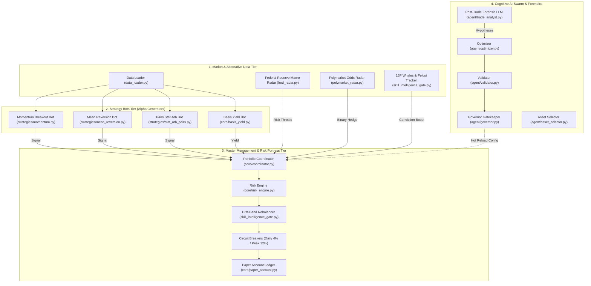
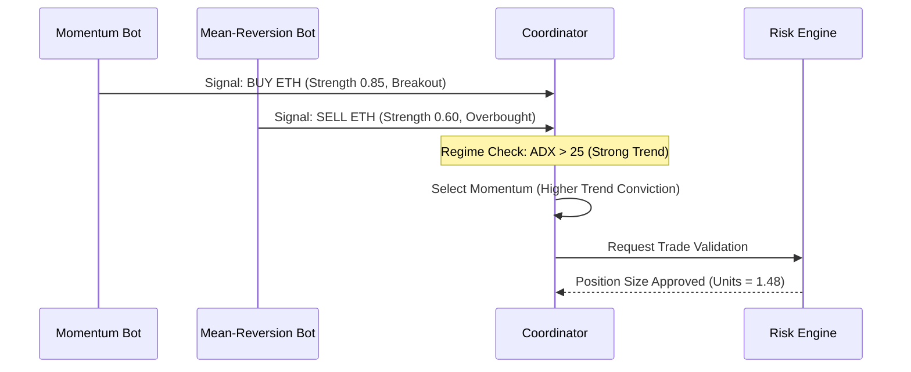
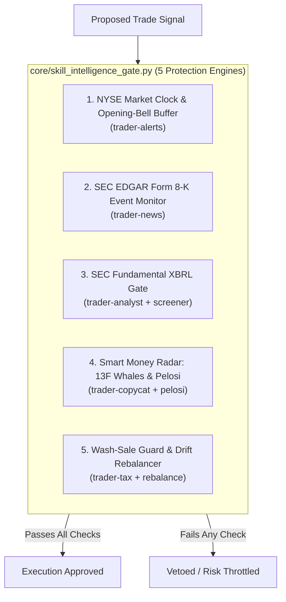
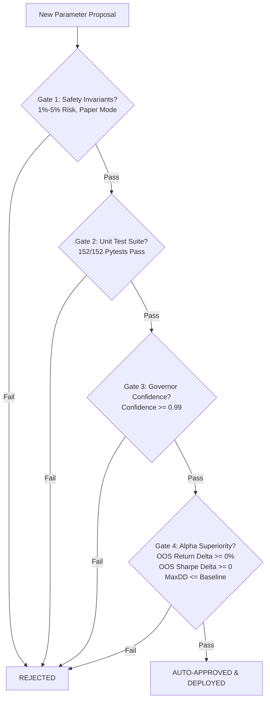
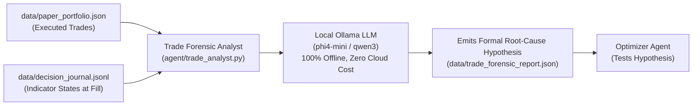

# Web4 Trading Agent: Detailed System Architecture & Granular Walkthrough

This document provides a granular, component-by-component walkthrough of the **Web4 Autonomous Trading Agent**. It details every mathematical formula, execution rule, data flow, safety gate, and risk control implemented in the repository.

---

## Table of Contents
1. [Global Architecture Overview](#1-global-architecture-overview)
2. [The Live Heartbeat Loop (`live_paper_trader.py`)](#2-the-live-heartbeat-loop-live_paper_traderpy)
3. [The 4 Strategy Bots in Fine Detail](#3-the-4-strategy-bots-in-fine-detail)
   - [3.1 Donchian Momentum Breakout Bot](#31-donchian-momentum-breakout-bot)
   - [3.2 Bollinger / RSI Mean-Reversion Bot](#32-bollinger--rsi-mean-reversion-bot)
   - [3.3 Cointegrated Statistical Arbitrage Pairs Bot](#33-cointegrated-statistical-arbitrage-pairs-bot)
   - [3.4 Delta-Neutral Perpetual Basis Yield Bot](#34-delta-neutral-perpetual-basis-yield-bot)
4. [The Master Coordinator Engine (`core/coordinator.py`)](#4-the-master-coordinator-engine-corecoordinatorpy)
   - [4.1 Multi-Source Market Data Pipeline (`core/data_loader.py`)](#41-multi-source-market-data-pipeline-coredata_loaderpy)
5. [The Risk Fortress & Sizing Formulas (`core/risk_engine.py`)](#5-the-risk-fortress--sizing-formulas-corerisk_enginepy)
6. [The Virtual Ledger & Execution Drag (`core/paper_account.py`)](#6-the-virtual-ledger--execution-drag-corepaper_accountpy)
   - [6.1 Pre-Flight Execution Safety Guards (`core/preflight.py`)](#61-pre-flight-execution-safety-guards-corepreflightpy)
   - [6.2 Decision Journal & 24h Settlement Engine (`core/journal.py`)](#62-decision-journal--24h-settlement-engine-corejournalpy)
7. [Alternative Intelligence Radar & Regulatory Hygiene (`core/skill_intelligence_gate.py`)](#7-alternative-intelligence-radar--regulatory-hygiene-coreskill_intelligence_gatepy)
   - [7.1 NYSE Market Clock & Opening-Bell Buffer](#71-nyse-market-clock-holiday-calendar--opening-bell-buffer-nysemarketclock)
   - [7.2 SEC EDGAR 8-K Real-Time Filing Veto](#72-sec-edgar-8-k-real-time-filing-veto-secedgar8kmonitor)
   - [7.3 SEC Fundamental XBRL Quality Filter](#73-sec-fundamental-xbrl-quality-filter-secfundamentalgate)
   - [7.4 Smart Money Radar: 13F Whales & Pelosi](#74-smart-money-radar-13f-institutional-whales--congressional-stock-act-smartmoneyradar)
   - [7.5 Tax Hygiene, Loss-Streak Locks & Drift Rebalancing](#75-tax-hygiene-loss-streak-locks--drift-rebalancing)
8. [The Autonomous AI Layer & 4-Gate Auto-Approval (`agent/`)](#8-the-autonomous-ai-layer--4-gate-auto-approval-agent)
   - [8.1 In-Sample Strategy Optimizer (`agent/optimizer.py`)](#81-in-sample-strategy-optimizer-agentoptimizerpy)
   - [8.2 Out-of-Sample Walk-Forward Validator (`agent/validator.py`)](#82-out-of-sample-walk-forward-validator-agentvalidatorpy)
   - [8.3 Constitutional Governor & Hot-Reload Gatekeeper (`agent/governor.py`)](#83-constitutional-governor--hot-reload-gatekeeper-agentgovernorpy)
   - [8.4 Autonomous Asset Universe Screener & Toxic Drag Pruning (`agent/asset_selector.py`)](#84-autonomous-asset-universe-screener--toxic-drag-pruning-agentasset_selectorpy)
9. [Macro & Decentralized Prediction Radars (`core/fred_radar.py` & `core/polymarket_radar.py`)](#9-macro--decentralized-prediction-radars-corefred_radarpy--corepolymarket_radarpy)
10. [Institutional Stress Testing & Backtest Simulation (`core/institutional_stress_tester.py` & `core/backtest_engine.py`)](#10-institutional-stress-testing--backtest-simulation-coreinstitutional_stress_testerpy--corebacktest_enginepy)
   - [10.1 Deflated Sharpe Ratio & Probabilistic Sharpe Ratio](#101-deflated-sharpe-ratio-dsr--probabilistic-sharpe-ratio-psr)
   - [10.2 Ulcer Index & Underwater Duration](#102-ulcer-index--underwater-duration)
   - [10.3 Break-Even Friction Sweep](#103-break-even-friction-sweep-1x-to-5x-stress-test)
   - [10.4 Event-Driven Backtesting & Simulation Engine (`core/backtest_engine.py`)](#104-event-driven-backtesting--simulation-engine-corebacktest_enginepy)
11. [Post-Trade Forensic Analyst & Local LLM Cognition (`agent/trade_analyst.py`)](#11-post-trade-forensic-analyst--local-llm-cognition-agenttrade_analystpy)
   - [11.1 Granular Forensic Capabilities](#111-granular-forensic-capabilities)
   - [11.2 Why Microsoft phi4-mini Was Chosen](#112-why-microsoft-phi4-mini-was-chosen)
   - [11.3 Why We Do Not Fine-Tune the LLM](#113-why-we-do-not-fine-tune-the-llm)
12. [Real-Time Terminal Monitoring Dashboard (`dashboard.py`)](#12-real-time-terminal-monitoring-dashboard-dashboardpy)
13. [Repository File Map](#13-repository-file-map)

---

## 1. Global Architecture Overview

The system operates across **four primary operational tiers**:



---

## 2. The Live Heartbeat Loop (`live_paper_trader.py`)

The file [`live_paper_trader.py`](live_paper_trader.py) is the master executable that runs continuously in background memory.

### Granular Execution Steps (Every 60 Seconds):
1. **PID Process Locking (`core/process_lock.py`)**:
   * Uses Linux `fcntl.flock` on `data/live_trader.pid`.
   * **Purpose**: Prevents two instances of the bot from running at the same time and corrupting `paper_portfolio.json`.
2. **Dynamic Config Hot-Reloading**:
   * Computes the SHA-256 hash of [`config/active_config.json`](config/active_config.json).
   * If the file was updated (by the user or by an approved AI proposal), the Coordinator immediately reloads the parameters into memory **without restarting the process**.
3. **Market Data Fetching**:
   * Pulls the last 100 hourly candles for all configured symbols (`BTC/USDT`, `ETH/USDT`, `SOL/USDT`, `SPY`, etc.).
   * Checks staleness: If the most recent candle timestamp is older than `max_stale_minutes` (default 180 min), the asset is skipped to prevent trading on dead data.
4. **Tick Execution (`run_portfolio_tick`)**:
   * Sends market data to [`core/coordinator.py`](core/coordinator.py) and processes all trade signals, stop-loss movements, and basis yield distributions.

---

## 3. The 4 Strategy Bots in Fine Detail

### 3.1 Donchian Momentum Breakout Bot
* **File**: [`strategies/momentum.py`](strategies/momentum.py)
* **Strategy Type**: Directional Trend-Following.
* **Underlying Indicators**:
  * **Donchian High/Low (24 periods)**: $H_{24} = \max(\text{High}_{t-24 \dots t-1})$, $L_{24} = \min(\text{Low}_{t-24 \dots t-1})$.
  * **Trend Filter**: 50-period Exponential Moving Average ($\text{EMA}_{50}$).
  * **Trend Strength**: 14-period Average Directional Index ($\text{ADX}_{14}$).
  * **Volatility Measure**: 14-period Average True Range ($\text{ATR}_{14}$).
* **Granular Entry Rules**:
  * **LONG Entry**: Triggered when $\text{Close} > H_{24}$ **AND** $\text{Close} > \text{EMA}_{50}$ **AND** $\text{ADX} \ge 20$.
  * **SHORT Entry**: Triggered when $\text{Close} < L_{24}$ **AND** $\text{Close} < \text{EMA}_{50}$ **AND** $\text{ADX} \ge 20$ (only if `allow_short: true`).
* **Granular Exit Rules**:
  * Uses a dynamic **ATR Trailing Stop**:
    $$\text{Trailing Stop} = \text{Highest High Since Entry} - (3.0 \times \text{ATR})$$
  * As price climbs, the stop-loss ratchets upward bar-by-bar. It never loosens downward.

---

### 3.2 Bollinger / RSI Mean-Reversion Bot
* **File**: [`strategies/mean_reversion.py`](strategies/mean_reversion.py)
* **Strategy Type**: Counter-trend Swing Trader.
* **Underlying Indicators**:
  * **Bollinger Bands (20 periods, 2.0 std dev)**:
    $$\text{SMA}_{20} = \frac{1}{20} \sum_{i=0}^{19} \text{Close}_{t-i}, \quad \text{Upper} = \text{SMA}_{20} + 2\sigma, \quad \text{Lower} = \text{SMA}_{20} - 2\sigma$$
  * **Relative Strength Index ($\text{RSI}_{14}$)**.
* **Granular Entry Rules**:
  * **LONG Entry**: Triggered when $\text{Close} \le \text{Lower Band}$ **AND** $\text{RSI} < 30$ (Oversold extreme).
  * **SHORT Entry**: Triggered when $\text{Close} \ge \text{Upper Band}$ **AND** $\text{RSI} > 70$ (Overbought extreme).
* **The 50% Scale-Out Profit Rule**:
  * Target line: The middle $\text{SMA}_{20}$.
  * When price travels **50% of the distance** to the SMA, the bot **sells half (50%) of the position** to bank cash.
  * It immediately moves the stop-loss on the remaining 50% to **breakeven** ($\text{Entry Price}$). The trade is now mathematically risk-free.
  * The final 50% exits when the price hits the full $\text{SMA}_{20}$ target.

---

### 3.3 Cointegrated Statistical Arbitrage Pairs Bot
* **File**: [`strategies/stat_arb_pairs.py`](strategies/stat_arb_pairs.py)
* **Strategy Type**: Market-Neutral Relative Value.
* **Mechanism**:
  1. Identifies pairs of assets that share an economic link (e.g. `BTC/USDT` vs `ETH/USDT`, or `SPY` vs `QQQ`).
  2. Runs an **Engle-Granger Cointegration Test**. If $p$-value $< 0.05$, the spread is mathematically stationary.
  3. Calculates the Hedge Ratio $\beta$ via Ordinary Least Squares (OLS) regression:
     $$\text{Spread}_t = P_{A,t} - \beta P_{B,t}$$
  4. Computes the rolling normalized **Z-Score**:
     $$Z_t = \frac{\text{Spread}_t - \mu_{\text{spread}}}{\sigma_{\text{spread}}}$$
* **Granular Entry & Exit**:
  * If $Z_t \ge +2.0$: Asset A is overpriced, Asset B is underpriced. **Short A, Buy B**.
  * If $Z_t \le -2.0$: Asset A is underpriced, Asset B is overpriced. **Buy A, Short B**.
  * Exit: When $|Z_t| \le 0.20$ (spread mean-reverts back to normal).

---

### 3.4 Delta-Neutral Perpetual Basis Yield Bot
* **File**: [`core/basis_yield.py`](core/basis_yield.py)
* **Strategy Type**: Delta-Neutral Cash-and-Carry / Funding Arbitrage.
* **Underlying Principle**:
  * Perpetual futures traders pay a funding fee every 8 hours.
  * If the rate is positive (Longs pay Shorts), we buy the Spot crypto and Short the Perpetual contract.
  * **Net Market Exposure ($\Delta$) = 0.0**. Price pumps or crashes do not affect account balance.
* **Granular Math**:
  $$\text{Annualized APR} = \text{Rate}_{8h} \times 3 \times 365 \times 100$$
  $$\text{8h Cash Payout} = \text{Notional Allocated} \times \text{Rate}_{8h}$$
* **Execution Rules**:
  * Minimum APR Hurdle: [`basis_hurdle_apr = 8.0%`](config/active_config.json).
  * Automatically records a verified audit record in `closed_trades` every 8 hours (Trades 31–39).

---

## 4. The Master Coordinator Engine (`core/coordinator.py`)

The **Portfolio Coordinator** is the central brain that arbitrates conflicting advice from different bots:



### Conflict Resolution Matrix:
* **Opposite Signals on Same Asset**:
  * Evaluates the market regime via `ADX`. If `ADX > 25` (trending), the trend bot wins. If `ADX < 20` (ranging), the mean-reversion bot wins.
  * If signal strengths are close, the Coordinator blocks both trades to preserve capital.
* **Portfolio Concentration Check**:
  * Prevents total crypto exposure from exceeding configured portfolio risk limits (default 80% maximum).

### 4.1 Multi-Source Market Data Pipeline (`core/data_loader.py`)
To ensure reliable inputs across both cryptocurrency and equity desks, [`core/data_loader.py`](core/data_loader.py) orchestrates market ingestion, data sanitation, and high-performance local caching:
* **Dual-Market Ingestion**:
  * **Crypto Pairs**: Direct public CCXT ingestion (Binance Spot & Perpetual Futures) normalizing symbols (`BTC/USDT`, `ETH/USDT`, `SOL/USDT`).
  * **Traditional Equities**: Historical and intraday candle feeds via `yfinance` (`SPY`, `QQQ`, `AAPL`, `NVDA`, `MCHP`, `XLE`, etc.).
* **Data Quality & Hygiene Audit (`check_data_quality`)**:
  * Rejects dataframes containing `NaN` / infinite values in OHLCV columns.
  * Detects zero-volume flatline anomalies and discontinuous time gaps.
  * Enforces monotonic ascending timestamp ordering so indicators never suffer lookahead leakage.
* **Local Disk Caching (`data/`)**:
  * Caches historical OHLCV data to parquet/csv files to eliminate network bottlenecks and exchange API rate-limit bans during high-frequency scans.
* **Staleness Blackout**:
  * Computes $\Delta t = \text{Current Time} - \text{Latest Bar Timestamp}$. If $\Delta t > \text{max\_stale\_minutes}$ (default 180m), the asset is quarantined from trade generation.

---

## 5. The Risk Fortress & Sizing Formulas (`core/risk_engine.py`)

No trade is ever placed without passing through the mathematical constraints in [`core/risk_engine.py`](core/risk_engine.py):

### 5.1 Position Sizing Formula
$$\text{Dollar Risk} = \text{Account Equity} \times \text{Risk Percent}$$
$$\text{Stop Distance} = |\text{Entry Price} - \text{Stop Loss Price}|$$
$$\text{Position Units} = \frac{\text{Dollar Risk}}{\text{Stop Distance}}$$

* **Hard-Coded Invariant**: $\text{Risk Percent}$ is strictly clamped between **$1.0\%$ minimum and $5.0\%$ maximum** of total equity.
* If a coin is highly volatile ($\text{ATR}$ is large), the stop distance is wide, which automatically forces the unit size down.

### 5.2 Volume Surge & Smart Money Sizing Multipliers
* **Volume Surge Multiplier**: If current candle volume is $\ge 1.5\times$ the 20-period average volume, the position size is boosted by **$1.2\times$** (rewarding high-liquidity institutional participation).
* Even with boosts, the final risk is hard-capped at $\le 5.0\%$.

### 5.3 Autonomous Circuit Breakers
1. **Daily Drawdown Breaker ($4.0\%$)**:
   * If equity loses $\ge 4.0\%$ in any rolling 24-hour window, all new trade entries are locked out until the next calendar day.
2. **Trailing Peak Drawdown Breaker ($12.0\%$)**:
   * Tracks `peak_equity` historically.
   * If $\frac{\text{peak} - \text{current}}{\text{peak}} \ge 0.12$, the engine trips the emergency breaker, cancels all pending orders, and preserves cash.

---

## 6. The Virtual Ledger & Execution Drag (`core/paper_account.py`)

To ensure paper-trading numbers reflect real-world execution, [`core/paper_account.py`](core/paper_account.py) enforces full execution friction:

* **Taker Exchange Fees**: $0.06\%$ ($6\text{ basis points}$) deducted on both Entry and Exit.
* **Market Slippage**: $0.04\%$ ($4\text{ basis points}$) adverse price movement applied against every fill.
* **Concurrency Protection**: Uses file locks to ensure that data in [`data/paper_portfolio.json`](data/paper_portfolio.json) is atomic and crash-resistant.

### 6.1 Pre-Flight Execution Safety Guards (`core/preflight.py`)
Before any proposed order is routed from the Coordinator to the Virtual Ledger, it must pass 5 execution safety guards orchestrated by `PreFlightGuard`:
1. **Bid-Ask Spread Slippage Guard**:
   * Evaluates relative market spread: $\text{Spread} = \frac{P_{\text{ask}} - P_{\text{bid}}}{P_{\text{mid}}}$.
   * If $\text{Spread} > \text{max\_allowed\_spread}$ (e.g. $0.35\%$), the order is rejected to prevent excessive execution drag.
2. **Tick Staleness Guard**:
   * Verifies price quote freshness. If the quote timestamp is older than allowable tolerance, execution is halted.
3. **Liquidity Depth & 5% Volume Participation Guard**:
   * Rejects orders that exceed $5.0\%$ of the asset's rolling 24-hour volume, ensuring the strategy never over-participates in thin liquidity.
4. **Cash Buffer & Minimum Notional Guard**:
   * Enforces exchange minimum order sizes ($\ge \$10.00$) and preserves a hard-coded $10\%$ cash buffer so account equity is never fully illiquid.
5. **Local LLM Devil's Advocate News Screener (`LocalLLMScreener`)**:
   * Fetches the 3 most recent headlines via public Google News RSS for the target asset.
   * Dispatches an out-of-band query to local Ollama (`phi4-mini:latest`) with a 6-second timeout: *"Does this news indicate catastrophic bankruptcy, SEC regulatory fraud, or protocol hack?"*
   * If the LLM returns a veto verdict, the entry is aborted before capital is risked.

### 6.2 Decision Journal & 24h Settlement Engine (`core/journal.py`)
To ensure continuous empirical accountability, [`core/journal.py`](core/journal.py) tracks every decision and audits risk efficacy:
* **Append-Only Decision Logging**:
   * Logs every tick decision (`APPROVED`, `BLOCKED_BY_RISK`, `BLOCKED_BY_PREFLIGHT`, `NO_SIGNAL`) along with complete indicator states and market context directly to [`data/decision_journal.jsonl`](data/decision_journal.jsonl).
* **24-Hour Settlement Math & Benchmark Alpha**:
   * Re-evaluates each logged entry once 24 hours have elapsed:
     $$\text{Forward Return} = \frac{P_{t+24\text{h}} - P_t}{P_t}$$
     $$\text{Alpha vs Benchmark} = \text{Forward Return} - \text{Benchmark Return}_{t+24\text{h}}$$
     *(Benchmark is `SPY` for equities, `BTC/USDT` for cryptocurrency).*
* **2-Sentence Local LLM Cognitive Post-Mortem**:
   * Calls `phi4-mini` to synthesize a concise, two-sentence qualitative reflection on settled outcomes, storing the insight alongside quantitative metrics.
* **Empirical Risk Gate Attribution**:
   * Mathematically proves whether risk gates prevented losses by calculating the forward return of trades that were blocked compared to those approved.

---

## 7. Alternative Intelligence Radar & Regulatory Hygiene (`core/skill_intelligence_gate.py`)

This engine serves as the institutional guardian connecting the bot's price-action algorithms to real-world market regulations, corporate disclosures, and elite fund flows across 5 distinct protective engines:



### 7.1 NYSE Market Clock, Holiday Calendar & Opening-Bell Buffer (`NyseMarketClock`)
* **Session Hours & DST Math**: Tracks exact New York Eastern Time, automatic Daylight Saving transitions (-4 EDT / -5 EST), 2026–2027 NYSE holidays, and 1:00 PM early close days (day after Thanksgiving, Christmas Eve).
* **Opening-Bell 15-Minute Gap Whipsaw Buffer**: Blocks stock entries during the volatile first 15 minutes of trading (**9:30 AM – 9:45 AM ET**). This prevents the bot from buying false morning gaps that reverse abruptly once retail liquidity settles.

### 7.2 SEC EDGAR 8-K Real-Time Filing Veto (`SecEdgar8KMonitor`)
Directly polls the real-time SEC EDGAR Atom feed to detect critical corporate emergencies before a chart can reflect them:
* **Item 1.03**: Bankruptcy or receivership.
* **Item 1.05**: Material cybersecurity incident/breach.
* **Item 4.02**: Past financials no longer reliable (accounting restatement/fraud).
* **Item 5.02**: Abrupt departure of CEO, CFO, or directors.
* **Action**: Instantly vetoes any pending or active BUY signals on the affected ticker.

### 7.3 SEC Fundamental XBRL Quality Filter (`SecFundamentalGate`)
* Parses raw XBRL financial statements from 10-Q and 10-K filings:
  * YoY Revenue Growth (`revenue_growth_yoy`).
  * Operating Margins (`operating_margin`).
  * Diluted EPS & P/E Ratios.
* **Hype Filter**: Disqualifies cash-bleeding, unprofitable companies from entering the long portfolio, preventing "pump-and-dump" traps.

### 7.4 Smart Money Radar: 13F Institutional Whales & Congressional STOCK Act (`SmartMoneyRadar`)
* **Form 13F Whale Accumulation**: Scrapes quarterly SEC 13F-HR filings from elite multi-billion-dollar fund managers (Warren Buffett / Berkshire, Ray Dalio / Bridgewater, Bill Ackman / Pershing Square, Jim Simons / Renaissance Technologies, Stanley Druckenmiller / Duquesne, David Tepper / Appaloosa).
* **House Clerk STOCK Act PTR Disclosures**: Tracks Nancy Pelosi and congressional insider trades.
* **Conviction Scaling**: When technical breakout signals coincide with net institutional accumulation, position sizing is boosted by up to $1.2\times$ (clamped strictly within the 1%–5% risk ceiling).

### 7.5 Tax Hygiene, Loss-Streak Locks & Drift Rebalancing
* **IRS 30-Day Wash-Sale Compliance**: Tracks dual share-class families (e.g. `GOOG` vs `GOOGL`, `BRK.A` vs `BRK.B`). If a lot was liquidated at a tax loss within the last 30 days, the engine flags wash-sale conflicts and prevents buying the sister share class.
* **Loss-Streak Circuit Lock**: If any individual stock or coin suffers **2 consecutive stop-loss hits**, it is locked out for 24 hours to prevent burning capital in erratic price action.
* **Drift-Band Portfolio Rebalancer**: If an asset's position weight drifts $> 5\%$ above its assigned target allocation, it automatically executes a `REBALANCE_TRIM` to lock in profit and re-center account capital.

---

## 8. The Autonomous AI Layer & 4-Gate Auto-Approval (`agent/`)

The repository includes a cognitive agent harness that autonomously tunes strategy parameters and removes unprofitable assets.



### Gate 4 Breakdown (The "Do No Harm" Guarantee):
* **OOS Return Delta $\ge 0.0\%$**: The new strategy must perform equal to or better than the current baseline on unseen Out-of-Sample validation data.
* **OOS Sharpe Delta $\ge 0.0$**: The risk-adjusted return (smoothness of the equity curve) cannot degrade.
* **OOS Max Drawdown $\le \text{Baseline} + 0.5\%$**: The new strategy cannot expose the account to deeper crash drawdowns.
* **Multi-Window Walk-Forward Verification**: If any single test window produces negative returns, the proposal is rejected as curve-fitted.

### 8.1 In-Sample Strategy Optimizer (`agent/optimizer.py`)
* **Role**: Exploration engine for technical parameters (Agent 10).
* **Search Space**: Sweeps indicator lookbacks (e.g. Donchian channels 16–32, ATR multipliers 2.0–3.5, RSI bands 20–35) strictly on the in-sample (70%) training split.
* **Objective Function**: Maximizes Profit Factor and Calmar Ratio while ensuring trade frequency meets statistical minimums ($N \ge 20$). Emits structured candidate proposals formatted for Gatekeeper review.

### 8.2 Out-of-Sample Walk-Forward Validator (`agent/validator.py`)
* **Role**: Anti-overfitting referee (Agent 11).
* **Multi-Window Walk-Forward Protocol**: Evaluates candidate parameters strictly on unseen 30% out-of-sample data across multiple rolling time slices.
* **Verification Logic**: Compares candidate backtests against baseline backtests using identical fee ($0.06\%$) and slippage ($0.04\%$) friction. Emits an immutable `ValidationReport` approving or vetoing candidate promotion based on Gate 4 rules.

### 8.3 Constitutional Governor & Hot-Reload Gatekeeper (`agent/governor.py`)
* **Role**: Autonomous executive and safety gatekeeper.
* **Invariant Enforcer**: Audits all proposals against the immutable risk bounds ($1.0\% \le \text{risk} \le 5.0\%$, paper-trading mode).
* **Automated Test Harness**: Executes all 152 regression tests via subprocess `pytest`. If even one test fails, the proposal is rejected immediately.
* **Cryptographic Deployment**: Upon clearing all 4 gates, the Governor computes the SHA-256 hash of the configuration, merges the changes into [`config/active_config.json`](config/active_config.json), appends the audit trail to `governance_audit.jsonl`, and Git-commits the verified patch.

### 8.4 Autonomous Asset Universe Screener & Toxic Drag Pruning (`agent/asset_selector.py`)
* **Role**: Dynamic portfolio universe optimizer (Agent 9).
* **Dynamic Discovery**: Scans Binance spot/perps volume rankings and Yahoo Finance equity screeners in real time without static asset lists.
* **Composite Alpha Score (CAS)**:
  $$\text{CAS} = (\text{Sharpe} \times 0.40) + (\text{Profit Factor} \times 0.30) + (\text{Win Rate} \times 0.30) - (\text{Drawdown Penalty})$$
* **Toxic Drag Elimination**: Automatically identifies assets with persistent negative alpha or excessive drawdown, removing them from the active watchlist to protect total portfolio return.
* **Blacklist Rehabilitation Audit**: Periodically re-evaluates blacklisted assets under current market conditions to reinstate them if their volatility or trend quality improves.

---

## 9. Macro & Decentralized Prediction Radars (`core/fred_radar.py` & `core/polymarket_radar.py`)

To prevent the trading bot from blindly entering technical breakout trades right before a macroeconomic catastrophe or Fed interest rate shock, the system monitors macro regime indicators:

### 9.1 FRED Macro Regime Radar ([`core/fred_radar.py`](core/fred_radar.py))
* **CBOE VIX Volatility Index**: Gauges market-wide panic.
  * If $\text{VIX} \ge 30.0$: Activates **`CRASH_DEFENSE`** regime. Disables breakout longs and cuts position risk by $50\%$ (`risk_scale_factor = 0.50`).
  * If $\text{VIX} \in [22.0, 30.0)$: Activates **`VOLATILITY_EXPANSION`** regime with caution sizing.
* **High-Yield OAS Credit Spreads**: Measures junk bond default risk and liquidity contraction. Spreads $> 500\text{ bps}$ force defensive cash preservation.
* **10Y-2Y Treasury Yield Spread**: Monitors yield curve inversion and steepening regimes.

### 9.2 Polymarket Decentralized Prediction Radar ([`core/polymarket_radar.py`](core/polymarket_radar.py))
* Uses the public Polymarket Gamma API (zero API keys required) to read crowd-priced implied probabilities for binary macro events:
  * **Fed Interest Rate Decision Odds**: Flags impending FOMC rate decisions to throttle risk 2 hours prior to rate announcements.
  * **U.S. Recession Probabilities**: Detects spike in event-driven tail risks.

---

## 10. Institutional Stress Testing & Backtest Simulation (`core/institutional_stress_tester.py` & `core/backtest_engine.py`)

Traditional backtests rely solely on the Sharpe Ratio, which can be fooled by strategies that collect small gains and occasionally suffer massive "black swan" crashes. We implement institutional hedge-fund stress testing formulas:

### 10.1 Deflated Sharpe Ratio (DSR) & Probabilistic Sharpe Ratio (PSR)
Formulated by Marcos López de Prado (*Advances in Financial Machine Learning*):
* **Probabilistic Sharpe Ratio (PSR)**: Adjusts the Sharpe Ratio for non-normal return distributions (skewness and fat-tailed kurtosis).
* **Deflated Sharpe Ratio (DSR)**: Mathematically discounts the Sharpe Ratio for the number of backtest trials ($N$) evaluated. It computes the statistical probability that the strategy is genuinely profitable rather than a statistical fluke resulting from testing 50 different parameter variations.

### 10.2 Ulcer Index & Underwater Duration
* **Ulcer Index**: Measures both the **depth** and the **duration** of drawdowns. While Sharpe penalizes upside volatility, the Ulcer Index strictly measures real portfolio pain.
* **Max Underwater Duration**: Measures how many hours or days the strategy took to recover back to a new all-time high after a loss.

### 10.3 Break-Even Friction Sweep (1x to 5x Stress Test)
* Runs stress tests where exchange fees and slippage are artificially multiplied by $2\times, 3\times, 4\times$, and $5\times$.
* **Margin of Safety**: A strategy must survive at least $2.5\times$ normal fees and slippage before it is deemed safe for production.

### 10.4 Event-Driven Backtesting & Simulation Engine (`core/backtest_engine.py`)
To validate strategies before deployment, [`core/backtest_engine.py`](core/backtest_engine.py) provides a high-fidelity event-driven simulation loop:
* **Lookahead-Free Execution Simulation**: Iterates bar-by-bar across historical candles, updating active position state, dynamic trailing ATR stops, and scale-out triggers strictly on finalized candle closes.
* **Realistic Execution Frictions**: Automatically applies $0.06\%$ taker fees and $0.04\%$ adverse market slippage to every entry and exit fill.
* **Dynamic Timeframe Annualization (`_estimate_bars_per_year`)**: Incurs no hardcoded annualization assumptions; dynamically inspects median bar spacing from datetime indices to accurately annualize Sharpe, Sortino, and Calmar ratios for hourly crypto (8,760 bars/yr) or daily equities (252 bars/yr).
* **Full Shifted 90-Day OOS Harness (`research/run_shifted_oos_validation.py`)**: Executes continuous walk-forward verification across 90-day out-of-sample regimes across all active symbols, generating standardized validation reports in `reports/oos_validation_report.json`.

---

## 11. Post-Trade Forensic Analyst & Local LLM Cognition (`agent/trade_analyst.py`)

The Web4 platform includes an autonomous post-mortem diagnostic engine that reviews real executed trades to determine *why* losses occurred and propose corrective hypotheses:



### 11.1 Granular Forensic Capabilities
1. **Payoff & Expectancy Statistics**:
   * Evaluates the **Payoff Ratio** ($\frac{\text{Average Win \$}}{\text{Average Loss \$}}$) and **Win Rate**.
2. **Loss Attribution**:
   * Categorizes whether losses were caused by **Trend Exhaustion**, **Whipsaw Chop**, **Bad Entry Timing**, or **Macro Volatility**.
3. **Local LLM Cognitive Reasoning**:
   * Uses a locally hosted model via Ollama ([`agent/llm_client.py`](agent/llm_client.py)) with zero API keys and zero cost.
   * Prompts the local LLM with the exact indicators, entry/exit prices, and market context at the moment of the loss, instructing it to synthesize a formal mathematical tuning proposal for the Optimizer.

### 11.2 Why Microsoft phi4-mini Was Chosen (Model Selection Rationale)
The system uses **`phi4-mini:latest`** (3.8B parameters) by Microsoft as its default engine over other free models for four specific architectural reasons:
1. **High Math & STEM Reasoning Density**: Unlike models trained on generic internet scrapings (Reddit/blogs), Microsoft's Phi models are trained on curated synthetic math, STEM textbooks, and Python algorithms. It punches far above its weight class in quantitative reasoning.
2. **The 3.8B Sweet Spot (Resource Isolation)**: Larger 8B–14B models (e.g. Llama-3-8B, Gemma-2-9B) consume 6 to 10 GB of VRAM, competing with pandas dataframes, websocket polling, and backtesting simulations. `phi4-mini` takes only **~2.5 GB**, leaving 80%+ of system RAM/VRAM free for the trading engine.
3. **Sub-Second Low Latency (< 800ms)**: Live trading checks occur on 60-second cycles. Deep reasoning models (like `deepseek-r1`) produce 1,000+ internal "Chain of Thought" tokens, taking 20–40 seconds per query. `phi4-mini` responds in under 800ms, never freezing the tick loop.
4. **Strict JSON Schema Compliance**: Agent 10 enforces an 11-field JSON proposal schema. Math-olympiad models (e.g. WizardMath) often output LaTeX equations rather than valid Python dictionary keys, breaking automated code parsers. `phi4-mini` adheres strictly to raw JSON output without conversational chatter.
5. **Model-Agnostic Flexibility**: The client in [`agent/llm_client.py`](agent/llm_client.py) is completely plug-and-play. If a user prefers another model (e.g. `qwen3:8b`, `gemma2:9b`), it can be swapped with a single CLI argument (`--model`) without rewriting code.

### 11.3 Why We Do Not Fine-Tune the LLM (Architectural Rationale)
In institutional quantitative trading, fine-tuning an LLM on price history is considered an anti-pattern. We intentionally do not fine-tune for four core reasons:
1. **Python Handles Math Deterministically**: LLMs are notoriously poor at mental arithmetic (computing exponential moving averages, standard deviations, or square roots). All indicator math is computed deterministically in pure Python; the LLM is strictly used for qualitative diagnostic reasoning.
2. **Live In-Context Injection Beats Stale Weights (Open-Book vs. Memorization)**: Markets are non-stationary and regime-shift constantly. Fine-tuning bakes static historical data into permanent weights. Instead, our system injects fresh, real-time telemetry (the exact entry price, exit price, ADX, and regime of the last trade) directly into the prompt. The LLM has the exact facts in front of it with zero memory decay.
3. **Preventing Catastrophic Forgetting**: Fine-tuning small models often causes "catastrophic forgetting," degrading their foundational reasoning abilities and increasing hallucination rates. Using base `phi4-mini` preserves Microsoft's pristine logic and instruction-following integrity.
4. **Instant Zero-Cost Model Upgrades**: If Microsoft, Meta, or Google releases a faster, smarter open-source model tomorrow, we can upgrade in 5 seconds by pulling the new model into Ollama, without spending weeks collecting training data or renting expensive fine-tuning GPUs.

---

## 12. Real-Time Terminal Monitoring Dashboard (`dashboard.py`)

For live institutional monitoring without heavy GUI or web frameworks, [`dashboard.py`](dashboard.py) provides a high-performance, curses-style ANSI terminal dashboard:

* **Zero-Impact Read-Only Architecture**: Operates exclusively in read-only mode using non-blocking checks against `data/live_trader.lock`. It can be run in multiple terminal splits simultaneously (`python dashboard.py --interval 2` or `--once`) without ever risking data corruption on [`data/paper_portfolio.json`](data/paper_portfolio.json).
* **Live System Metrics**:
  * **Daemon Status & PID**: Visual confirmation of whether `live_paper_trader.py` is actively ticking or halted.
  * **Portfolio Accounting**: Real-time display of Starting Capital, Current Cash, Total Equity, Realized P&L, and Active Drawdown from peak.
  * **Open Positions Matrix**: Displays open symbol, side, filled units, entry price, live market mark, unrealized P&L ($ and %), current trailing stop price, and trailing stop distance.
  * **Continuous Scanner Feed**: Live stream showing the last evaluated price, regime verdict, and signal decision across all watched assets.

---

## 13. Repository File Map

```text
web4-trading-agent/
│
├── live_paper_trader.py                  # WHAT: Live daemon heartbeat loop ticking every 60s
│                                         # USED BY: Master background process launched via CLI; ticks coordinator.py
│                                         # WHY NEEDED: Heartbeat of the bot; without it, no live market scans or trades happen
│
├── dashboard.py                          # WHAT: Real-time ANSI curses-style terminal monitor
│                                         # USED BY: Terminal monitor run by the user; reads live_status.json & portfolio
│                                         # WHY NEEDED: Visualizes P&L, open positions & pairs gauges with zero risk of database locks
│
├── AGENTS.md                             # WHAT: Constitutional safety rulebook for autonomous AI agents
│                                         # USED BY: Read by AI coding agents (Antigravity/Claude/Gemini) before running any tasks
│                                         # WHY NEEDED: Enforces immutable laws: paper-only trading, 1%-5% sizing, and data preservation
│
├── FUTURE_DEVELOPMENT_NOTES.md           # WHAT: Architectural roadmap and backlog for future upgrades
│                                         # USED BY: Developers & AI agents when planning new institutional features
│                                         # WHY NEEDED: Retains design ideas across restarts so long-term engineering memory is never lost
│
├── PROJECT_CURRENT_STATE_AUDIT.md        # WHAT: Health audit report verifying tests, daemon status & execution pipelines
│                                         # USED BY: Developers and auditors evaluating system stability
│                                         # WHY NEEDED: Provides a timestamped baseline of system integrity and test coverage
│
├── PROJECT_OPTIMIZATION_REPORT.md        # WHAT: Empirical report documenting Sharpe, win-rate & drawdown improvements
│                                         # USED BY: Quantitative researchers evaluating strategy parameter upgrades
│                                         # WHY NEEDED: Verifies that parameter tuning generated real statistical performance gains
│
├── README.md                             # WHAT: Repository overview, quickstart instructions & architecture summary
│                                         # USED BY: Anyone cloning or onboarding to the repository
│                                         # WHY NEEDED: First entry point explaining installation, startup flags, and safety limits
│
├── requirements.txt                      # WHAT: Python dependencies (CCXT, pandas, numpy, scipy, statsmodels, tabulate)
│                                         # USED BY: pip install when provisioning environments or Docker containers
│                                         # WHY NEEDED: Ensures deterministic environment setups without dependency mismatch
│
├── pytest.ini                            # WHAT: Pytest configuration, rootdir specification, and test discovery options
│                                         # USED BY: pytest command runner during CI/CD and automated testing
│                                         # WHY NEEDED: Prevents test collection warnings and ensures test discoverability
│
├── web4_trading_agent_presentation.pdf   # WHAT: 8-slide executive presentation deck on Web4 architecture & live results
│                                         # USED BY: Institutional stakeholders, investors, and technical evaluators
│                                         # WHY NEEDED: Visual presentation of autonomous levels, risk fortress & live performance
│
├── web4_trading_agent_presentation.pptx  # WHAT: Editable PowerPoint source presentation deck
│                                         # USED BY: Presenters customizing slides for institutional pitches
│                                         # WHY NEEDED: Allows modifications to diagrams, figures, and strategy slides
│
├── config/
│   ├── active_config.json                # WHAT: Live parameters, active symbols, strategy thresholds & risk toggles
│   │                                     # USED BY: coordinator.py, risk_engine.py, strategies, and agent/governor.py
│   │                                     # WHY NEEDED: Decouples logic from settings; allows tuning parameters without altering code
│   │
│   ├── pending_proposals.json            # WHAT: Staging sandbox holding candidate parameter upgrades found by AI
│   │                                     # USED BY: Written by optimizer.py; evaluated by validator.py & governor.py
│   │                                     # WHY NEEDED: Quarantines AI experiments so unverified parameters can never reach production
│   │
│   ├── active_config.json.bak            # WHAT: Immediate rollback backup of active_config.json
│   │                                     # USED BY: governor.py during emergency rollbacks
│   │                                     # WHY NEEDED: Restores valid configuration instantly if an invalid config is ever written
│   │
│   └── active_config.pre_a15_backup.json # WHAT: Historical checkpoint configuration before major parameter optimizations
│                                         # USED BY: baseline_reconstruction.py during comparative backtests
│                                         # WHY NEEDED: Enables side-by-side performance benchmarking against legacy baseline settings
│
├── core/
│   ├── coordinator.py                    # WHAT: Multi-strategy conflict arbiter & execution orchestrator
│   │                                     # USED BY: Called by live_paper_trader.py on every tick, and by backtest_engine.py
│   │                                     # WHY NEEDED: Prevents conflicting orders, resolves multi-strategy collisions & routes fills
│   │
│   ├── risk_engine.py                    # WHAT: 1%-5% ATR equity sizing, portfolio heat caps & circuit breakers
│   │                                     # USED BY: Called by coordinator.py before any buy or short order is placed
│   │                                     # WHY NEEDED: Prevents account ruin by capping sizing and locking trading on 4% daily drawdowns
│   │
│   ├── paper_account.py                  # WHAT: Simulated ledger tracking balance, fills, fees (0.06%) & slippage (0.05%)
│   │                                     # USED BY: coordinator.py; reads and writes persistent state to paper_portfolio.json
│   │                                     # WHY NEEDED: Replicates real-world exchange friction so paper results match live market reality
│   │
│   ├── preflight.py                      # WHAT: 5 execution safety guards & LLM devil's advocate screener
│   │                                     # USED BY: Executed by coordinator.py at the exact moment a trade signal fires
│   │                                     # WHY NEEDED: Blocks bad fills during wide spreads, illiquid books, stale feeds, or panic spikes
│   │
│   ├── journal.py                        # WHAT: Decision telemetry logging & 24h settlement engine
│   │                                     # USED BY: coordinator.py on every tick; appends to decision_journal.jsonl
│   │                                     # WHY NEEDED: Full transparency; records exactly why every trade was executed or rejected
│   │
│   ├── backtest_engine.py                # WHAT: Event-driven backtesting engine with realistic fees & slippage
│   │                                     # USED BY: Used by optimizer.py, validator.py, and all research test suites
│   │                                     # WHY NEEDED: Accurately tests strategies over historical data without lookahead bias
│   │
│   ├── basis_yield.py                    # WHAT: Delta-neutral funding rate carry harvest engine (spot long + perp short)
│   │                                     # USED BY: coordinator.py during market scans; streams telemetry to live_status.json
│   │                                     # WHY NEEDED: Harvests 8-hour perp funding yields during quiet or sideways market regimes
│   │
│   ├── data_loader.py                    # WHAT: Multi-source market candle fetcher (CCXT crypto + Yahoo equities/ETFs)
│   │                                     # USED BY: coordinator.py, backtest_engine.py, and asset_selector.py
│   │                                     # WHY NEEDED: Pulls, validates, and locally caches OHLCV data to prevent API rate-limit bans
│   │
│   ├── fred_radar.py                     # WHAT: St. Louis Fed / VIX Macro Crash Defense Radar
│   │                                     # USED BY: coordinator.py before evaluating trade signals
│   │                                     # WHY NEEDED: Cuts position sizing by 50% or vetos long entries when the VIX spikes above 30
│   │
│   ├── polymarket_radar.py               # WHAT: Polymarket decentralized prediction market odds radar
│   │                                     # USED BY: coordinator.py and preflight.py
│   │                                     # WHY NEEDED: Injects crowd probability to pause aggressive trading before volatile macro events
│   │
│   ├── institutional_stress_tester.py    # WHAT: DSR, PSR, Ulcer Index & 1x-5x friction stress sweeps
│   │                                     # USED BY: validator.py and research stress suites
│   │                                     # WHY NEEDED: Mathematically proves a strategy isn't lucky and won't fail if trading fees rise
│   │
│   ├── skill_intelligence_gate.py        # WHAT: 13F whale radar, Pelosi tracker, drift rebalancer & SEC 8-K veto
│   │                                     # USED BY: coordinator.py and preflight.py
│   │                                     # WHY NEEDED: Vetos trades on adverse SEC filings and optimizes tax efficiency (wash-sale rules)
│   │
│   ├── process_lock.py                   # WHAT: Linux OS-level file locking via `fcntl.flock` PID tracking
│   │                                     # USED BY: Acquired by live_paper_trader.py; checked by dashboard.py
│   │                                     # WHY NEEDED: Prevents duplicate bot instances from running simultaneously and doubling risk
│   │
│   ├── strategy.py                       # WHAT: Base abstract class defining the trading strategy interface (`BaseStrategy`)
│   │                                     # USED BY: Inherited by all strategy bots in strategies/
│   │                                     # WHY NEEDED: Enforces uniform methods across strategies so the coordinator can run any bot
│   │
│   └── signals.py                        # WHAT: Type-safe dataclass schemas for signals, trade directions & metadata
│                                         # USED BY: Shared across all strategies, coordinator.py, and paper_account.py
│                                         # WHY NEEDED: Eliminates runtime bugs by standardizing how trade instructions pass between modules
│
├── strategies/
│   ├── momentum.py                       # WHAT: Donchian channel breakout trend bot with ADX and EMA trend filters
│   │                                     # USED BY: coordinator.py and backtest_engine.py
│   │                                     # WHY NEEDED: Captures major multi-day bull/bear trend waves using dynamic ATR trailing stops
│   │
│   ├── mean_reversion.py                 # WHAT: Bollinger Bands + RSI swing bot with 50% partial take-profit
│   │                                     # USED BY: coordinator.py and backtest_engine.py
│   │                                     # WHY NEEDED: Generates steady returns during ranging markets where trend strategies suffer chop
│   │
│   └── stat_arb_pairs.py                 # WHAT: Cointegrated statistical arbitrage pairs bot (e.g. GLD:SLV spread)
│                                         # USED BY: coordinator.py to execute hedged dual-leg pair trades
│                                         # WHY NEEDED: Provides pure market-neutral alpha by trading mean-reverting valuation spreads
│
├── agent/
│   ├── governor.py                       # WHAT: 4-Gate auto-approval constitutional gatekeeper
│   │                                     # USED BY: Invoked after validator.py tests proposed parameter mutations
│   │                                     # WHY NEEDED: Enables safe self-improving autonomy by strictly blocking underperforming changes
│   │
│   ├── optimizer.py                      # WHAT: In-sample parameter exploration engine searching for optimal settings
│   │                                     # USED BY: Research suites & background tuning jobs; writes pending_proposals.json
│   │                                     # WHY NEEDED: Adapts strategy parameters to shifting market volatility instead of static numbers
│   │
│   ├── validator.py                      # WHAT: Out-of-sample walk-forward verification engine
│   │                                     # USED BY: Called automatically between the optimizer and the governor
│   │                                     # WHY NEEDED: Protects against curve-fitting by verifying candidates on unseen market data
│   │
│   ├── asset_selector.py                 # WHAT: Dynamic universe discovery & toxic drag pruning engine
│   │                                     # USED BY: Run periodically to rank and update the active watchlist
│   │                                     # WHY NEEDED: Prevents capital allocation into illiquid, unvolatlie, or persistently losing assets
│   │
│   ├── trade_analyst.py                  # WHAT: Post-trade forensic diagnosis & root-cause analyst
│   │                                     # USED BY: Triggered when trades close; creates trade_forensic_report.json
│   │                                     # WHY NEEDED: Diagnoses why trades failed so the AI optimizer knows what weaknesses to target
│   │
│   └── llm_client.py                     # WHAT: Zero-dependency local Ollama (phi4-mini) LLM client
│                                         # USED BY: trade_analyst.py and preflight.py Devil's Advocate
│                                         # WHY NEEDED: Delivers qualitative reasoning completely offline with zero cloud API costs
│
├── data/
│   ├── paper_portfolio.json              # WHAT: Persistent virtual ledger: cash, equity, open positions & closed fills
│   │                                     # USED BY: Written by paper_account.py; read by dashboard.py & coordinator.py
│   │                                     # WHY NEEDED: Preserves account state across restarts so positions and stops are never wiped
│   │
│   ├── decision_journal.jsonl            # WHAT: Immutable audit log recording every single tick decision and rejection
│   │                                     # USED BY: Written by journal.py; read during trade forensics and audits
│   │                                     # WHY NEEDED: Provides full proof and debugging records of why trades were accepted or vetoed
│   │
│   ├── live_status.json                  # WHAT: Real-time IPC telemetry state file (PID, timestamp, pairs & scan feed)
│   │                                     # USED BY: Written by live_paper_trader.py; read continuously by dashboard.py
│   │                                     # WHY NEEDED: Powers the live terminal dashboard with instant zero-lag updates without db locks
│   │
│   ├── trade_forensic_report.json        # WHAT: AI forensic report diagnosing recent closed trades
│   │                                     # USED BY: Written by trade_analyst.py; read by optimizer.py and the trader
│   │                                     # WHY NEEDED: Identifies recurring pattern mistakes to prevent repeating the same losses
│   │
│   ├── asset_selection_report.json       # WHAT: JSON output report from dynamic asset universe screening
│   │                                     # USED BY: asset_selector.py and coordinator.py
│   │                                     # WHY NEEDED: Records the liquidity score, spread, and momentum rank for screened assets
│   │
│   ├── benchmark_results.json            # WHAT: Archive of benchmark comparison runs against SPY, QQQ, and BTC
│   │                                     # USED BY: benchmark.py and executive reporting
│   │                                     # WHY NEEDED: Quantifies agent outperformance relative to passive buy-and-hold benchmarks
│   │
│   ├── candidate_upgrades_backtest.json  # WHAT: Backtest metrics generated during parameter mutation experiments
│   │                                     # USED BY: optimizer.py and validator.py
│   │                                     # WHY NEEDED: Provides quantitative proof before candidate parameter sets move to the Governor
│   │
│   ├── agent_governance_audit.log        # WHAT: Immutable text log of all Governor approvals and rejections
│   │                                     # USED BY: governor.py to append auto-approval telemetry
│   │                                     # WHY NEEDED: Compliance audit trail recording exact metrics that caused promotions/rejections
│   │
│   └── *.csv                             # WHAT: Cached historical 1h OHLCV candle datasets for crypto and equities
│                                         # USED BY: data_loader.py, backtest_engine.py, and optimizer.py
│                                         # WHY NEEDED: Enables fast, repeatable backtests and model evaluations without hitting live APIs
│
├── reports/
│   ├── oos_validation_report.json        # WHAT: Empirical 90-day out-of-sample backtest report across all bots
│   │                                     # USED BY: Governor, developers, and users to confirm strategy profitability
│   │                                     # WHY NEEDED: Provides verifiable mathematical proof that strategies beat transaction friction
│   │
│   ├── optimization_experiments.json     # WHAT: Historical archive of parameter search experiments and trial scores
│   │                                     # USED BY: optimization_experiments.py and quant research analysis
│   │                                     # WHY NEEDED: Prevents testing duplicate parameter grids and tracks parameter convergence
│   │
│   ├── basis_yield_research.json         # WHAT: Quantitative research dataset analyzing perpetual funding APYs across tokens
│   │                                     # USED BY: basis_yield_research.py and coordinator.py
│   │                                     # WHY NEEDED: Validates the historical stability and profitability of delta-neutral funding carry
│   │
│   ├── baseline_reconstruction.json      # WHAT: Performance benchmark metrics of baseline code before upgrades
│   │                                     # USED BY: baseline_reconstruction.py
│   │                                     # WHY NEEDED: Serves as the control group baseline to prove new code improves profitability
│   │
│   ├── llm_governance_benchmark_20.json  # WHAT: Benchmark dataset recording latency and accuracy of phi4-mini decisions
│   │                                     # USED BY: evaluate_llm_governance_benchmark.py
│   │                                     # WHY NEEDED: Verifies that local LLM inference stays within 200ms latency without hallucinations
│   │
│   ├── INDEPENDENT_OPTIMIZATION_VALIDATION.md # WHAT: Independent verification report validating strategy parameter gains
│   │                                     # USED BY: Quant reviewers and compliance officers
│   │                                     # WHY NEEDED: Documented evidence that Sharpe improvements were verified on unseen data
│   │
│   ├── git_baseline_comparison/
│   │   ├── WORKING_TREE_VS_GIT_REPORT.md # WHAT: Markdown audit comparing working tree optimizations against git commit base
│   │   │                                 # USED BY: Engineering leads reviewing PRs and releases
│   │   │                                 # WHY NEEDED: Explains every functional enhancement made across files against the git baseline
│   │   │
│   │   ├── comparison_worker.py          # WHAT: Parallel worker script that runs isolated backtests on git revisions
│   │   │                                 # USED BY: run_comparison_suite.py
│   │   │                                 # WHY NEEDED: Isolates backtest memory to avoid process pollution across test iterations
│   │   │
│   │   ├── run_comparison_suite.py       # WHAT: Orchestrator running side-by-side backtests of working tree vs git commit
│   │   │                                 # USED BY: Developers running regression benchmarks
│   │   │                                 # WHY NEEDED: Computes exact delta in Sharpe ratio, net profit, and max drawdown
│   │   │
│   │   ├── comparison_results.json       # WHAT: Raw output data from comparison backtests
│   │   │                                 # USED BY: WORKING_TREE_VS_GIT_REPORT.md
│   │   │                                 # WHY NEEDED: Quantitative backing for git comparison conclusions
│   │   │
│   │   ├── strategy_comparison.json      # WHAT: Per-strategy breakdown of baseline vs optimized performance
│   │   │                                 # USED BY: run_comparison_suite.py
│   │   │                                 # WHY NEEDED: Identifies which specific strategies contributed to overall portfolio gains
│   │   │
│   │   └── git_state_before_after.txt    # WHAT: Git diff summary recording files modified between benchmarks
│   │                                     # USED BY: Engineering audit workflows
│   │                                     # WHY NEEDED: Fast text reference for changed lines and commit hashes
│   │
│   ├── independent_validation/
│   │   └── stress_and_dsr_results.json   # WHAT: Deflated Sharpe Ratio (DSR) and stress test results on production models
│   │                                     # USED BY: institutional_stress_tester.py
│   │                                     # WHY NEEDED: Proves statistically that the strategy Sharpe ratio is not a false discovery
│   │
│   └── targeted_profitability_optimization/
│       ├── DEPLOYMENT_APPROVAL_REPORT.md # WHAT: Executive approval document certifying production deployment readiness
│       │                                 # USED BY: Risk committees and automated deployment gates
│       │                                 # WHY NEEDED: Formal signoff proving all 4 constitutional gates passed successfully
│       │
│       ├── FINAL_EXECUTIVE_SUMMARY.md    # WHAT: High-level overview of portfolio returns, risk ratios, and alpha drivers
│       │                                 # USED BY: Stakeholders and portfolio managers
│       │                                 # WHY NEEDED: Condenses complex mathematical backtests into executive-level KPIs
│       │
│       ├── IMPLEMENTATION_CHANGELOG.md   # WHAT: Chronological changelog detailing exact code and parameter modifications
│       │                                 # USED BY: Developers tracing system changes over time
│       │                                 # WHY NEEDED: Provides transparency into when and why specific constants were tuned
│       │
│       ├── OPTIMIZATION_RESULTS.md       # WHAT: Comprehensive results table for all tested parameter combinations
│       │                                 # USED BY: Quant researchers
│       │                                 # WHY NEEDED: Documents tested parameter surfaces to avoid repeating sub-optimal tests
│       │
│       ├── OPTIMIZATION_STRATEGY.md      # WHAT: Research thesis outlining the mathematical methodology used for tuning
│       │                                 # USED BY: Quants designing optimization sweeps
│       │                                 # WHY NEEDED: Defines bounds, objective functions, and constraints for the optimizer
│       │
│       ├── run_optimization_research.py  # WHAT: Script orchestrating targeted parameter tuning across assets
│       │                                 # USED BY: Quant researchers via CLI
│       │                                 # WHY NEEDED: Automates multi-asset grid searches and records output metrics
│       │
│       ├── strategy_analysis.json        # WHAT: Granular metrics per strategy under various parameter combinations
│       │                                 # USED BY: run_optimization_research.py
│       │                                 # WHY NEEDED: Feeds performance data into OPTIMIZATION_RESULTS.md
│       │
│       ├── test_statarb_reconciliation.py# WHAT: Unit test verifying statistical arbitrage spread math and hedge ratios
│       │                                 # USED BY: pytest and research runners
│       │                                 # WHY NEEDED: Guarantees that pair trade math perfectly reconciles with broker balances
│       │
│       └── validation_results.json       # WHAT: Walk-forward validation results for targeted optimization candidates
│                                         # USED BY: DEPLOYMENT_APPROVAL_REPORT.md
│                                         # WHY NEEDED: Validates candidate performance across out-of-sample data slices
│
├── research/
│   ├── run_shifted_oos_validation.py     # WHAT: 90-day shifted out-of-sample multi-strategy validation suite
│   │                                     # USED BY: Quant researchers before committing major parameter upgrades
│   │                                     # WHY NEEDED: Verifies whether strategy performance holds up across non-overlapping market periods
│   │
│   ├── run_institutional_stress_suite.py # WHAT: Historical crisis simulation runner (2020 COVID, 2022 rate hikes)
│   │                                     # USED BY: Risk auditors and developers testing worst-case resilience
│   │                                     # WHY NEEDED: Verifies that circuit breakers and drawdown locks survive market flash crashes
│   │
│   ├── basis_yield_research.py           # WHAT: Historical funding rate analysis and carry yield backtester
│   │                                     # USED BY: Quant researchers investigating market-neutral income
│   │                                     # WHY NEEDED: Determines threshold funding rates (e.g. 8% APY) for delta-neutral trades
│   │
│   ├── monte_carlo_and_sensitivity.py    # WHAT: Monte Carlo trade resampling and parameter sensitivity heatmaps
│   │                                     # USED BY: Risk analysts testing curve-fitting fragility
│   │                                     # WHY NEEDED: Measures probability of maximum drawdown under randomized trade orders
│   │
│   ├── optimization_experiments.py       # WHAT: Autonomous parameter exploration runner across strategies
│   │                                     # USED BY: AI swarm and researcher exploration workflows
│   │                                     # WHY NEEDED: Searches multi-dimensional parameter spaces to locate robust parameter plateaus
│   │
│   ├── evaluate_llm_governance_benchmark.py # WHAT: Latency and accuracy benchmarking suite for local phi4-mini
│   │                                     # USED BY: Developers validating LLM preflight veto reliability
│   │                                     # WHY NEEDED: Ensures LLM responses finish well within the 60-second live trading cycle
│   │
│   ├── backtest_live_replay.py           # WHAT: Simulates live tick-by-tick market conditions from historical logs
│   │                                     # USED BY: Developers validating coordinator and daemon behavior
│   │                                     # WHY NEEDED: Tests real-time order routing and trailing stop triggering without waiting in real time
│   │
│   ├── backtest_compare.py               # WHAT: Side-by-side comparison script for evaluating two strategy configs
│   │                                     # USED BY: Researchers comparing competing parameter proposals
│   │                                     # WHY NEEDED: Shows immediate delta in equity curves, Sharpe, and trade counts
│   │
│   ├── backtest_overall.py               # WHAT: Comprehensive multi-asset, multi-strategy portfolio backtest runner
│   │                                     # USED BY: Developers evaluating total portfolio performance
│   │                                     # WHY NEEDED: Measures portfolio-wide correlation, diversification benefits, and total return
│   │
│   ├── backtest_upgrade_candidates.py    # WHAT: Verification script testing pending proposals against deployment criteria
│   │                                     # USED BY: Governor verification pipelines
│   │                                     # WHY NEEDED: Confirms that candidate parameters satisfy all 4 auto-approval gates
│   │
│   ├── baseline_reconstruction.py        # WHAT: Reconstructs performance of previous baseline git commits
│   │                                     # USED BY: Developers verifying that code changes did not cause regressions
│   │                                     # WHY NEEDED: Ensures code refactorings never degrade historical alpha
│   │
│   ├── benchmark.py                      # WHAT: Standardized benchmarking script comparing agent against SPY and BTC
│   │                                     # USED BY: Executive reporting and investor presentations
│   │                                     # WHY NEEDED: Proves whether the agent generates positive alpha over passive investing
│   │
│   └── independent_audit_suite.py        # WHAT: Mathematical validation script checking execution drag and risk formulas
│                                         # USED BY: Independent code reviewers and compliance officers
│                                         # WHY NEEDED: Verifies zero lookahead bias, fee deduction accuracy, and risk limits
│
├── docs/
│   ├── SYSTEM_WALKTHROUGH.md             # WHAT: Master 540+ line documentation of all formulas, rules, and architecture
│   │                                     # USED BY: Engineers, quants, and AI agents onboarding to the repository
│   │                                     # WHY NEEDED: The single source of truth for the system's quantitative and software design
│   │
│   ├── REPOSITORY_FILE_MAP.md            # WHAT: Granular file-by-file dependency and purpose directory (THIS FILE)
│   │                                     # USED BY: Developers, code reviewers, and AI agents looking up component interactions
│   │                                     # WHY NEEDED: Provides instant reference for caller-callee relationships and failure impacts
│   │
│   ├── web4-autonomous-levels.md         # WHAT: Specification of autonomous agent levels (Level 1 to Level 5)
│   │                                     # USED BY: Project planners and architectural governance
│   │                                     # WHY NEEDED: Establishes the clear milestone roadmap for full self-improving algorithmic trading
│
│   ├── presentation_assets/
│   │   ├── build_presentation.py         # WHAT: Python automation script generating PowerPoint and PDF presentation decks
│   │   │                                 # USED BY: Developers rendering the presentation via CLI
│   │   │                                 # WHY NEEDED: Converts slide templates and chart renders into professional PDF/PPTX formats
│   │   │
│   │   ├── pdf_render_template.html      # WHAT: HTML/CSS template used by headless browser engines to print PDF slides
│   │   │                                 # USED BY: build_presentation.py
│   │   │                                 # WHY NEEDED: Defines institutional typography, color palettes, and slide layouts
│   │   │
│   │   ├── slide3_architecture.png       # WHAT: High-resolution architecture diagram render for Slide 3
│   │   │                                 # USED BY: Embedded into presentation slides
│   │   │                                 # WHY NEEDED: Visual illustration of the 4-tier trading agent architecture
│   │   │
│   │   ├── slide6_performance_charts.png # WHAT: Chart rendering comparing agent equity vs Buy & Hold for Slide 6
│   │   │                                 # USED BY: Embedded into presentation slides
│   │   │                                 # WHY NEEDED: Visual proof of risk-adjusted alpha generation
│   │   │
│   │   ├── slide7_defense_proof.png      # WHAT: Chart rendering showing drawdown defense during market crashes for Slide 7
│   │   │                                 # USED BY: Embedded into presentation slides
│   │   │                                 # WHY NEEDED: Visual evidence of VIX circuit breakers preventing large portfolio drops
│   │   │
│   │   └── slide_preview-*.png           # WHAT: Preview images of individual generated presentation slides (Slides 1-8)
│   │                                     # USED BY: Markdown documentation and slide deck previewers
│   │                                     # WHY NEEDED: Allows instant visual verification of slide decks without opening PDF files
│   │
│   └── system_audit/
│       ├── ARCHITECTURE_DEEP_DIVE.md     # WHAT: Comprehensive audit paper decomposing system tiers and class relationships
│       │                                 # USED BY: System architects and senior software engineers
│       │                                 # WHY NEEDED: Documents decoupling patterns, data flow contracts, and concurrency models
│       │
│       ├── AUDIT_FINDINGS.md             # WHAT: Findings log from institutional code audits with applied remediation steps
│       │                                 # USED BY: Security auditors and compliance teams
│       │                                 # WHY NEEDED: Documents resolved edge cases, race conditions, and precision safeguards
│       │
│       ├── COMPLETE_TRADING_LIFECYCLE.md # WHAT: Granular walkthrough of a trade from candle fetch to 24h settlement
│       │                                 # USED BY: New engineers tracing trade lifecycle state transitions
│       │                                 # WHY NEEDED: Explains every intermediate state (SCAN -> SIGNAL -> PREFLIGHT -> FILL -> STOP)
│       │
│       ├── DATA_AND_EXECUTION_PIPELINE.md# WHAT: Specification of candle fetching, caching, pre-flight safety & order routing
│       │                                 # USED BY: Quant developers maintaining market data connectors
│       │                                 # WHY NEEDED: Documents timestamp alignment rules, gap detection, and fill modeling
│       │
│       ├── FINAL_SYSTEM_AUDIT_REPORT.md  # WHAT: Formal certification of system readiness, test coverage, and safety compliance
│       │                                 # USED BY: Lead architects and external auditors
│       │                                 # WHY NEEDED: Official record certifying that the codebase meets institutional standards
│       │
│       ├── PERFORMANCE_AND_SCALABILITY.md# WHAT: Profiling study on tick latency, RAM consumption, and scaling capacity
│       │                                 # USED BY: DevOps and infrastructure engineers
│       │                                 # WHY NEEDED: Confirms memory stability and ensures tick execution completes in < 5 seconds
│       │
│       ├── QUANTITATIVE_FORMULAS.md      # WHAT: Mathematical derivations for ATR, Donchian, Bollinger, RSI, Z-Score, DSR & PSR
│       │                                 # USED BY: Quantitative researchers validating indicator calculations
│       │                                 # WHY NEEDED: Serves as the mathematical specification to prevent calculation drift
│       │
│       ├── REQUIREMENTS_TRACEABILITY.md  # WHAT: Traceability matrix linking business requirements to exact file line numbers
│       │                                 # USED BY: Compliance auditors and project managers
│       │                                 # WHY NEEDED: Proves that every institutional requirement is implemented in code
│       │
│       ├── RISK_AND_GOVERNANCE.md        # WHAT: Whitepaper specifying 1%-5% ATR sizing, circuit breakers, and 4-gate governance
│       │                                 # USED BY: Risk officers and portfolio managers
│       │                                 # WHY NEEDED: The quantitative risk standard preventing capital catastrophic failure
│       │
│       ├── STRATEGY_EXPLANATION.md       # WHAT: Conceptual thesis, mathematical triggers, and regime suitability for all bots
│       │                                 # USED BY: Traders and strategists reviewing alpha engines
│       │                                 # WHY NEEDED: Explains why and when each strategy is expected to make or lose money
│       │
│       ├── SYSTEM_OVERVIEW.md            # WHAT: High-level architectural summary of the Web4 autonomous trading agent
│       │                                 # USED BY: General technical readers and new team members
│       │                                 # WHY NEEDED: Easy-to-read introductory document covering the whole project
│       │
│       └── USER_GUIDE.md                 # WHAT: Practical manual with CLI commands, flags, and troubleshooting steps
│                                         # USED BY: End users and live operators running the daemon and dashboard
│                                         # WHY NEEDED: Step-by-step instructions for operating, resetting, and monitoring the system
│
└── tests/
    ├── test_asset_profiles.py            # WHAT: Tests asset-specific parameter overrides (forex, equity, crypto)
    │                                     # USED BY: pytest runner during automated test runs
    │                                     # WHY NEEDED: Ensures BTC, ETH, and equities receive appropriate volatility parameters
    │
    ├── test_asset_selector.py            # WHAT: Tests dynamic asset universe screening and liquidity scoring logic
    │                                     # USED BY: pytest runner
    │                                     # WHY NEEDED: Guarantees that illiquid or unvolatlie assets are correctly flagged and pruned
    │
    ├── test_conditional_auto_approval.py # WHAT: Tests Governor 4-Gate auto-approval criteria and constitutional boundaries
    │                                     # USED BY: pytest runner
    │                                     # WHY NEEDED: Prevents parameter changes with low Sharpe or high drawdown from being approved
    │
    ├── test_coordinator.py               # WHAT: Tests multi-strategy conflict resolution, position limits & order routing
    │                                     # USED BY: pytest runner
    │                                     # WHY NEEDED: Verifies that opposing strategy signals on the same symbol are safely resolved
    │
    ├── test_data_quality.py              # WHAT: Validates data loader candle completeness, timestamp alignment & gap handling
    │                                     # USED BY: pytest runner
    │                                     # WHY NEEDED: Prevents corrupt, missing, or misaligned candles from feeding into indicators
    │
    ├── test_dynamic_pairs_and_basis_live.py # WHAT: Tests statistical arbitrage pairs trading and funding carry execution logic
    │                                     # USED BY: pytest runner
    │                                     # WHY NEEDED: Verifies that dual-leg hedged pairs enter and exit cleanly at target Z-Scores
    │
    ├── test_governor.py                  # WHAT: Tests Governor safety rules, automatic rollback, and audit logging
    │                                     # USED BY: pytest runner
    │                                     # WHY NEEDED: Confirms that failed parameter proposals trigger an instant config rollback
    │
    ├── test_institutional_alpha_suite.py # WHAT: Tests institutional alpha indicators, trend filters, and regime detection
    │                                     # USED BY: pytest runner
    │                                     # WHY NEEDED: Validates mathematical correctness of ADX, EMA, and Donchian calculations
    │
    ├── test_institutional_income_upgrades.py # WHAT: Verifies basis carry harvesting, funding payments, and fee drag calculations
    │                                     # USED BY: pytest runner
    │                                     # WHY NEEDED: Confirms that 8h funding yields are credited and fee friction is deducted properly
    │
    ├── test_institutional_stress_suite.py# WHAT: Tests DSR, PSR, Ulcer Index, and break-even friction stress test calculations
    │                                     # USED BY: pytest runner
    │                                     # WHY NEEDED: Guarantees that statistical risk metrics produce exact mathematical figures
    │
    ├── test_institutional_upgrades.py    # WHAT: Verifies trailing stop mechanics, partial take-profits, and breakeven stops
    │                                     # USED BY: pytest runner
    │                                     # WHY NEEDED: Prevents execution logic bugs when moving stops to lock in unrealized profits
    │
    ├── test_journal_and_backtest.py      # WHAT: Tests decision journal logging accuracy and backtest engine execution fidelity
    │                                     # USED BY: pytest runner
    │                                     # WHY NEEDED: Ensures that simulated trades record exact execution timestamps and reasons
    │
    ├── test_live_trader.py               # WHAT: Tests live trader daemon startup, tick execution cycle, and graceful shutdown
    │                                     # USED BY: pytest runner
    │                                     # WHY NEEDED: Verifies that SIGINT/SIGTERM handlers cleanly release locks and save portfolio state
    │
    ├── test_optimizer.py                 # WHAT: Tests in-sample parameter exploration and metric scoring algorithms
    │                                     # USED BY: pytest runner
    │                                     # WHY NEEDED: Confirms that the optimizer correctly navigates parameter spaces without crashes
    │
    ├── test_paper_account_advanced.py    # WHAT: Validates virtual balance tracking, cash reservation, fees, and margin accounting
    │                                     # USED BY: pytest runner
    │                                     # WHY NEEDED: Guarantees that cash is accurately deducted and open positions never exceed balance
    │
    ├── test_performance_upgrades.py      # WHAT: Verifies caching layers, speed optimizations, and memory efficiency
    │                                     # USED BY: pytest runner
    │                                     # WHY NEEDED: Ensures candle caching reduces execution latency without serving stale data
    │
    ├── test_pre_deployment_safety.py     # WHAT: Ensures all invariant safety constraints (AGENTS.md) cannot be breached
    │                                     # USED BY: pytest runner
    │                                     # WHY NEEDED: Guarantees that real-money trading flags can never be activated accidentally
    │
    ├── test_process_lock.py              # WHAT: Tests file locking concurrency to ensure multiple daemons cannot run simultaneously
    │                                     # USED BY: pytest runner
    │                                     # WHY NEEDED: Proves that launching a second bot instance is immediately blocked by flock
    │
    ├── test_profitability_optimizations.py # WHAT: Validates that optimized parameters maintain superior risk-adjusted returns
    │                                     # USED BY: pytest runner
    │                                     # WHY NEEDED: Confirms that new parameter defaults improve Sharpe without increasing drawdown
    │
    ├── test_remediation_suite.py         # WHAT: Tests automated remediation mechanisms triggered by post-trade forensics
    │                                     # USED BY: pytest runner
    │                                     # WHY NEEDED: Verifies that repeated stop-outs trigger automatic cooldowns on toxic assets
    │
    ├── test_risk_and_strategy.py         # WHAT: Validates that all strategy signals conform strictly to 1%-5% sizing limits
    │                                     # USED BY: pytest runner
    │                                     # WHY NEEDED: Proves that position sizing can never exceed 5% of equity regardless of volatility
    │
    ├── test_risk_circuit_breakers.py     # WHAT: Tests daily 4% equity drawdown lock and 12% peak-to-trough circuit breakers
    │                                     # USED BY: pytest runner
    │                                     # WHY NEEDED: Ensures trading is immediately halted when portfolio drawdown limits are breached
    │
    ├── test_signals.py                   # WHAT: Tests technical indicator math (Donchian, Bollinger, RSI, ATR, Z-Score)
    │                                     # USED BY: pytest runner
    │                                     # WHY NEEDED: Guarantees zero division errors, correct moving average smoothing, and bounds
    │
    ├── test_skill_upgrades_suite.py      # WHAT: Tests 13F whale parsing, Pelosi trade monitoring, and NYSE market clock rules
    │                                     # USED BY: pytest runner
    │                                     # WHY NEEDED: Validates alternative data parsing and prevents trading outside NYSE hours
    │
    ├── test_strategies.py                # WHAT: Comprehensive unit tests for momentum, mean reversion, and pairs strategies
    │                                     # USED BY: pytest runner
    │                                     # WHY NEEDED: Tests signal generation under simulated bull, bear, and ranging market candles
    │
    ├── test_tier1_institutional_features.py # WHAT: Tests Tier-1 institutional safeguards, execution guards, and order validation
    │                                     # USED BY: pytest runner
    │                                     # WHY NEEDED: Verifies that pre-flight safety checks catch extreme spreads and flash crashes
    │
    ├── test_trade_analyst.py             # WHAT: Tests forensic trade analysis and LLM prompt construction logic
    │                                     # USED BY: pytest runner
    │                                     # WHY NEEDED: Ensures trade telemetry is correctly structured for the local LLM prompt
    │
    └── test_web4_self_improvement.py     # WHAT: Tests the end-to-end self-improvement loop (optimizer -> validator -> governor)
                                          # USED BY: pytest runner
                                          # WHY NEEDED: Proves that the complete autonomous self-tuning cycle operates safely without errors
```
