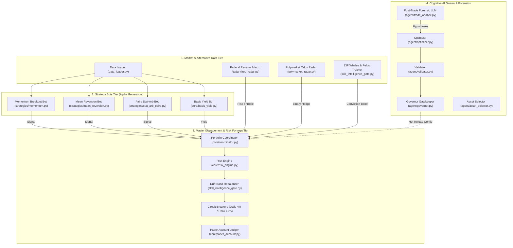
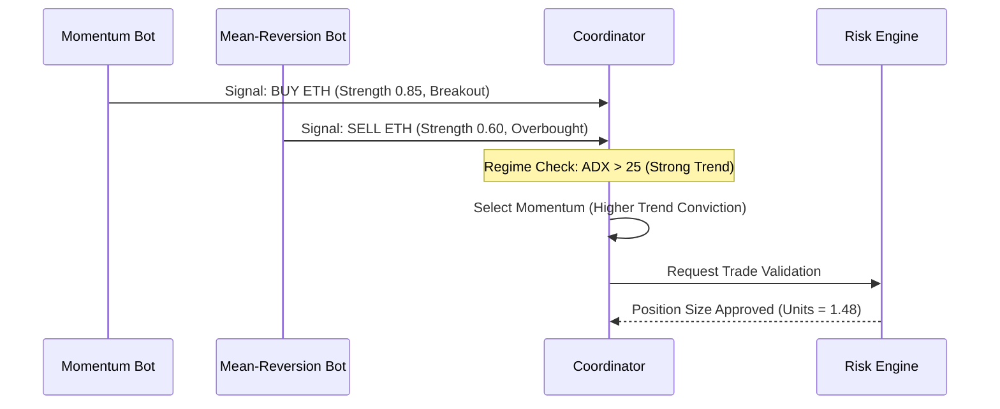
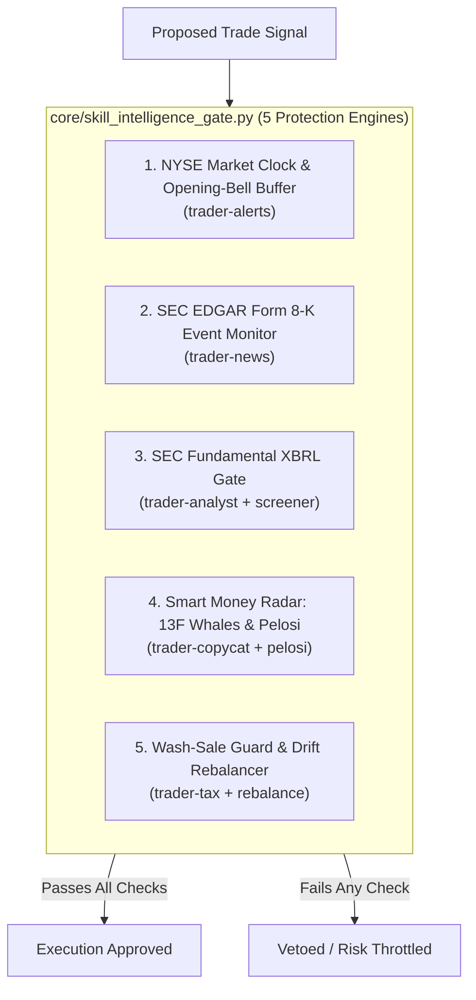
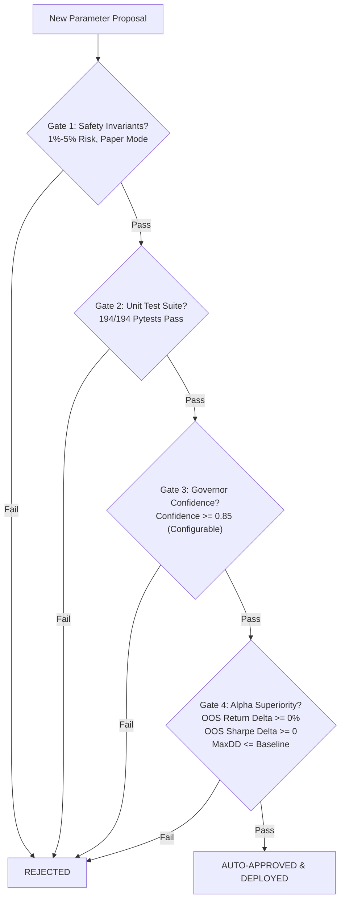
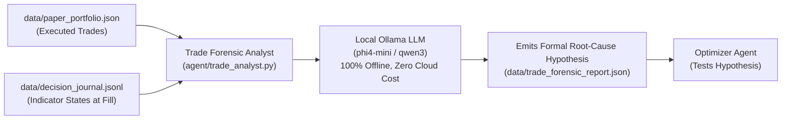

# Web4 Trading Agent: Detailed System Architecture & Granular Walkthrough

This document provides a granular, component-by-component walkthrough of the **Web4 Autonomous Trading Agent**. It details every mathematical formula, execution rule, data flow, safety gate, and risk control implemented in the repository.

---

## Table of Contents
1. [Global Architecture Overview](#1-global-architecture-overview)
2. [The Live Heartbeat Loop (`live_paper_trader.py`)](#2-the-live-heartbeat-loop-live_paper_traderpy)
3. [The 4 Strategy Bots in Fine Detail](#3-the-4-strategy-bots-in-fine-detail)
   - [3.1 Donchian Momentum Breakout Bot](#31-donchian-momentum-breakout-bot)
   - [3.2 Bollinger / RSI Mean-Reversion Bot](#32-bollinger--rsi-mean-reversion-bot)
   - [3.3 Cointegrated Statistical Arbitrage Pairs Bot](#33-cointegrated-statistical-arbitrage-pairs-bot)
   - [3.4 Delta-Neutral Perpetual Basis Yield Bot](#34-delta-neutral-perpetual-basis-yield-bot)
4. [The Master Coordinator Engine (`core/coordinator.py`)](#4-the-master-coordinator-engine-corecoordinatorpy)
   - [4.1 Multi-Source Market Data Pipeline (`core/data_loader.py`)](#41-multi-source-market-data-pipeline-coredata_loaderpy)
5. [The Risk Fortress & Sizing Formulas (`core/risk_engine.py`)](#5-the-risk-fortress--sizing-formulas-corerisk_enginepy)
6. [The Virtual Ledger & Execution Drag (`core/paper_account.py`)](#6-the-virtual-ledger--execution-drag-corepaper_accountpy)
   - [6.1 Pre-Flight Execution Safety Guards (`core/preflight.py`)](#61-pre-flight-execution-safety-guards-corepreflightpy)
   - [6.2 Decision Journal & 24h Settlement Engine (`core/journal.py`)](#62-decision-journal--24h-settlement-engine-corejournalpy)
7. [Alternative Intelligence Radar & Regulatory Hygiene (`core/skill_intelligence_gate.py`)](#7-alternative-intelligence-radar--regulatory-hygiene-coreskill_intelligence_gatepy)
   - [7.1 NYSE Market Clock & Opening-Bell Buffer](#71-nyse-market-clock-holiday-calendar--opening-bell-buffer-nysemarketclock)
   - [7.2 SEC EDGAR 8-K Real-Time Filing Veto](#72-sec-edgar-8-k-real-time-filing-veto-secedgar8kmonitor)
   - [7.3 SEC Fundamental XBRL Quality Filter](#73-sec-fundamental-xbrl-quality-filter-secfundamentalgate)
   - [7.4 Smart Money Radar: 13F Whales & Pelosi](#74-smart-money-radar-13f-institutional-whales--congressional-stock-act-smartmoneyradar)
   - [7.5 Tax Hygiene, Loss-Streak Locks & Drift Rebalancing](#75-tax-hygiene-loss-streak-locks--drift-rebalancing)
8. [The Autonomous AI Layer & 4-Gate Auto-Approval (`agent/`)](#8-the-autonomous-ai-layer--4-gate-auto-approval-agent)
   - [8.1 In-Sample Strategy Optimizer (`agent/optimizer.py`)](#81-in-sample-strategy-optimizer-agentoptimizerpy)
   - [8.2 Out-of-Sample Walk-Forward Validator (`agent/validator.py`)](#82-out-of-sample-walk-forward-validator-agentvalidatorpy)
   - [8.3 Constitutional Governor & Hot-Reload Gatekeeper (`agent/governor.py`)](#83-constitutional-governor--hot-reload-gatekeeper-agentgovernorpy)
   - [8.4 Autonomous Asset Universe Screener & Toxic Drag Pruning (`agent/asset_selector.py`)](#84-autonomous-asset-universe-screener--toxic-drag-pruning-agentasset_selectorpy)
9. [Macro & Decentralized Prediction Radars (`core/fred_radar.py` & `core/polymarket_radar.py`)](#9-macro--decentralized-prediction-radars-corefred_radarpy--corepolymarket_radarpy)
10. [Institutional Stress Testing & Backtest Simulation (`core/institutional_stress_tester.py` & `core/backtest_engine.py`)](#10-institutional-stress-testing--backtest-simulation-coreinstitutional_stress_testerpy--corebacktest_enginepy)
   - [10.1 Deflated Sharpe Ratio & Probabilistic Sharpe Ratio](#101-deflated-sharpe-ratio-dsr--probabilistic-sharpe-ratio-psr)
   - [10.2 Ulcer Index & Underwater Duration](#102-ulcer-index--underwater-duration)
   - [10.3 Break-Even Friction Sweep](#103-break-even-friction-sweep-1x-to-5x-stress-test)
   - [10.4 Event-Driven Backtesting & Simulation Engine (`core/backtest_engine.py`)](#104-event-driven-backtesting--simulation-engine-corebacktest_enginepy)
11. [Post-Trade Forensic Analyst & Local LLM Cognition (`agent/trade_analyst.py`)](#11-post-trade-forensic-analyst--local-llm-cognition-agenttrade_analystpy)
   - [11.1 Granular Forensic Capabilities](#111-granular-forensic-capabilities)
   - [11.2 Why Microsoft phi4-mini Was Chosen](#112-why-microsoft-phi4-mini-was-chosen)
   - [11.3 Why We Do Not Fine-Tune the LLM](#113-why-we-do-not-fine-tune-the-llm)
12. [Real-Time Terminal Monitoring Dashboard (`dashboard.py`)](#12-real-time-terminal-monitoring-dashboard-dashboardpy)
13. [Repository File Map](#13-repository-file-map)

---

## 1. Global Architecture Overview

The system operates across **four primary operational tiers**:



---

## 2. The Live Heartbeat Loop (`live_paper_trader.py`)

The file [`live_paper_trader.py`](live_paper_trader.py) is the master executable that runs continuously in background memory.

### Granular Execution Steps (Every 60 Seconds):
1. **PID Process Locking (`core/process_lock.py`)**:
   * Uses Linux `fcntl.flock` on `data/live_trader.pid`.
   * **Purpose**: Prevents two instances of the bot from running at the same time and corrupting `paper_portfolio.json`.
2. **Dynamic Config Hot-Reloading**:
   * Computes the SHA-256 hash of [`config/active_config.json`](config/active_config.json).
   * If the file was updated (by the user or by an approved AI proposal), the Coordinator immediately reloads the parameters into memory **without restarting the process**.
3. **Market Data Fetching**:
   * Pulls the last 100 hourly candles for all configured symbols (`BTC/USDT`, `ETH/USDT`, `SOL/USDT`, `SPY`, etc.).
   * Checks staleness: If the most recent candle timestamp is older than `max_stale_minutes` (default 180 min), the asset is skipped to prevent trading on dead data.
4. **Tick Execution (`run_portfolio_tick`)**:
   * Sends market data to [`core/coordinator.py`](core/coordinator.py) and processes all trade signals, stop-loss movements, and basis yield distributions.

---

## 3. The 4 Strategy Bots in Fine Detail

### 3.1 Donchian Momentum Breakout Bot
* **File**: [`strategies/momentum.py`](strategies/momentum.py)
* **Strategy Type**: Directional Trend-Following.
* **Underlying Indicators**:
  * **Donchian High/Low (24 periods)**: $H_{24} = \max(\text{High}_{t-24 \dots t-1})$, $L_{24} = \min(\text{Low}_{t-24 \dots t-1})$.
  * **Trend Filter**: 50-period Exponential Moving Average ($\text{EMA}_{50}$).
  * **Trend Strength**: 14-period Average Directional Index ($\text{ADX}_{14}$).
  * **Volatility Measure**: 14-period Average True Range ($\text{ATR}_{14}$).
* **Granular Entry Rules**:
  * **LONG Entry**: Triggered when $\text{Close} > H_{24}$ **AND** $\text{Close} > \text{EMA}_{50}$ **AND** $\text{ADX} \ge 20$.
  * **SHORT Entry**: Triggered when $\text{Close} < L_{24}$ **AND** $\text{Close} < \text{EMA}_{50}$ **AND** $\text{ADX} \ge 20$ (only if `allow_short: true`).
* **Granular Exit Rules**:
  * Uses a dynamic **ATR Trailing Stop**:
    $$\text{Trailing Stop} = \text{Highest High Since Entry} - (3.0 \times \text{ATR})$$
  * As price climbs, the stop-loss ratchets upward bar-by-bar. It never loosens downward.

---

### 3.2 Bollinger / RSI Mean-Reversion Bot
* **File**: [`strategies/mean_reversion.py`](strategies/mean_reversion.py)
* **Strategy Type**: Counter-trend Swing Trader.
* **Underlying Indicators**:
  * **Bollinger Bands (20 periods, 2.0 std dev)**:
    $$\text{SMA}_{20} = \frac{1}{20} \sum_{i=0}^{19} \text{Close}_{t-i}, \quad \text{Upper} = \text{SMA}_{20} + 2\sigma, \quad \text{Lower} = \text{SMA}_{20} - 2\sigma$$
  * **Relative Strength Index ($\text{RSI}_{14}$)**.
* **Granular Entry Rules**:
  * **LONG Entry**: Triggered when $\text{Close} \le \text{Lower Band}$ **AND** $\text{RSI} < 30$ (Oversold extreme).
  * **SHORT Entry**: Triggered when $\text{Close} \ge \text{Upper Band}$ **AND** $\text{RSI} > 70$ (Overbought extreme).
* **The 50% Scale-Out Profit Rule**:
  * Target line: The middle $\text{SMA}_{20}$.
  * When price travels **50% of the distance** to the SMA, the bot **sells half (50%) of the position** to bank cash.
  * It immediately moves the stop-loss on the remaining 50% to **breakeven** ($\text{Entry Price}$). The trade is now mathematically risk-free.
  * The final 50% exits when the price hits the full $\text{SMA}_{20}$ target.

---

### 3.3 Cointegrated Statistical Arbitrage Pairs Bot
* **File**: [`strategies/stat_arb_pairs.py`](strategies/stat_arb_pairs.py)
* **Strategy Type**: Market-Neutral Relative Value.
* **Mechanism**:
  1. Identifies pairs of assets that share an economic link (e.g. `BTC/USDT` vs `ETH/USDT`, or `SPY` vs `QQQ`).
  2. Runs an **Engle-Granger Cointegration Test**. If $p$-value $< 0.05$, the spread is mathematically stationary.
  3. Calculates the Hedge Ratio $\beta$ via Ordinary Least Squares (OLS) regression:
     $$\text{Spread}_t = P_{A,t} - \beta P_{B,t}$$
  4. Computes the rolling normalized **Z-Score**:
     $$Z_t = \frac{\text{Spread}_t - \mu_{\text{spread}}}{\sigma_{\text{spread}}}$$
* **Granular Entry & Exit**:
  * If $Z_t \ge +2.0$: Asset A is overpriced, Asset B is underpriced. **Short A, Buy B**.
  * If $Z_t \le -2.0$: Asset A is underpriced, Asset B is overpriced. **Buy A, Short B**.
  * Exit: When $|Z_t| \le 0.20$ (spread mean-reverts back to normal).

---

### 3.4 Delta-Neutral Perpetual Basis Yield Bot
* **File**: [`core/basis_yield.py`](core/basis_yield.py)
* **Strategy Type**: Delta-Neutral Cash-and-Carry / Funding Arbitrage.
* **Underlying Principle**:
  * Perpetual futures traders pay a funding fee every 8 hours.
  * If the rate is positive (Longs pay Shorts), we buy the Spot crypto and Short the Perpetual contract.
  * **Net Market Exposure ($\Delta$) = 0.0**. Price pumps or crashes do not affect account balance.
* **Granular Math**:
  $$\text{Annualized APR} = \text{Rate}_{8h} \times 3 \times 365 \times 100$$
  $$\text{8h Cash Payout} = \text{Notional Allocated} \times \text{Rate}_{8h}$$
* **Execution Rules**:
  * Minimum APR Hurdle: [`basis_hurdle_apr = 8.0%`](config/active_config.json).
  * Automatically records a verified audit record in `closed_trades` every 8 hours (Trades 31–39).

---

## 4. The Master Coordinator Engine (`core/coordinator.py`)

The **Portfolio Coordinator** is the central brain that arbitrates conflicting advice from different bots:



### Conflict Resolution Matrix:
* **Opposite Signals on Same Asset**:
  * Evaluates the market regime via `ADX`. If `ADX > 25` (trending), the trend bot wins. If `ADX < 20` (ranging), the mean-reversion bot wins.
  * If signal strengths are close, the Coordinator blocks both trades to preserve capital.
* **Portfolio Concentration Check**:
  * Prevents total crypto exposure from exceeding configured portfolio risk limits (default 80% maximum).

### 4.1 Multi-Source Market Data Pipeline (`core/data_loader.py`)
To ensure reliable inputs across both cryptocurrency and equity desks, [`core/data_loader.py`](core/data_loader.py) orchestrates market ingestion, data sanitation, and high-performance local caching:
* **Dual-Market Ingestion**:
  * **Crypto Pairs**: Direct public CCXT ingestion (Binance Spot & Perpetual Futures) normalizing symbols (`BTC/USDT`, `ETH/USDT`, `SOL/USDT`).
  * **Traditional Equities**: Historical and intraday candle feeds via `yfinance` (`SPY`, `QQQ`, `AAPL`, `NVDA`, `MCHP`, `XLE`, etc.).
* **Data Quality & Hygiene Audit (`check_data_quality`)**:
  * Rejects dataframes containing `NaN` / infinite values in OHLCV columns.
  * Detects zero-volume flatline anomalies and discontinuous time gaps.
  * Enforces monotonic ascending timestamp ordering so indicators never suffer lookahead leakage.
* **Local Disk Caching (`data/`)**:
  * Caches historical OHLCV data to parquet/csv files to eliminate network bottlenecks and exchange API rate-limit bans during high-frequency scans.
* **Staleness Blackout**:
  * Computes $\Delta t = \text{Current Time} - \text{Latest Bar Timestamp}$. If $\Delta t > \text{max\_stale\_minutes}$ (default 180m), the asset is quarantined from trade generation.

---

## 5. The Risk Fortress & Sizing Formulas (`core/risk_engine.py`)

No trade is ever placed without passing through the mathematical constraints in [`core/risk_engine.py`](core/risk_engine.py):

### 5.1 Position Sizing Formula
$$\text{Dollar Risk} = \text{Account Equity} \times \text{Risk Percent}$$
$$\text{Stop Distance} = |\text{Entry Price} - \text{Stop Loss Price}|$$
$$\text{Position Units} = \frac{\text{Dollar Risk}}{\text{Stop Distance}}$$

* **Hard-Coded Invariant**: $\text{Risk Percent}$ is strictly clamped between **$1.0\%$ minimum and $5.0\%$ maximum** of total equity.
* If a coin is highly volatile ($\text{ATR}$ is large), the stop distance is wide, which automatically forces the unit size down.

### 5.2 Volume Surge & Smart Money Sizing Multipliers
* **Volume Surge Multiplier**: If current candle volume is $\ge 1.5\times$ the 20-period average volume, the position size is boosted by **$1.2\times$** (rewarding high-liquidity institutional participation).
* Even with boosts, the final risk is hard-capped at $\le 5.0\%$.

### 5.3 Autonomous Circuit Breakers
1. **Daily Drawdown Breaker ($4.0\%$)**:
   * If equity loses $\ge 4.0\%$ in any rolling 24-hour window, all new trade entries are locked out until the next calendar day.
2. **Trailing Peak Drawdown Breaker ($12.0\%$)**:
   * Tracks `peak_equity` historically.
   * If $\frac{\text{peak} - \text{current}}{\text{peak}} \ge 0.12$, the engine trips the emergency breaker, cancels all pending orders, and preserves cash.

---

## 6. The Virtual Ledger & Execution Drag (`core/paper_account.py`)

To ensure paper-trading numbers reflect real-world execution, [`core/paper_account.py`](core/paper_account.py) enforces full execution friction:

* **Taker Exchange Fees**: $0.06\%$ ($6\text{ basis points}$) deducted on both Entry and Exit.
* **Market Slippage**: $0.04\%$ ($4\text{ basis points}$) adverse price movement applied against every fill.
* **Concurrency Protection**: Uses file locks to ensure that data in [`data/paper_portfolio.json`](data/paper_portfolio.json) is atomic and crash-resistant.

### 6.1 Pre-Flight Execution Safety Guards (`core/preflight.py`)
Before any proposed order is routed from the Coordinator to the Virtual Ledger, it must pass 5 execution safety guards orchestrated by `PreFlightGuard`:
1. **Bid-Ask Spread Slippage Guard**:
   * Evaluates relative market spread: $\text{Spread} = \frac{P_{\text{ask}} - P_{\text{bid}}}{P_{\text{mid}}}$.
   * If $\text{Spread} > \text{max\_allowed\_spread}$ (e.g. $0.35\%$), the order is rejected to prevent excessive execution drag.
2. **Tick Staleness Guard**:
   * Verifies price quote freshness. If the quote timestamp is older than allowable tolerance, execution is halted.
3. **Liquidity Depth & 5% Volume Participation Guard**:
   * Rejects orders that exceed $5.0\%$ of the asset's rolling 24-hour volume, ensuring the strategy never over-participates in thin liquidity.
4. **Cash Buffer & Minimum Notional Guard**:
   * Enforces exchange minimum order sizes ($\ge \$10.00$) and preserves a hard-coded $10\%$ cash buffer so account equity is never fully illiquid.
5. **Local LLM Devil's Advocate News Screener (`LocalLLMScreener`)**:
   * Fetches the 3 most recent headlines via public Google News RSS for the target asset.
   * Dispatches an out-of-band query to local Ollama (`phi4-mini:latest`) with a 6-second timeout: *"Does this news indicate catastrophic bankruptcy, SEC regulatory fraud, or protocol hack?"*
   * If the LLM returns a veto verdict, the entry is aborted before capital is risked.

### 6.2 Decision Journal & 24h Settlement Engine (`core/journal.py`)
To ensure continuous empirical accountability, [`core/journal.py`](core/journal.py) tracks every decision and audits risk efficacy:
* **Append-Only Decision Logging**:
   * Logs every tick decision (`APPROVED`, `BLOCKED_BY_RISK`, `BLOCKED_BY_PREFLIGHT`, `NO_SIGNAL`) along with complete indicator states and market context directly to [`data/decision_journal.jsonl`](data/decision_journal.jsonl).
* **24-Hour Settlement Math & Benchmark Alpha**:
   * Re-evaluates each logged entry once 24 hours have elapsed:
     $$\text{Forward Return} = \frac{P_{t+24\text{h}} - P_t}{P_t}$$
     $$\text{Alpha vs Benchmark} = \text{Forward Return} - \text{Benchmark Return}_{t+24\text{h}}$$
     *(Benchmark is `SPY` for equities, `BTC/USDT` for cryptocurrency).*
* **2-Sentence Local LLM Cognitive Post-Mortem**:
   * Calls `phi4-mini` to synthesize a concise, two-sentence qualitative reflection on settled outcomes, storing the insight alongside quantitative metrics.
* **Empirical Risk Gate Attribution**:
   * Mathematically proves whether risk gates prevented losses by calculating the forward return of trades that were blocked compared to those approved.

---

## 7. Alternative Intelligence Radar & Regulatory Hygiene (`core/skill_intelligence_gate.py`)

This engine serves as the institutional guardian connecting the bot's price-action algorithms to real-world market regulations, corporate disclosures, and elite fund flows across 5 distinct protective engines:



### 7.1 NYSE Market Clock, Holiday Calendar & Opening-Bell Buffer (`NyseMarketClock`)
* **Session Hours & DST Math**: Tracks exact New York Eastern Time, automatic Daylight Saving transitions (-4 EDT / -5 EST), 2026–2027 NYSE holidays, and 1:00 PM early close days (day after Thanksgiving, Christmas Eve).
* **Opening-Bell 15-Minute Gap Whipsaw Buffer**: Blocks stock entries during the volatile first 15 minutes of trading (**9:30 AM – 9:45 AM ET**). This prevents the bot from buying false morning gaps that reverse abruptly once retail liquidity settles.

### 7.2 SEC EDGAR 8-K Real-Time Filing Veto (`SecEdgar8KMonitor`)
Directly polls the real-time SEC EDGAR Atom feed to detect critical corporate emergencies before a chart can reflect them:
* **Item 1.03**: Bankruptcy or receivership.
* **Item 1.05**: Material cybersecurity incident/breach.
* **Item 4.02**: Past financials no longer reliable (accounting restatement/fraud).
* **Item 5.02**: Abrupt departure of CEO, CFO, or directors.
* **Action**: Instantly vetoes any pending or active BUY signals on the affected ticker.

### 7.3 SEC Fundamental XBRL Quality Filter (`SecFundamentalGate`)
* Parses raw XBRL financial statements from 10-Q and 10-K filings:
  * YoY Revenue Growth (`revenue_growth_yoy`).
  * Operating Margins (`operating_margin`).
  * Diluted EPS & P/E Ratios.
* **Hype Filter**: Disqualifies cash-bleeding, unprofitable companies from entering the long portfolio, preventing "pump-and-dump" traps.

### 7.4 Smart Money Radar: 13F Institutional Whales & Congressional STOCK Act (`SmartMoneyRadar`)
* **Form 13F Whale Accumulation**: Scrapes quarterly SEC 13F-HR filings from elite multi-billion-dollar fund managers (Warren Buffett / Berkshire, Ray Dalio / Bridgewater, Bill Ackman / Pershing Square, Jim Simons / Renaissance Technologies, Stanley Druckenmiller / Duquesne, David Tepper / Appaloosa).
* **House Clerk STOCK Act PTR Disclosures**: Tracks Nancy Pelosi and congressional insider trades.
* **Conviction Scaling**: When technical breakout signals coincide with net institutional accumulation, position sizing is boosted by up to $1.2\times$ (clamped strictly within the 1%–5% risk ceiling).

### 7.5 Tax Hygiene, Loss-Streak Locks & Drift Rebalancing
* **IRS 30-Day Wash-Sale Compliance**: Tracks dual share-class families (e.g. `GOOG` vs `GOOGL`, `BRK.A` vs `BRK.B`). If a lot was liquidated at a tax loss within the last 30 days, the engine flags wash-sale conflicts and prevents buying the sister share class.
* **Loss-Streak Circuit Lock**: If any individual stock or coin suffers **2 consecutive stop-loss hits**, it is locked out for 24 hours to prevent burning capital in erratic price action.
* **Drift-Band Portfolio Rebalancer**: If an asset's position weight drifts $> 5\%$ above its assigned target allocation, it automatically executes a `REBALANCE_TRIM` to lock in profit and re-center account capital.

---

## 8. The Autonomous AI Layer & 4-Gate Auto-Approval (`agent/`)

The repository includes a cognitive agent harness that autonomously tunes strategy parameters and removes unprofitable assets.



### Gate 4 Breakdown (The "Do No Harm" Guarantee):
* **OOS Return Delta $\ge 0.0\%$**: The new strategy must perform equal to or better than the current baseline on unseen Out-of-Sample validation data.
* **OOS Sharpe Delta $\ge 0.0$**: The risk-adjusted return (smoothness of the equity curve) cannot degrade.
* **OOS Max Drawdown $\le \text{Baseline} + 0.5\%$**: The new strategy cannot expose the account to deeper crash drawdowns.
* **Multi-Window Walk-Forward Verification**: If any single test window produces negative returns, the proposal is rejected as curve-fitted.

### 8.1 In-Sample Strategy Optimizer (`agent/optimizer.py`)
* **Role**: Exploration engine for technical parameters (Agent 10).
* **Search Space**: Sweeps indicator lookbacks (e.g. Donchian channels 16–32, ATR multipliers 2.0–3.5, RSI bands 20–35) strictly on the in-sample (70%) training split.
* **Objective Function**: Maximizes Profit Factor and Calmar Ratio while ensuring trade frequency meets statistical minimums ($N \ge 20$). Emits structured candidate proposals formatted for Gatekeeper review.

### 8.2 Out-of-Sample Walk-Forward Validator (`agent/validator.py`)
* **Role**: Anti-overfitting referee (Agent 11).
* **Multi-Window Walk-Forward Protocol**: Evaluates candidate parameters strictly on unseen 30% out-of-sample data across multiple rolling time slices.
* **Verification Logic**: Compares candidate backtests against baseline backtests using identical fee ($0.06\%$) and slippage ($0.04\%$) friction. Emits an immutable `ValidationReport` approving or vetoing candidate promotion based on Gate 4 rules.

### 8.3 Constitutional Governor & Hot-Reload Gatekeeper (`agent/governor.py`)
* **Role**: Autonomous executive and safety gatekeeper.
* **Invariant Enforcer**: Audits all proposals against the immutable risk bounds ($1.0\% \le \text{risk} \le 5.0\%$, paper-trading mode).
* **Automated Test Harness**: Executes all 194 regression tests via subprocess `pytest`. If even one test fails, the proposal is rejected immediately.
* **Cryptographic Deployment**: Upon clearing all 4 gates, the Governor computes the SHA-256 hash of the configuration, merges the changes into [`config/active_config.json`](config/active_config.json), appends the audit trail to `governance_audit.jsonl`, and Git-commits the verified patch.

### 8.4 Autonomous Asset Universe Screener & Toxic Drag Pruning (`agent/asset_selector.py`)
* **Role**: Dynamic portfolio universe optimizer (Agent 9).
* **Dynamic Discovery**: Scans Binance spot/perps volume rankings and Yahoo Finance equity screeners in real time without static asset lists.
* **Composite Alpha Score (CAS)**:
  $$\text{CAS} = (\text{Sharpe} \times 0.40) + (\text{Profit Factor} \times 0.30) + (\text{Win Rate} \times 0.30) - (\text{Drawdown Penalty})$$
* **Toxic Drag Elimination**: Automatically identifies assets with persistent negative alpha or excessive drawdown, removing them from the active watchlist to protect total portfolio return.
* **Blacklist Rehabilitation Audit**: Periodically re-evaluates blacklisted assets over the past 60 days using the Web4 Dynamic Rolling Router directional criteria (`profit_factor >= dynamic_router_min_pf`, ranked by Sharpe ratio, with Basis Yield intentionally excluded so ~100%-WR carry ticks do not mask directional quality) to reinstate passing assets via Governor.

---

## 9. Macro & Decentralized Prediction Radars (`core/fred_radar.py` & `core/polymarket_radar.py`)

To prevent the trading bot from blindly entering technical breakout trades right before a macroeconomic catastrophe or Fed interest rate shock, the system monitors macro regime indicators:

### 9.1 FRED Macro Regime Radar ([`core/fred_radar.py`](core/fred_radar.py))
* **CBOE VIX Volatility Index**: Gauges market-wide panic.
  * If $\text{VIX} \ge 30.0$: Activates **`CRASH_DEFENSE`** regime. Disables breakout longs and cuts position risk by $50\%$ (`risk_scale_factor = 0.50`).
  * If $\text{VIX} \in [22.0, 30.0)$: Activates **`VOLATILITY_EXPANSION`** regime with caution sizing.
* **High-Yield OAS Credit Spreads**: Measures junk bond default risk and liquidity contraction. Spreads $> 500\text{ bps}$ force defensive cash preservation.
* **10Y-2Y Treasury Yield Spread**: Monitors yield curve inversion and steepening regimes.

### 9.2 Polymarket Decentralized Prediction Radar ([`core/polymarket_radar.py`](core/polymarket_radar.py))
* Uses the public Polymarket Gamma API (zero API keys required) to read crowd-priced implied probabilities for binary macro events:
  * **Fed Interest Rate Decision Odds**: Flags impending FOMC rate decisions to throttle risk 2 hours prior to rate announcements.
  * **U.S. Recession Probabilities**: Detects spike in event-driven tail risks.

---

## 10. Institutional Stress Testing & Backtest Simulation (`core/institutional_stress_tester.py` & `core/backtest_engine.py`)

Traditional backtests rely solely on the Sharpe Ratio, which can be fooled by strategies that collect small gains and occasionally suffer massive "black swan" crashes. We implement institutional hedge-fund stress testing formulas:

### 10.1 Deflated Sharpe Ratio (DSR) & Probabilistic Sharpe Ratio (PSR)
Formulated by Marcos López de Prado (*Advances in Financial Machine Learning*):
* **Probabilistic Sharpe Ratio (PSR)**: Adjusts the Sharpe Ratio for non-normal return distributions (skewness and fat-tailed kurtosis).
* **Deflated Sharpe Ratio (DSR)**: Mathematically discounts the Sharpe Ratio for the number of backtest trials ($N$) evaluated. It computes the statistical probability that the strategy is genuinely profitable rather than a statistical fluke resulting from testing 50 different parameter variations.

### 10.2 Ulcer Index & Underwater Duration
* **Ulcer Index**: Measures both the **depth** and the **duration** of drawdowns. While Sharpe penalizes upside volatility, the Ulcer Index strictly measures real portfolio pain.
* **Max Underwater Duration**: Measures how many hours or days the strategy took to recover back to a new all-time high after a loss.

### 10.3 Break-Even Friction Sweep (1x to 5x Stress Test)
* Runs stress tests where exchange fees and slippage are artificially multiplied by $2\times, 3\times, 4\times$, and $5\times$.
* **Margin of Safety**: A strategy must survive at least $2.5\times$ normal fees and slippage before it is deemed safe for production.

### 10.4 Event-Driven Backtesting & Simulation Engine (`core/backtest_engine.py`)
To validate strategies before deployment, [`core/backtest_engine.py`](core/backtest_engine.py) provides a high-fidelity event-driven simulation loop:
* **Lookahead-Free Execution Simulation**: Iterates bar-by-bar across historical candles, updating active position state, dynamic trailing ATR stops, and scale-out triggers strictly on finalized candle closes.
* **Realistic Execution Frictions**: Automatically applies $0.06\%$ taker fees and $0.04\%$ adverse market slippage to every entry and exit fill.
* **Dynamic Timeframe Annualization (`_estimate_bars_per_year`)**: Incurs no hardcoded annualization assumptions; dynamically inspects median bar spacing from datetime indices to accurately annualize Sharpe, Sortino, and Calmar ratios for hourly crypto (8,760 bars/yr) or daily equities (252 bars/yr).
* **Full Shifted 90-Day OOS Harness (`research/run_shifted_oos_validation.py`)**: Executes continuous walk-forward verification across 90-day out-of-sample regimes across all active symbols, generating standardized validation reports in `reports/oos_validation_report.json`.

---

## 11. Post-Trade Forensic Analyst & Local LLM Cognition (`agent/trade_analyst.py`)

The Web4 platform includes an autonomous post-mortem diagnostic engine that reviews real executed trades to determine *why* losses occurred and propose corrective hypotheses:



### 11.1 Granular Forensic Capabilities
1. **Payoff & Expectancy Statistics**:
   * Evaluates the **Payoff Ratio** ($\frac{\text{Average Win \$}}{\text{Average Loss \$}}$) and **Win Rate**.
2. **Loss Attribution**:
   * Categorizes whether losses were caused by **Trend Exhaustion**, **Whipsaw Chop**, **Bad Entry Timing**, or **Macro Volatility**.
3. **Local LLM Cognitive Reasoning**:
   * Uses a locally hosted model via Ollama ([`agent/llm_client.py`](agent/llm_client.py)) with zero API keys and zero cost.
   * Prompts the local LLM with the exact indicators, entry/exit prices, and market context at the moment of the loss, instructing it to synthesize a formal mathematical tuning proposal for the Optimizer.

### 11.2 Why Microsoft phi4-mini Was Chosen (Model Selection Rationale)
The system uses **`phi4-mini:latest`** (3.8B parameters) by Microsoft as its default engine over other free models for four specific architectural reasons:
1. **High Math & STEM Reasoning Density**: Unlike models trained on generic internet scrapings (Reddit/blogs), Microsoft's Phi models are trained on curated synthetic math, STEM textbooks, and Python algorithms. It punches far above its weight class in quantitative reasoning.
2. **The 3.8B Sweet Spot (Resource Isolation)**: Larger 8B–14B models (e.g. Llama-3-8B, Gemma-2-9B) consume 6 to 10 GB of VRAM, competing with pandas dataframes, websocket polling, and backtesting simulations. `phi4-mini` takes only **~2.5 GB**, leaving 80%+ of system RAM/VRAM free for the trading engine.
3. **Sub-Second Low Latency (< 800ms)**: Live trading checks occur on 60-second cycles. Deep reasoning models (like `deepseek-r1`) produce 1,000+ internal "Chain of Thought" tokens, taking 20–40 seconds per query. `phi4-mini` responds in under 800ms, never freezing the tick loop.
4. **Strict JSON Schema Compliance**: Agent 10 enforces an 11-field JSON proposal schema. Math-olympiad models (e.g. WizardMath) often output LaTeX equations rather than valid Python dictionary keys, breaking automated code parsers. `phi4-mini` adheres strictly to raw JSON output without conversational chatter.
5. **Model-Agnostic Flexibility**: The client in [`agent/llm_client.py`](agent/llm_client.py) is completely plug-and-play. If a user prefers another model (e.g. `qwen3:8b`, `gemma2:9b`), it can be swapped with a single CLI argument (`--model`) without rewriting code.

### 11.3 Why We Do Not Fine-Tune the LLM (Architectural Rationale)
In institutional quantitative trading, fine-tuning an LLM on price history is considered an anti-pattern. We intentionally do not fine-tune for four core reasons:
1. **Python Handles Math Deterministically**: LLMs are notoriously poor at mental arithmetic (computing exponential moving averages, standard deviations, or square roots). All indicator math is computed deterministically in pure Python; the LLM is strictly used for qualitative diagnostic reasoning.
2. **Live In-Context Injection Beats Stale Weights (Open-Book vs. Memorization)**: Markets are non-stationary and regime-shift constantly. Fine-tuning bakes static historical data into permanent weights. Instead, our system injects fresh, real-time telemetry (the exact entry price, exit price, ADX, and regime of the last trade) directly into the prompt. The LLM has the exact facts in front of it with zero memory decay.
3. **Preventing Catastrophic Forgetting**: Fine-tuning small models often causes "catastrophic forgetting," degrading their foundational reasoning abilities and increasing hallucination rates. Using base `phi4-mini` preserves Microsoft's pristine logic and instruction-following integrity.
4. **Instant Zero-Cost Model Upgrades**: If Microsoft, Meta, or Google releases a faster, smarter open-source model tomorrow, we can upgrade in 5 seconds by pulling the new model into Ollama, without spending weeks collecting training data or renting expensive fine-tuning GPUs.

---

## 12. Real-Time Terminal Monitoring Dashboard (`dashboard.py`)

For live institutional monitoring without heavy GUI or web frameworks, [`dashboard.py`](dashboard.py) provides a high-performance, curses-style ANSI terminal dashboard:

* **Zero-Impact Read-Only Architecture**: Operates exclusively in read-only mode using non-blocking checks against `data/live_trader.lock`. It can be run in multiple terminal splits simultaneously (`python dashboard.py --interval 2` or `--once`) without ever risking data corruption on [`data/paper_portfolio.json`](data/paper_portfolio.json).
* **Live System Metrics**:
  * **Daemon Status & PID**: Visual confirmation of whether `live_paper_trader.py` is actively ticking or halted.
  * **Portfolio Accounting**: Real-time display of Starting Capital, Current Cash, Total Equity, Realized P&L, and Active Drawdown from peak.
  * **Open Positions Matrix**: Displays open symbol, side, filled units, entry price, live market mark, unrealized P&L ($ and %), current trailing stop price, and trailing stop distance.
  * **Continuous Scanner Feed**: Live stream showing the last evaluated price, regime verdict, and signal decision across all watched assets.

---

## 13. Repository File Map

```text
web4-trading-agent/
├── live_paper_trader.py       # Live daemon heartbeat loop (every 60s)
├── dashboard.py               # Real-time ANSI curses-style terminal monitor
├── config/
│   └── active_config.json     # Live parameters, active symbols & risk toggles
├── core/
│   ├── coordinator.py         # Multi-strategy conflict arbiter & execution orchestrator
│   ├── risk_engine.py         # 1%-5% equity sizing & circuit breakers
│   ├── paper_account.py       # Simulated ledger, fills, fees & slippage
│   ├── preflight.py           # 5 execution safety guards & LLM devil's advocate screener
│   ├── journal.py             # Decision telemetry logging & 24h settlement engine
│   ├── backtest_engine.py     # Event-driven backtesting engine with fees & slippage
│   ├── basis_yield.py         # Delta-neutral funding rate carry harvest engine
│   ├── data_loader.py         # Real-time & historical crypto/equity candle fetcher
│   ├── fred_radar.py          # St. Louis Fed / VIX Macro Crash Defense Radar
│   ├── polymarket_radar.py    # Polymarket decentralized prediction market odds radar
│   ├── institutional_stress_tester.py # DSR, PSR, Ulcer Index & friction stress sweeps
│   ├── skill_intelligence_gate.py # 13F whale radar, Pelosi tracker, drift rebalancer
│   └── process_lock.py        # PID flock concurrency protection
├── strategies/
│   ├── momentum.py            # Donchian channel breakout trend bot
│   ├── mean_reversion.py      # Bollinger / RSI oversold/overbought swing bot
│   ├── stat_arb_pairs.py      # Cointegrated statistical arbitrage pairs bot
│   ├── volatility_squeeze.py  # Bollinger-inside-Keltner squeeze breakout bot
│   ├── trend_pullback.py      # Confirmed-uptrend EMA20/RSI pullback bot
│   └── vwap_reversion.py      # Rolling VWAP fair-value reversion bot
├── agent/
│   ├── governor.py            # 4-Gate auto-approval constitutional gatekeeper
│   ├── optimizer.py           # In-sample parameter exploration engine
│   ├── validator.py           # Out-of-sample walk-forward verification engine
│   ├── asset_selector.py      # Dynamic universe discovery & toxic drag pruning engine
│   ├── trade_analyst.py       # Post-trade forensic diagnosis & root-cause analyst
│   └── llm_client.py          # Zero-dependency local Ollama (phi4-mini) LLM client
├── research/
│   └── run_shifted_oos_validation.py # 90-day shifted out-of-sample multi-strategy validation
├── data/
│   ├── paper_portfolio.json   # Live ledger state, cash balance & closed trades
│   ├── decision_journal.jsonl # Complete audit log of every tick decision
│   └── trade_forensic_report.json # AI forensic diagnosis on closed trades
├── reports/
│   └── oos_validation_report.json # Empirical 90-day out-of-sample backtest report
├── docs/
│   ├── SYSTEM_WALKTHROUGH.md  # THIS MASTER DETAILED GUIDE
│   └── web4-autonomous-levels.md # Web4 autonomy level specification
└── tests/                     # 194 automated regression tests (including 7 strategies, Correlation Guard, Web Dashboard & Audit Fixes)
```

> [!NOTE]
> For the exhaustive, granular directory detailing the role (**WHAT**), caller execution paths (**USED BY**), and architectural purpose (**WHY NEEDED**) for every single script, sub-report, presentation asset, and test suite across the repository, see the dedicated [Repository File Map & Component Directory](docs/REPOSITORY_FILE_MAP.md).
