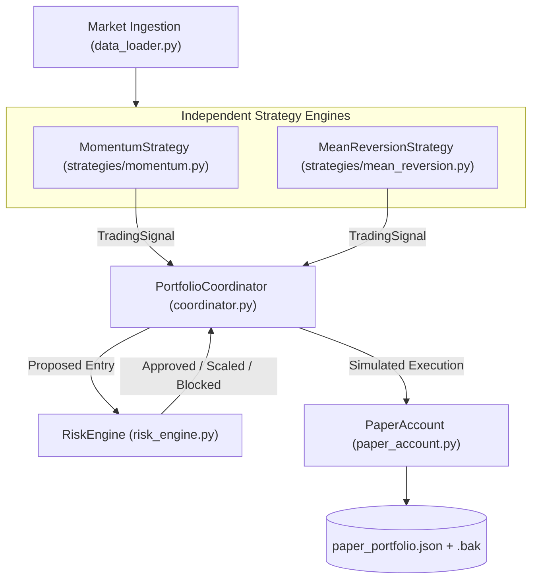

# Web4 Trading Agent — Architecture Specification

## 1. Overview & Principles
The Web4 Trading Agent is a modular, self-contained algorithmic trading system designed for multi-asset monitoring, automated self-improvement, and deterministic risk management.

## 2. Key Modules
For a deep specification of the agent's autonomous levels and mathematical models, see [The 3 Levels of Web4 Autonomy](web4-autonomous-levels.md).

- **`core/data_loader.py`**: Free data feeds from Binance (crypto via CCXT) and Yahoo Finance (stocks/ETFs via yfinance) with local CSV caching, timestamp monotonic verification, gap detection, and staleness validation.
- **`core/signals.py`**: Strongly typed `TradingSignal` dataclass establishing standard contracts between strategies and the portfolio coordinator.
- **`core/strategy.py`**: Technical indicators (Donchian, EMA, ATR, Bollinger, RSI, ADX) plus order flow liquidation absorption wicks and statistical regime scoring.
- **`strategies/momentum.py`**: Momentum and trend following breakout strategy with multi-timeframe confluence, macro bear gating, and ATR trailing stops.
- **`strategies/mean_reversion.py`**: Statistical reversion strategy with Bollinger Bands, strict bear shorting (`RSI > 75`), and ADX chop gates.
- **`strategies/stat_arb_pairs.py`**: Market-neutral statistical arbitrage pairs trading engine calculating rolling beta and spread Z-scores.
- **`core/coordinator.py`**: Central coordinator handling cross-strategy signal reconciliation, thesis conflict resolution, smart maker order routing, and chop risk throttling.
- **`core/risk_engine.py`**: Deterministic risk controls: Van Tharp R-risk position sizing (1%-5%), Half-Kelly growth sizing, Hierarchical Risk Parity (HRP) sector clustering, and emergency circuit breakers.
- **`core/paper_account.py`**: Atomic portfolio simulation ledger tracking cash, open multi-asset positions, fees, slippage, and closed trade histories with automatic `.bak` recovery.
- **`agent/optimizer.py` & `agent/validator.py`**: Autonomous parameter optimization arena with walk-forward out-of-sample safety gates.
