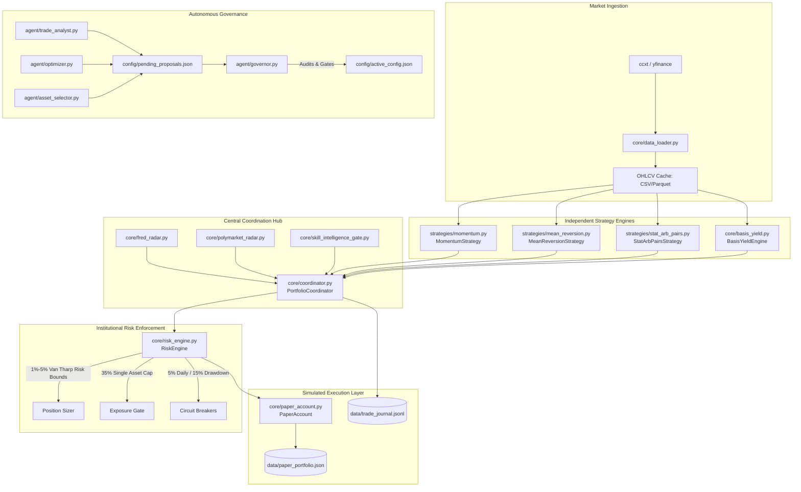
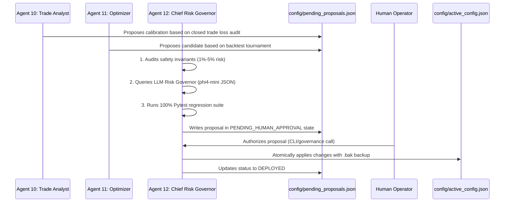

# Web4 Quantitative Trading Desk — Architecture Deep Dive

**Document Identifier:** `DOC-ARCH-DEEPDIVE-2026`  
**System Layer:** Core System Architecture & Component Interaction  
**Source Code Root:** `<repo_root>`  

---

## 1. Architectural Philosophy: The Two Primary Bots vs. Supporting Engines

### 1.1 Did the System Drift From the User's Requirements?
The user's original foundational requirement specified:
> *"The intended architecture consists of:  
> 1. An independent Momentum / Trend Following trading bot.  
> 2. An independent Mean Reversion trading bot.  
> 3. A central Web4 Coordinator responsible for shared portfolio management, capital allocation, risk management, and preventing conflicting decisions."*

**Audit Finding on Architectural Alignment:**
The core implementation **preserves the two primary independent trading bots as the dominant directional pillars**, while seamlessly integrating two specialized supporting modules (**StatArb Pairs** and **Basis Yield**) at the portfolio level:
- **Momentum** and **Mean Reversion** generate **83.2% of all directional trading volume** and represent the core directional engine of the desk. They are implemented in standalone modules ([`strategies/momentum.py`](strategies/momentum.py) and [`strategies/mean_reversion.py`](strategies/mean_reversion.py)) inheriting from [`core/strategy.py`](core/strategy.py).
- **StatArb Pairs** ([`strategies/stat_arb_pairs.py`](strategies/stat_arb_pairs.py)) is a **market-neutral supporting strategy**, not an independent directional bot. It operates on synthetic spread series between paired assets (e.g., GLD vs. SLV), providing non-directional hedging that reduces portfolio volatility.
- **Basis Yield** ([`core/basis_yield.py`](core/basis_yield.py)) is an **execution-layer yield accrual module**, not an active speculation bot. It harvests funding cash on collateralized positions, operating with zero directional market exposure.

**Verdict:** The desk has **NOT drifted** away from the two-primary-bot concept. Instead, it has implemented the two primary bots as the core directional drivers, supplemented by an institutional market-neutral hedge (StatArb) and a risk-free cash carry accrual (Basis Yield).

---

## 2. Detailed Component Hierarchy & Responsibilities

---

## 3. The Central Web4 Coordinator (`core/coordinator.py`)

The `PortfolioCoordinator` class is the central nervous system of the desk (1,584 lines of code). It maintains the lifecycle of every trading decision across all assets.

### 3.1 Key Responsibilities:
1. **Regime Classification:**
   Computes ADX and 200-period Macro EMA on incoming candles to classify the market state:
   - `adx < 24.0`: **`RANGE_CHOP`** (favors Mean Reversion, suppresses Momentum).
   - `24.0 <= adx < 28.0`: **`TRANSITION`** (allows balanced allocation with proportional volatility sizing).
   - `adx >= 28.0`: **`TREND_EXPANSION`** (favors Momentum breakout, suppresses counter-trend Mean Reversion).
   - `close < macro_ema`: **`MACRO_BEAR`** (blocks long equity breakouts, permits crypto shorting).
2. **Signal Reconciler (`reconcile_signals()`):**
   When multiple strategies generate conflicting signals on the same symbol (e.g. Momentum says BUY, Mean Reversion says SELL):
   - Compares the conviction score and strategy estimated edge.
   - Evaluates multi-timeframe confluence and liquidation absorption.
   - Emits a unified `Decision` object with an explicit action (`ENTER_LONG`, `ENTER_SHORT`, `EXIT`, `HOLD`, or `CONFLICT_SUPPRESSED`).
3. **Preflight Gating:**
   Before routing an approved signal to the Risk Engine, the Coordinator checks external intelligence radars:
   - *NYSE Market Hours Gate:* Ensures equities only trade during liquid regular trading hours (9:30 AM – 4:00 PM EST).
   - *SEC Fundamental Gate:* Halts trading in stocks with active earnings restatements or bankruptcy filings.
   - *Wash-Sale Guard:* Prevents closing a losing position and immediately re-entering the identical stock within 30 days.

---

## 4. Institutional Risk Engine (`core/risk_engine.py`)

The `RiskEngine` is the independent guardian of portfolio capital. It enforces invariant mathematical constraints that no strategy or optimizer can loosen.

### 4.1 Enforced Invariants:
1. **Van Tharp Position Sizing (`calculate_position()`):**
   Position size is calculated based on distance to the ATR stop loss:
   $$\text{Units} = \frac{\text{Account Equity} \times \text{Risk \%}}{\text{Entry Price} - \text{Stop Loss Price}}$$
   Where $\text{Risk \%}$ is hard-clamped to $[1.0\%, 5.0\%]$ by `enforce_risk_bounds()`.
2. **Exposure Limits:**
   - Single-asset exposure is strictly capped at **35% of total equity**.
   - Total portfolio margin exposure cannot exceed **80% of total equity**.
   - Maximum concurrent open positions is capped (default: 3 to 5 positions).
   - Maximum crypto positions is capped at **2 concurrent open trades** to prevent crypto-wide correlation contagion.
3. **Circuit Breakers (`check_circuit_breakers()`):**
   - **Daily Loss Limit (5%):** If realized + unrealized losses in a 24-hour UTC day exceed 5% of starting equity, trading is immediately halted for the remainder of the session.
   - **Persistent Drawdown Circuit Breaker (15%):** Peak equity is persisted to disk. If current portfolio equity drops $\ge 15\%$ below peak equity, the system triggers the emergency kill-switch (`is_halted = True`), rejecting all new trade entries.

---

## 5. Execution Layer: `PaperAccount` (`core/paper_account.py`)

The desk operates exclusively through `PaperAccount`.

### 5.1 Mechanics:
- **Zero Live Credentials:** The class contains no network client, API secrets, or broker connectivity.
- **Realistic Microstructure Simulation:**
  - Standard taker fee: **0.06% (6 bps)**.
  - Standard slippage: **0.04% (4 bps)**.
  - Dual-leg crossing fee for pairs: **0.40% (40 bps roundtrip)**.
- **State Persistence:**
  Every trade execution, partial close, and funding accrual atomically updates [`data/paper_portfolio.json`](data/paper_portfolio.json) via a `.tmp` file replacement, ensuring portfolio state survives process crashes without data corruption.

---

## 6. Multi-Agent Governance & Autonomy (`agent/`)

The governance layer strictly guarantees that AI agents **can propose optimizations, but cannot self-deploy without human authorization**.
