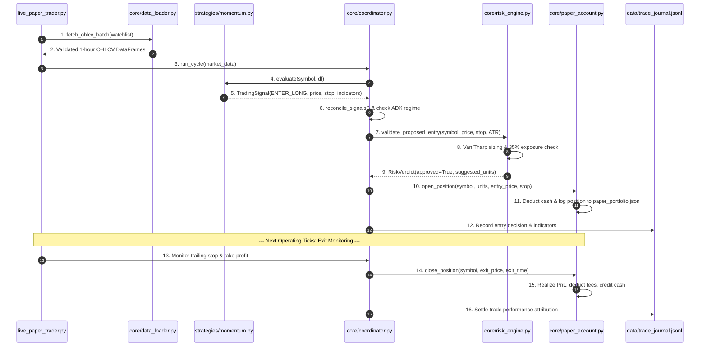

# Web4 Quantitative Trading Desk — Complete Trading Lifecycle

**Document Identifier:** `DOC-LIFECYCLE-2026`  
**Scope:** Complete Code-Level Walkthrough of the 22-Stage Trading Lifecycle  
**Primary Engine:** `core/coordinator.py`, `core/risk_engine.py`, `core/paper_account.py`  

---

## 1. High-Level Lifecycle Flowchart



---

## 2. The 22 Detailed Lifecycle Stages

### Stage 1: Market Data Retrieval
- **File:** [`core/data_loader.py`](../../core/data_loader.py)
- **Function:** `fetch_ohlcv_batch(symbols, symbol_params)`
- **Inputs:** List of ticker symbols, timeframes (`1h`), lookback days (`30d` crypto, `90d` stocks).
- **Outputs:** Dictionary `{symbol: pd.DataFrame}` with standard OHLCV columns (`open`, `high`, `low`, `close`, `volume`).
- **Mechanics:** Checks local disk cache (`data/cache/crypto_*.csv` or `stock_*.csv`). If cache is older than 2 hours (or market is open), fetches fresh bars via `ccxt` (Binance/Coinbase) or `yfinance`.
- **Failure Mode:** Network timeout, rate limiting, or exchange downtime. Caught safely; logs warning and skips missing asset.

### Stage 2: Data Validation & Freshness
- **File:** [`core/data_loader.py`](../../core/data_loader.py)
- **Function:** `check_data_quality(df, max_stale_minutes=180, min_bars=30)`
- **Inputs:** `pd.DataFrame`.
- **Validation Rules:**
  - Length must be $\ge 30$ candles.
  - Zero NaN values in `open`, `high`, `low`, `close`.
  - Non-positive prices rejected ($P \le 0$).
  - High must be $\ge$ Low for every single bar.
  - Datetime index must be strictly monotonically increasing.
  - Staleness limit: Most recent bar timestamp cannot be older than 180 minutes.
- **Failure Mode:** Rejects corrupt or stale feeds; logs `Data quality warning` and drops asset for the current tick.

### Stage 3: Candle Construction & Preprocessing
- **File:** [`core/data_loader.py`](../../core/data_loader.py)
- **Inputs:** Validated OHLCV DataFrame.
- **Outputs:** DataFrame with verified UTC timestamps, attributes (`quote_time`), and normalized floating point numeric types.

### Stage 4: Indicator Calculation
- **File:** [`core/strategy.py`](../../core/strategy.py)
- **Function:** `compute_indicators(df, breakout_lookback=48, ema_trend_filter=50, atr_period=14, macro_ema_period=200)`
- **Calculations:**
  - **Donchian Breakout High:** $\text{Highest High}(N)_{t-1}$.
  - **Donchian Breakdown Low:** $\text{Lowest Low}(N)_{t-1}$.
  - **EMA Trend Filter:** $\text{EMA}_{50}(\text{Close})$.
  - **Macro EMA Filter:** $\text{EMA}_{200}(\text{Close})$.
  - **Average True Range (ATR):** Wilder's 14-period smoothed true range.
  - **Average Directional Index (ADX):** 14-period directional trend strength index.
  - **Bollinger Bands:** 20-period SMA $\pm 1.9 \times$ rolling standard deviation.
  - **RSI:** 14-period Relative Strength Index.
- **Failure Mode:** Insufficient bars for rolling warmup returns `NaN`, signaling warmup phase.

### Stage 5: Market Regime Detection
- **File:** [`core/coordinator.py`](../../core/coordinator.py)
- **Function:** `_process_symbol()` (lines 915–927)
- **Logic:**
  ```python
  if cur_price < macro_ema:
      regime = "MACRO_BEAR"
  elif adx >= 28.0:
      regime = "TREND_EXPANSION"
  elif adx < 24.0:
      regime = "RANGE_CHOP"
  else:
      regime = "TRANSITION"
  ```
- **Outputs:** Merged indicator context containing exact market state.

### Stage 6: Strategy Evaluation
- **File:** [`strategies/momentum.py`](../../strategies/momentum.py) & [`strategies/mean_reversion.py`](../../strategies/mean_reversion.py)
- **Function:** `evaluate(symbol, df, existing_position)`
- **Mechanics:** Each bot evaluates its rules independently against the latest closed bar.

### Stage 7: Signal Generation
- **Outputs:** Standardized `TradingSignal` dataclass:
  - `signal_type`: `ENTRY_LONG`, `ENTRY_SHORT`, `EXIT`, `HOLD`, or `NO_TRADE`.
  - `symbol`: Ticker symbol.
  - `price`: Latest bar close price.
  - `stop_loss`: Proposed stop price.
  - `take_profit`: Proposed target price.
  - `indicators`: Dictionary of all computed indicator values.

### Stage 8: Signal Validation
- **File:** [`core/signals.py`](../../core/signals.py)
- **Checks:** Validates that proposed entry price is finite, positive, and that stop loss is strictly on the correct side of price (Stop < Price for Longs; Stop > Price for Shorts).

### Stage 9: Coordinator Conflict Arbitration
- **File:** [`core/coordinator.py`](../../core/coordinator.py)
- **Function:** `reconcile_signals(symbol, mom_sig, mr_sig, extra_signals, context)`
- **Rules:**
  1. In `TREND_EXPANSION` (ADX $\ge 28$), counter-trend Mean Reversion entries are strictly suppressed.
  2. In `RANGE_CHOP` (ADX $< 24$), Momentum breakout entries are suppressed.
  3. In `TRANSITION` (24 $\le$ ADX $< 28$), signals require multi-timeframe confluence $\ge 0.60$.
  4. If opposite signals occur simultaneously, both are suppressed (`CONFLICT_SUPPRESSED`) unless one strategy has $>1.5\times$ edge conviction.

### Stage 10: External Preflight Gating
- **File:** [`core/coordinator.py`](../../core/coordinator.py) (lines 1000–1080)
- **Checks:**
  - *NYSE Clock Check:* Rejects stock trades when NYSE is closed.
  - *SEC 8-K Gate:* Rejects stock entries within 48 hours of material corporate filings.
  - *Polymarket Radar:* Scales down sizing if macro crisis probability $> 60\%$.
  - *Streak Guard:* Rejects entries if symbol has 3 consecutive losses in the past 24 hours.

### Stage 11: Risk Evaluation & Position Sizing
- **File:** [`core/risk_engine.py`](../../core/risk_engine.py)
- **Function:** `validate_proposed_entry(...)`
- **Calculations:**
  - Circuit Breaker Check: Halts if daily loss $> 5\%$ or drawdown $> 15\%$.
  - Stop Distance: $D_{\text{stop}} = |\text{Entry} - \text{Stop}|$.
  - Dollar Risk: $R_{\$} = \text{Equity} \times \text{Risk \%}$ (where Risk \% is clamped to $[1\%, 5\%]$).
  - Sizing: $\text{Units} = R_{\$} / D_{\text{stop}}$.
  - Exposure Cap: If $\text{Units} \times \text{Entry} > 0.35 \times \text{Equity}$, clamps units so notional equals $35\%$ of equity.
  - Cash Buffer: Rejects if required margin exceeds available cash.
- **Outputs:** `RiskVerdict(approved=True, suggested_units=..., suggested_stop=...)`.

### Stage 12: Order Construction
- **File:** [`core/coordinator.py`](../../core/coordinator.py)
- **Outputs:** Constructs final `Decision` object specifying symbol, strategy ID, side (`BUY` or `SELL`), units, limit/stop prices, and justification.

### Stage 13: Paper Execution
- **File:** [`core/paper_account.py`](../../core/paper_account.py)
- **Function:** `open_position(symbol, entry_price, units, stop_loss, dollar_risk, ...)`
- **Mechanics:** Modifies in-memory portfolio state under process lock.

### Stage 14: Fill Simulation & Slippage Application
- **Calculations:**
  - Fills Longs at $\text{Fill Price} = \text{Bar Close} \times (1 + \text{Slippage \%})$ where Slippage = 0.04%.
  - Fills Shorts at $\text{Fill Price} = \text{Bar Close} \times (1 - \text{Slippage \%})$.

### Stage 15: Fee Calculation
- **Calculations:**
  $$\text{Taker Fee} = \text{Units} \times \text{Fill Price} \times 0.0006 \text{ (6 bps)}$$
  Deducted immediately from cash balance.

### Stage 16: Position Creation & State Persistence
- **File:** [`core/paper_account.py`](../../core/paper_account.py)
- **State Updated:** Adds position entry to `account.positions[symbol]`. Atomically persists updated cash, positions, and equity to `data/paper_portfolio.json`.

### Stage 17: Stop-Loss & Take-Profit Monitoring (Subsequent Ticks)
- **File:** [`core/coordinator.py`](../../core/coordinator.py) (lines 1150–1250)
- **Mechanics:**
  - **Trailing Ratchet:** If price moves favorably by $> 1.0\times$ ATR, ratchets stop loss to breakeven (`breakeven_lock`). As price rises, trailing stop ratchets upward at a fixed multiple of ATR (`atr_multiplier * ATR`).
  - **Partial Scale-Out:** When unrealized gain reaches $2.5\times$ ATR, closes 50% of units to bank profit (`PARTIAL_EXIT`), trailing remaining 50%.
  - **Hard Stop Exit:** If bar low crosses below trailing stop, triggers full `EXIT`.

### Stage 18: Position Closing
- **File:** [`core/paper_account.py`](../../core/paper_account.py)
- **Function:** `close_position(symbol, exit_price, exit_time, reason)`
- **Mechanics:** Removes symbol from `account.positions`.

### Stage 19: Realized PnL Calculation
- **Formulas:**
  - Long PnL: $\text{Gross PnL} = (\text{Exit Price} - \text{Entry Price}) \times \text{Units}$.
  - Short PnL: $\text{Gross PnL} = (\text{Entry Price} - \text{Exit Price}) \times \text{Units}$.
  - Closing Fee: $\text{Exit Fee} = \text{Exit Price} \times \text{Units} \times 0.0006$.
  - $\text{Net Realized PnL} = \text{Gross PnL} - (\text{Entry Fee} + \text{Exit Fee})$.

### Stage 20: Portfolio Balance Update
- **Mechanics:** Adds invested capital + Net Realized PnL back into `account.cash`. Updates peak equity tracking.

### Stage 21: Strategy Performance Attribution
- **File:** [`core/paper_account.py`](../../core/paper_account.py) & [`core/journal.py`](../../core/journal.py)
- **Attribution:** Records completed trade in `account.closed_trades` with explicit tags for `strategy_id`, holding duration, win/loss flag, and gross vs. net dollar returns.

### Stage 22: Logging, Monitoring & Audit Journal
- **File:** [`live_paper_trader.py`](../../live_paper_trader.py)
- **Output:** Appends human-readable trade alert to `data/live_trader.log`. Emits JSON snapshot to `data/live_status.json` for dashboard visualization.

---

## 3. Concrete Execution Walkthroughs

### Example 1: Momentum Breakout Trade (Approved & Executed)
- **Asset:** `BTC/USDT`
- **Initial Conditions:**
  - Account Equity: **$10,000.00** | Available Cash: **$10,000.00**
  - Donchian 48h High: **$65,000.00** | 50 EMA: **$64,200.00** | ADX: **31.5** (Regime: `TREND_EXPANSION`)
  - 14 ATR: **$1,200.00** | Current Bar Close: **$65,200.00**
- **Evaluation:**
  1. Price ($65,200) broke above Donchian High ($65,000) while above 50 EMA ($64,200).
  2. ADX (31.5 $\ge$ 28.0) confirms strong trend regime. Momentum emits `ENTRY_LONG` with initial stop at $\text{Close} - 2.5\times\text{ATR} = \$65,200 - \$3,000 = \$62,200.00$.
  3. Coordinator checks regime: `TREND_EXPANSION` permits Momentum. Multi-timeframe confluence: 0.85. Preflight radars all pass.
  4. Risk Engine evaluates sizing:
     - Stop distance = $\$3,000.00$.
     - Configured risk = $2.0\%$ of $\$10,000 = \$200.00$.
     - Position size = $\$200 / \$3,000 = 0.06667 \text{ BTC}$.
     - Notional value = $0.06667 \times \$65,200 = \$4,346.88$.
     - Exposure check: $\$4,346.88 / \$10,000 = 43.47\% > 35\%$ cap!
     - **Risk Engine caps notional to 35% ($3,500.00):**
       $$\text{Approved Units} = \frac{\$3,500.00}{\$65,200.00} = \mathbf{0.05368\text{ BTC}}$$
  5. Execution:
     - Taker fee (0.06%) = $\$3,500 \times 0.0006 = \$2.10$.
     - Cash deducted = $\$3,500 + \$2.10 = \$3,502.10$. Remaining cash = $\$6,497.90$.
     - Trade logged to `paper_portfolio.json` with trailing stop at $\$62,200.00$.

---

### Example 2: Mean Reversion Signal Rejected by Coordinator
- **Asset:** `NVDA`
- **Initial Conditions:**
  - Current Price: **$185.00** | Lower Bollinger Band ($1.9\sigma$): **$186.20** | RSI: **24.5**
  - ADX: **34.2** (Regime: `TREND_EXPANSION` — Severe Bearish Selloff)
- **Evaluation:**
  1. Mean Reversion engine detects price below lower band ($185.00 < 186.20$) and RSI oversold ($24.5 < 30$). Emits `ENTRY_LONG` signal.
  2. Signal enters Coordinator. Coordinator inspects market regime:
     $$\text{ADX} = 34.2 \ge 28.0 \implies \mathbf{TREND\_EXPANSION}$$
  3. **Coordinator Rule Enforcement:** In a strong trend expansion, buying an oversold asset is "catching a falling knife". Counter-trend Mean Reversion entries are strictly forbidden when ADX $\ge 28.0$.
  4. **Outcome:** The Coordinator immediately rejects the signal:
     > `SCANNING NVDA | Suppressed counter-trend MR in strong trend (ADX 34.2 >= 28.0)`
  5. Zero orders are sent to the Risk Engine. Account capital is protected from the ongoing downtrend.
