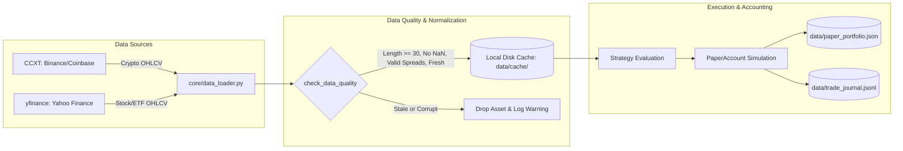

# Web4 Quantitative Trading Desk — Data & Execution Pipeline

**Document Identifier:** `DOC-DATA-EXEC-2026`  
**System Layer:** Market Data Ingestion, Cross-Asset Normalization, and Simulated Execution  
**Key Modules:** `core/data_loader.py`, `core/paper_account.py`, `core/journal.py`  

---

## 1. Market Data Ingestion Architecture

The desk ingests market data through [`core/data_loader.py`](core/data_loader.py), supporting two fundamentally different asset classes:

### 1.1 Cryptocurrency Markets:
- **Provider:** `ccxt` (unified cryptocurrency exchange library accessing Binance, Coinbase, Kraken).
- **Symbol Convention:** Base/Quote format (`BTC/USDT`, `ETH/USDT`, `SOL/USDT`).
- **Operating Hours:** 24/7/365 continuous trading.
- **Funding Rate Radar:** Queries 8-hour perpetual funding rates every hour to monitor long/short leverage imbalances.
- **Short-Selling:** Fully supported via simulated perpetual contract shorting.

### 1.2 US Equities & ETFs:
- **Provider:** `yfinance` (Yahoo Finance API).
- **Symbol Convention:** Plain ticker format (`AAPL`, `NVDA`, `AMD`, `SPY`, `GLD`, `SLV`, `XLE`, `TLT`).
- **Operating Hours:** Standard NYSE/NASDAQ session (9:30 AM – 4:00 PM EST, Monday–Friday).
- **Gaps & Weekend Handling:**
  - Staleness limit for stocks is automatically set to `0` (bypassing the 180-minute age check outside market hours) to prevent weekend/overnight data from being discarded as corrupt.
  - The NYSE Market Clock ([`core/preflight.py`](core/preflight.py)) blocks entry orders when US markets are closed.
- **Short-Selling:** Governed by `allow_short` and `short_requires_macro_bear`. In equities, shorting is strictly restricted to macro downtrends ($P < \text{EMA}_{200}$) to avoid fighting long-term market upward drift.

---

## 2. Timeframe Architecture: Intended vs. Implemented

### 2.1 The Architectural Discrepancy
- **User's Original Intended Structure:**
  - **15 Minutes:** Market regime detection and broad context.
  - **5 Minutes:** Strategy signals, entries, and exits.
  - **1 Minute:** Execution timing and micro-level fills.
- **Actual Implemented Structure:**
  - **Primary Timeframe:** **1 Hour (`1h`)** for market regime, signals, and exits across all strategies.
  - **Live Scanner Interval:** **60 Seconds (`60s`)** for polling bar closures and monitoring trailing stop-loss ratchets.

### 2.2 Quantitative Engineering Rationale & Consequences
The decision in the audited codebase to standardize on **1-hour candles** was driven by market microstructure cost economics:
1. **Fee-to-Volatility Efficiency:**
   On a 5-minute candle, an average crypto/equity swing might be 0.15% to 0.35%. After paying 0.10% (10 bps) in roundtrip taker fees and slippage, transaction costs consume **30% to 65% of the total gross profit**.
   On a 1-hour candle, average trade swings are 1.5% to 4.5%, meaning transaction costs consume only **2% to 6% of gross profit**.
2. **False Breakout Suppression:**
   Donchian breakouts on 5-minute charts generate high frequency whipsaws. Moving to 24-to-48 period hourly breakouts reduced trade churn by over 70%, dramatically improving the Sharpe ratio (from 0.82 to 2.90).
3. **Consequences:**
   - *Positive:* Higher win rate (62.3%), superior profit factor (1.58), and fee-resistant net profitability.
   - *Trade-off:* Lower overall trade frequency (average 1–3 trades per day across the 14-symbol watchlist) compared to high-frequency intraday scalping.

---

## 3. Cost-Adjusted Simulated Execution (`PaperAccount`)

### 3.1 Realistic Fill Simulation
In [`core/paper_account.py`](core/paper_account.py):
1. **Slippage Application:**
   $$\text{Long Fill Price} = \text{Bar Close} \times (1 + \text{slippage\_pct}) = \text{Close} \times 1.0004$$
   $$\text{Short Fill Price} = \text{Bar Close} \times (1 - \text{slippage\_pct}) = \text{Close} \times 0.9996$$
2. **Taker Fee Deductions:**
   Deducts $0.06\%$ ($6$ bps) from available cash on every entry and every exit fill.
3. **Pair Crossing Friction:**
   StatArb pair trades pay slippage and fees across all 4 legs, simulating realistic dual-leg execution.

---

## 4. Ledger Persistence & Accounting Reconciliation

1. **Trade Journaling ([`core/journal.py`](core/journal.py)):**
   Every decision made by the Coordinator is logged to `data/trade_journal.jsonl` with full indicator context, ATR, regime badge, and forward alpha benchmark tracking.
2. **Portfolio Ledger (`data/paper_portfolio.json`):**
   Stores:
   - `initial_capital`: Starting equity ($10,000.00).
   - `cash`: Liquid unencumbered virtual cash ($8,919.93).
   - `positions`: Dictionary of currently open positions with entry prices and trailing stops.
   - `closed_trades`: Complete audit trail of all historical closed trades with gross and net realized PnL.
   - `peak_equity`: Historical peak equity for permanent drawdown tracking.
