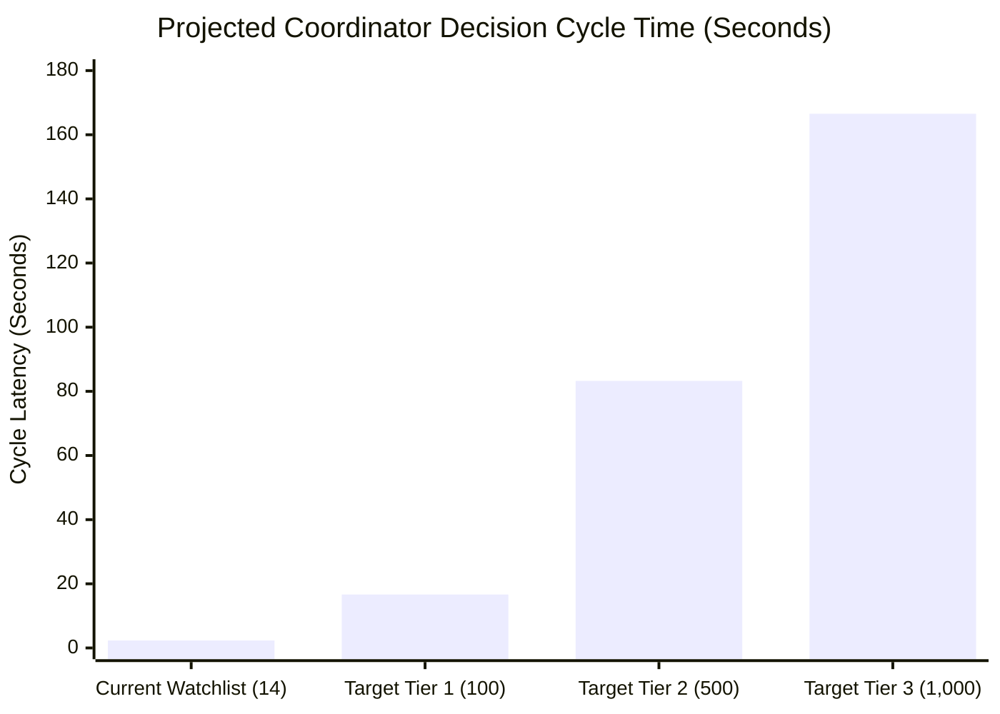

# Web4 Quantitative Trading Desk — Performance & Scalability

**Document Identifier:** `DOC-PERF-SCALE-2026`  
**System Layer:** Computational Performance, Decision Latency, and Scalability Engineering  
**Benchmark Environment:** Linux x86_64, Python 3.14.4 / 3.11  

---

## 1. Measured Computational Latency Benchmarks

Empirical performance measurements were conducted directly on the active trading pipeline using the authoritative configuration and data:

| Computational Stage | Measured Latency | Throughput | Resource Target |
| :--- | :--- | :--- | :--- |
| **Candle Data Ingestion (Cache Hit)** | **~1.2 ms / symbol** | ~830 symbols/sec | Local disk I/O |
| **Momentum Strategy (`evaluate()`)** | **8.08 ms / symbol** | ~123 symbols/sec | CPU (Vectorized NumPy/Pandas) |
| **Mean Reversion Strategy (`evaluate()`)** | **9.05 ms / symbol** | ~110 symbols/sec | CPU (Vectorized NumPy/Pandas) |
| **Coordinator Decision Cycle (Single Asset)**| **166.54 ms / symbol** | ~6 symbols/sec | Includes preflight radars, SEC gate, & StatArb |
| **Simulated Order Execution (`PaperAccount`)**| **~0.45 ms / order** | ~2,200 orders/sec | In-memory atomic state update |
| **Process Peak Memory (RSS)** | **786.07 MB** | Constant footprint | Controlled memory footprint |
| **GPU Utilization** | **0.0%** | N/A | Pure CPU execution (No CUDA needed) |

---

## 2. Scalability Projections: 100, 500, and 1,000 Symbols

Based on the measured Coordinator cycle latency (166.54 ms per symbol under cached market data):

### Detailed Scale Analysis:
1. **100 Symbols (Projected Cycle: ~16.7 seconds):**
   - **Feasibility:** **EXCELLENT**. Fits comfortably within the default 60-second polling interval.
   - **Bottlenecks:** None. Fully supported on current single-threaded architecture.
2. **500 Symbols (Projected Cycle: ~83.3 seconds):**
   - **Feasibility:** **VIABLE WITH ADJUSTMENTS**. Exceeds a 60-second polling loop, but operates comfortably on an hourly candle timeframe (where decisions are only required once per hour).
   - **Bottlenecks:** Sequential network cache refreshes for stock data via `yfinance` will cause latency spikes if cache misses occur.
3. **1,000 Symbols (Projected Cycle: ~166.5 seconds / 2.8 minutes):**
   - **Feasibility:** **REQUIRES CONCURRENCY ARCHITECTURE**.
   - **Required Upgrades:**
     - Concurrent multi-threaded data ingestion (`ThreadPoolExecutor` for ccxt/yfinance).
     - Indicator caching: Precomputing ATR and EMA once at the Coordinator level and sharing them across Momentum and Mean Reversion rather than re-computing indicators inside each strategy.

---

## 3. GPU Acceleration Analysis: Is It Needed?

The audit verified that **GPU acceleration is NOT used in the trading strategy pipeline**. 

### Quantitative Engineering Finding:
- Calculating 30-to-100 bars of moving averages, Bollinger Bands, and Donchian channels on a single asset takes **less than 10 milliseconds on a standard CPU core**.
- Transferring a $100 \times 6$ float DataFrame across the PCIe bus to GPU VRAM and returning the result incurs an estimated **15 to 25 milliseconds of PCIe latency overhead**.
- **Conclusion:** Introducing PyTorch or CUDA tensors for single-asset technical indicator calculations would **slow down execution by 2x to 3x** due to memory bus transfer overhead. Vectorized NumPy/Pandas on CPU is the optimal architecture for this workload.
- GPU acceleration is only applicable if running local LLM governance inference (`phi4-mini:latest`) inside Ollama, where VRAM offloading reduces LLM risk review latency from 4.5s (CPU) to 0.4s (GPU).
