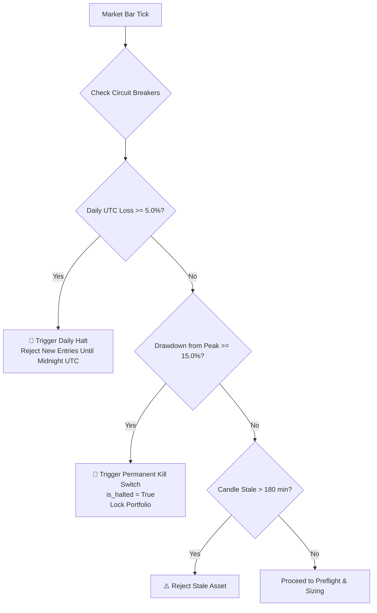

# Web4 Quantitative Trading Desk — Risk Management & Governance

**Document Identifier:** `DOC-RISK-GOV-2026`  
**System Layer:** Risk Engineering, SEC Rule 15c3-5 Compliance, and Supervisory Governance  
**Relevant Modules:** `core/risk_engine.py`, `agent/governor.py`, `core/process_lock.py`  

---

## 1. Absolute Financial Safety Invariants

In compliance with the **Engineering Guidelines for Autonomous AI Agents** ([`AGENTS.md`](../../AGENTS.md)), the trading desk enforces immutable financial invariants that supersede all optimization objectives:

1. **Simulation-Only Execution (`PaperAccount`):**
   - The execution mode is hard-coded to simulated paper trading.
   - The system contains zero broker trading API keys, zero private wallet keys, and zero paths to transmit real-money orders.
2. **Hard-Coded 1%–5% Risk Bounds:**
   - In [`core/risk_engine.py`](../../core/risk_engine.py), `MIN_ALLOWED_RISK_PCT = 0.01` and `MAX_ALLOWED_RISK_PCT = 0.05`.
   - The helper `enforce_risk_bounds()` clamps any incoming risk parameter:
     ```python
     def enforce_risk_bounds(self, requested_risk: float) -> float:
         return max(MIN_ALLOWED_RISK_PCT, min(MAX_ALLOWED_RISK_PCT, float(requested_risk)))
     ```
   - No autonomous agent, parameter mutation, or human proposal can loosen risk below 1% or above 5%.
3. **Single-Asset & Concentration Caps:**
   - Single-asset notional exposure is capped at **35% of portfolio equity**.
   - Maximum concurrent open crypto positions is capped at **2** (or 3 maximum in profiles) to eliminate correlated systemic crypto drawdowns.
   - Total portfolio margin exposure cannot exceed **80% of total equity**.
4. **Preservation of User Portfolio State:**
   - Virtual balances and closed trade histories in [`data/paper_portfolio.json`](../../data/paper_portfolio.json) cannot be cleared, reset, or overwritten except through an explicit CLI `--reset` argument passed by a human operator.

---

## 2. Emergency Circuit Breakers & Kill Switches

The desk implements multi-layered deterministic circuit breakers in [`core/risk_engine.py`](../../core/risk_engine.py):



### 2.1 Daily Loss Circuit Breaker (5.0%)
- **Trigger:** Realized + unrealized losses within a rolling 24-hour UTC session exceed 5.0% of starting session equity.
- **Action:** Rejects all new entry orders for the rest of the UTC day. Existing positions continue to be monitored for trailing stop-loss exits.

### 2.2 Persistent Drawdown Circuit Breaker (15.0%)
- **Trigger:** Portfolio equity drops $\ge 15.0\%$ below the historical high-water mark (`peak_equity`).
- **Disk Persistence:** `peak_equity` is persisted in `data/paper_portfolio.json` and restored on process restarts, preventing a bot reboot from resetting the drawdown counter.
- **Action:** Hard halt (`is_halted = True`). Emits emergency alert; requires manual human audit to clear.

---

## 3. Autonomous Multi-Agent Governance Protocol

All system modifications are governed by **Agent 12: Chief Risk Governor** ([`agent/governor.py`](../../agent/governor.py)):

### 3.1 The 4-Stage Governance Gate:
1. **Deterministic Invariant Audit (`audit_invariants()`):**
   - Validates that execution mode is simulated.
   - Asserts risk is within [1%, 5%].
   - Asserts maximum drawdown limit is $\le 15.0\%$.
   - Asserts parameter values fall within hard institutional bounds (e.g., ADX thresholds [12, 45], Bollinger Band period [10, 60], std [1.2, 3.5]).
2. **LLM Risk Review (`query_llm_risk_review_structured()`):**
   - Invocates local Ollama LLM (`phi4-mini:latest`) using a strict JSON schema.
   - **Fail-Closed Architecture:** If Ollama is offline, times out, returns malformed JSON, or outputs a non-approved verdict, the governor automatically defaults to `DISAPPROVE`.
3. **Automated Pytest Regression Suite (`run_pytest_regression_gate()`):**
   - Executes the complete test suite (`.venv/bin/pytest tests/`).
   - If even a single test out of 144 fails, the proposal is immediately rejected.
4. **Mandatory Human-in-the-Loop Gate:**
   - Any proposal that passes Stages 1–3 is staged in [`config/pending_proposals.json`](../../config/pending_proposals.json) with status `PENDING_HUMAN_APPROVAL`.
   - **The system cannot deploy changes autonomously.** Deployment requires an explicit human command:
     ```bash
     .venv/bin/python agent/governor.py --approve PROP-XXXXXXXX --approver "operator_name"
     ```

---

## 4. Atomic Deployment, Rollback & Process Concurrency

### 4.1 Process Concurrency Lock (`core/process_lock.py`)
To prevent race conditions, corrupted state, or duplicate orders:
- The bot acquires an OS-level file lock (`data/live_trader.lock`) via `fcntl.flock(LOCK_EX | LOCK_NB)` upon startup.
- If a second instance attempts to start, it raises `AlreadyRunningError` and exits immediately.

### 4.2 Atomic Deployment & Rollback
When a proposal is approved:
1. Governor copies `config/active_config.json` to `config/active_config.json.bak`.
2. Writes new candidate configuration to `config/active_config.json.tmp`.
3. Atomically replaces the file via `os.replace()`, preventing half-written JSON files if power is lost.
4. To rollback at any time:
   ```bash
   cp config/active_config.json.bak config/active_config.json
   ```
