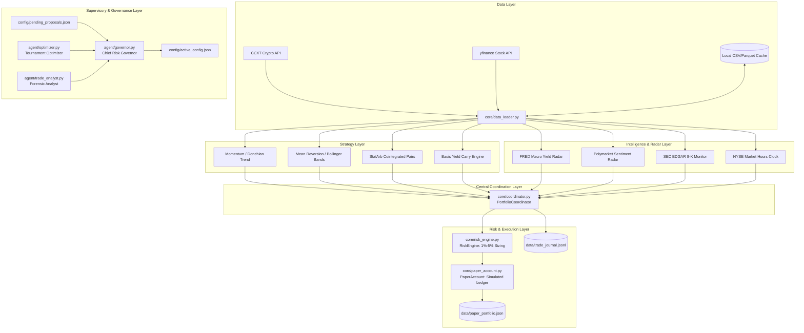

# Web4 Quantitative Trading Desk — System Overview

**Document Identifier:** `DOC-SYS-OVERVIEW-2026`  
**System Name:** Web4 Autonomous Multi-Strategy Algorithmic Trading Desk  
**Target Environment:** Simulated Paper Trading (`PaperAccount`)  
**Active Production Branch:** `main` (Merge Commit: `0a3d588`)  
**Audience:** Project Owner, Algorithmic Trading Engineers, Risk Officers  

---

## 1. What is the Web4 Quantitative Trading Desk?

The **Web4 Quantitative Trading Desk** is an autonomous, platform-independent, multi-strategy algorithmic trading system implemented entirely in standard Python 3.10+. It is engineered to monitor cross-asset financial markets—specifically cryptocurrency perpetuals/spot and US equities/ETFs—and execute quantitative trading strategies under strict institutional risk limits, market microstructure friction awareness, and cryptographically verified governance.

### Core Operating Principles:
1. **Capital Preservation First:** Generating alpha is secondary to preserving principal. Hard circuit breakers immediately halt trading if adverse drawdowns occur.
2. **Strict Paper Isolation:** The live system is hard-coded to execute against an in-memory, disk-persisted `PaperAccount`. It has zero live broker execution bridges, zero production API trading credentials, and cannot place real-money orders.
3. **Evidence-Based Parameter Governance:** No parameter modification, strategy calibration, or universe expansion can be applied without out-of-sample backtest validation, automated regression test verification (100% pass rate), Chief Risk Governor audit, and explicit human sign-off.
4. **Friction-Adjusted Expectancy:** Every strategy signal is evaluated after accounting for exchange taker fees, dual-leg crossing friction, and slippage. Strategies that generate gross predictive power but bleed money after trading costs are systematically rejected by cost hurdles.

---

## 2. High-Level System Architecture

The trading desk is architected as a modular, layered quantitative pipeline:

---

## 3. The Four Trading Engines

While the original foundational design centered on two primary complementary bots (**Momentum** and **Mean Reversion**), the desk has evolved into an institutional 4-strategy ecosystem to capture diverse sources of market alpha:

1. **Momentum / Trend Following ([`strategies/momentum.py`](strategies/momentum.py)):**
   - *Alpha Source:* Captures persistent directional price trends during volatility expansions.
   - *Mechanics:* 24-to-48 hour Donchian channel breakouts confirmed by an Exponential Moving Average (EMA 50/100) trend filter and ADX $\ge$ 28.0.
   - *Protection:* Dynamic ATR chandelier trailing ratchet and 50% partial scale-out profit target.
2. **Mean Reversion ([`strategies/mean_reversion.py`](strategies/mean_reversion.py)):**
   - *Alpha Source:* Exploits temporary price over-extensions back toward statistical equilibrium.
   - *Mechanics:* 20-period Bollinger Bands ($1.9\sigma$) combined with RSI extremes (<30 oversold, >70 overbought) active strictly when ADX < 24.0.
   - *Protection:* Hard stop-loss outside band extreme and automatic trade suppression during strong trend expansions.
3. **Statistical Arbitrage Pairs ([`strategies/stat_arb_pairs.py`](strategies/stat_arb_pairs.py)):**
   - *Alpha Source:* Market-neutral mean-reversion of economically linked, cointegrated asset pairs (e.g., GLD/SLV, NVDA/AMD, BTC/ETH).
   - *Mechanics:* Rolling 48-hour OLS spread z-score. Enters when $|Z| \ge 2.5\sigma$.
   - *Protection:* **2.5x Edge-to-Cost Gate** (`stat_arb_min_edge_cost_ratio: 2.5`), requiring expected spread profit to exceed 2.5 times the 40 bps roundtrip dual-leg execution friction.
4. **Basis Yield Carry ([`core/basis_yield.py`](core/basis_yield.py)):**
   - *Alpha Source:* Captures delta-neutral perpetual funding rate yields on crypto assets.
   - *Mechanics:* Long Spot + Short Perpetual carry position accrued monotonically every 8 hours whenever annualized yield exceeds hurdle rate (e.g. 8% APR).

---

## 4. The Role of the Central Coordinator

Individual trading strategies operate as pure analytical signal generators. They have **no authority to execute trades or allocate capital**. 

The **Portfolio Coordinator** ([`core/coordinator.py`](core/coordinator.py)) acts as the supreme operational arbiter:
- **Regime Classification:** Measures market-wide and asset-level ADX to determine whether the environment is pure chop (ADX < 24), transition (24 to 28), or explosive trend (ADX $\ge$ 28).
- **Conflict Resolution:** If Momentum generates a BUY signal while Mean Reversion generates a SELL signal on the same asset, the Coordinator resolves the conflict deterministically using regime conviction and multi-timeframe confluence.
- **Pre-Flight Sanity Checks:** Passes candidate signals through external intelligence radars:
  - *SEC EDGAR Gate:* Blocks entries on stocks within 48 hours of material 8-K filings.
  - *Polymarket Radar:* Gauges macro event probabilities to scale down exposure before binary shocks.
  - *FRED Economic Radar:* Adjusts risk based on yield curve inversions and Fed interest rate expectations.
  - *NYSE Market Clock:* Blocks opening auctions and illiquid after-hours fills for US equities.
- **Portfolio-Level Sizing & Execution:** Forwards vetted signals to the Risk Engine, which sizes positions according to the Van Tharp volatility model (1%–5% risk per trade) and enforces the 35% single-asset exposure cap.

---

## 5. Multi-Agent Supervisory Layer

Above the live execution loop sits an autonomous multi-agent supervisory framework:
- **Agent 9: Dynamic Asset Selector ([`agent/asset_selector.py`](agent/asset_selector.py)):** Continuously scans candidate market assets, builds elite alpha watchlists, and conducts parole hearings to rehabilitate blacklisted assets once their drawdowns stabilize.
- **Agent 10: Post-Trade Forensic Analyst ([`agent/trade_analyst.py`](agent/trade_analyst.py)):** Audits closed trades every 15 executions, categorizes loss root causes, and generates candidate parameter improvements.
- **Agent 11: Self-Improvement Optimizer ([`agent/optimizer.py`](agent/optimizer.py)):** Runs periodic backtest tournaments to identify parameter calibrations that improve Sharpe ratio and reduce drawdown.
- **Agent 12: Chief Risk Governor ([`agent/governor.py`](agent/governor.py)):** Supreme deployment gatekeeper. Enforces immutable safety invariants, invokes local LLM risk audits (fail-closed schema), runs automated regression test gates (100% pass required), and manages the mandatory human-in-the-loop approval queue.

---

## 6. Runtime Operating Loop

The system operates as a continuous daemon via [`live_paper_trader.py`](live_paper_trader.py):
1. **Loop Cadence:** Wakes up every 60 seconds (configurable via `--interval`).
2. **Process Locking:** Uses an OS-level file lock (`data/live_trader.lock`) via [`core/process_lock.py`](core/process_lock.py) to guarantee that only one bot process can access or mutate the portfolio ledger at any given millisecond.
3. **Data Freshness Guard:** Validates that incoming candles are strictly non-stale (<180m for crypto closed bars; active session for stocks).
4. **Read-Only Dashboard Feeds:** Publishes atomic tick snapshots to `data/live_status.json`, enabling terminal operators to monitor portfolio performance live via `dashboard.py` without touching the trade ledger.
