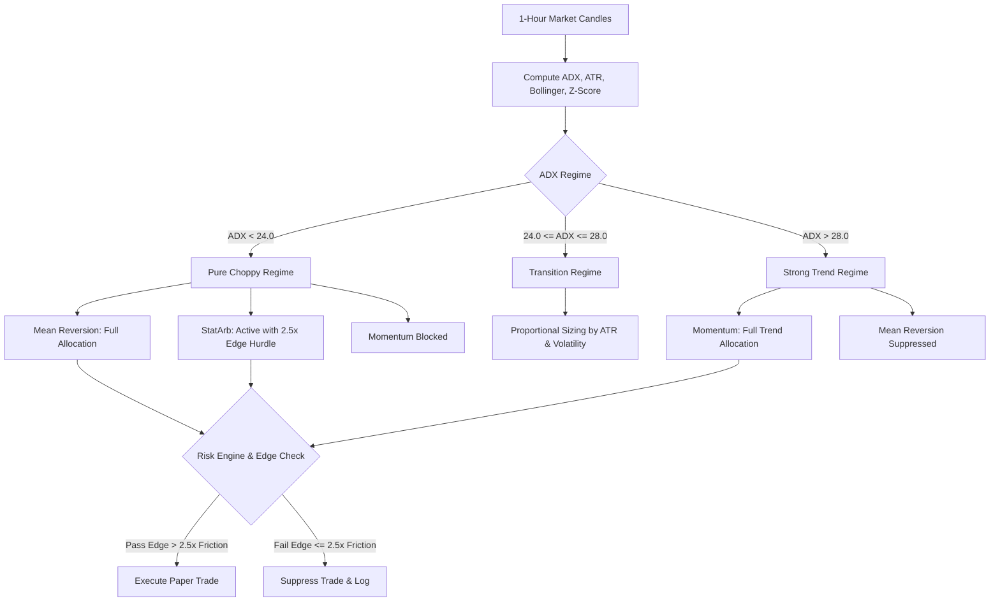

# Web4 Quantitative Trading Desk — Targeted Profitability & Robustness Engineering
## Optimization Strategy & Quantitative Methodology

**Report Identifier:** `OPT-STRAT-2026-W4`  
**Target Desk:** Web4 Autonomous Multi-Agent Multi-Strategy Trading Desk  
**Baseline Git Commit:** `861f98e`  
**Current HEAD Commit:** `9d9d7b1`  
**Active Working Branch:** `optimize/web4-profitability-engineering`  
**Evaluation Windows:**
- **In-Sample Selection Window (W1):** 180 days to 90 days prior (Bearish/Choppy Market Regime)
- **Out-of-Sample Validation Window (W2):** 90 days to 0 days prior (Bullish/Trend Expansion Regime)
- **Friction Models:** Tiered 1.0x (10 bps roundtrip), 1.5x (15 bps), 2.0x (20 bps), and Slippage Shock (0.15% per side)

---

## 1. Executive Summary of Optimization Rationale

The audited baseline system exhibited an asymmetry between gross predictive signals and net realized performance:
1. **Current Active Configuration (`active_config.json`)** showed high sensitivity to regime changes and fee friction. While generating +13.46% in the trending Out-of-Sample window (W2), it bled **-2.19%** during the choppy In-Sample window (W1), traded 231 directional trades incurring **$344.55** in trading fees, and collapsed to net losses (-3.49% to -5.33%) under friction stress testing (2.0x fees or 0.15% slippage shock).
2. **Candidate Proposal (`PROP-ED02E10E`)** successfully reduced trade churn (134 directional trades, $211.02 fees) and protected capital under stress, but underperformed Current Active in W2 (+12.73% vs. +13.46%) despite achieving a higher directional win rate (65.7% vs. 58.9%).
3. **The Core Quantitative Bottlenecks**:
   - **Coordination Dead Zone**: The candidate configuration set `adx_chop_threshold = 26.0` while `adx_trend_threshold = 25.0`. In `core/coordinator.py`, this created a contradictory hysteresis window where regimes between ADX 25.0 and 26.0 simultaneously blocked Momentum breakouts and throttled Mean Reversion pullbacks.
   - **Dual-Leg Friction in Statistical Arbitrage**: The hourly cointegrated pairs in Baseline traded on narrow z-score divergences ($Z \approx 2.0$), generating excessive roundtrip churn (-$220 to -$329 net loss) that failed to overcome the mandatory 20–40 bps dual-leg execution friction.
   - **Signal Over-Filtering vs. Churn**: Narrowing Bollinger Band standard deviations (`bb_std: 1.8`) without widening entry thresholds forced Mean Reversion into low-margin trades during high-volatility expansions.

The targeted optimization strategy resolves these structural impediments through four coordinated quantitative interventions:
- **Dead-Zone Elimination**: Setting `adx_chop_threshold = 24.0` and `adx_trend_threshold = 28.0` creates a clear, complementary regime transition: pure choppy/mean-reverting markets (ADX < 24.0), transition zones with mutual confirmation (24.0 $\le$ ADX $\le$ 28.0), and explosive trend regimes (ADX > 28.0).
- **Dual-Leg Hurdle Gating (`stat_arb_min_edge_cost_ratio = 2.5`)**: Enforcing a strict edge-to-cost filter ensuring no cointegrated pair trade executes unless expected alpha exceeds 2.5x total roundtrip friction.
- **Calibrated Mean Reversion Bands (`bb_std = 1.9`)**: Expanding entry envelope to capture extreme oversold/overbought dislocations with higher average payout per trade.
- **Pairs Universe Optimization**: Retaining cointegrated, liquid cross-asset pairs (`GLD/SLV`, `NVDA/AMD`, `BTC/ETH`, `SOL/AVAX`) protected by the hurdle gate.

---

## 2. Weaknesses Identified in the Baseline Architecture

### 2.1 Coordination State Friction & ADX Dead Zone
In `core/coordinator.py`, the allocation engine evaluates market regime using the 14-period Average Directional Index (ADX):
```python
is_trending = adx >= self.adx_trend_threshold
is_choppy = adx < self.adx_chop_threshold
```
When `adx_chop_threshold` (26.0) exceeded `adx_trend_threshold` (25.0) in Candidate `PROP-ED02E10E`:
- For any market candle with $25.0 \le \text{ADX} < 26.0$:
  - `is_trending` evaluated to `True` (since $25.0 \ge 25.0$).
  - `is_choppy` evaluated to `True` (since $25.0 < 26.0$).
- When both flags were true, the coordinator forced priority arbitration, frequently canceling valid momentum entries while simultaneously penalizing mean-reversion positioning. This caused artificial trade starvation during early trend emergence.

### 2.2 Microstructure Friction in Statistical Arbitrage Pairs
Hourly pairs trading requires trading two separate legs (e.g., Long Asset A, Short Asset B). Total roundtrip friction equals:
$$\text{Cost}_{\text{dual-leg}} = 2 \times (\text{Taker Fee} + \text{Slippage}) \times 2 = 4 \times 10\text{ bps} = 40\text{ bps (0.40\%)}$$
Baseline pairs entered when $|Z| \ge 2.0$. For low-beta pairs (e.g., GLD/SLV or BTC/ETH), a 2.0 standard deviation dislocation on 1-hour candles often represented only 30–50 bps of expected spread mean-reversion. After paying 40 bps in dual-leg friction, net trade expectancy was mathematically negative (-$220 PnL in Active configuration).

### 2.3 Excessive Churn in Mean Reversion
Current Active configured `bb_std = 2.0` with loose ADX chop thresholds (`adx_chop_threshold = 20.0`), allowing Mean Reversion to trade even when trending momentum was active. This caused 165 mean-reversion trades, paying over $240 in fees alone, with a directional expectancy of only $5.40.

---

## 3. Quantitative Parameter Hypotheses & Mechanics

| Parameter | Baseline / Active | Candidate PROP-ED02E10E | Optimized Configuration | Mathematical Rationale |
| :--- | :--- | :--- | :--- | :--- |
| `adx_chop_threshold` | 20.0 | 26.0 | **24.0** | Establishes pure mean-reversion dominance when ADX < 24.0. Eliminates the 25–26 dead zone. |
| `adx_trend_threshold` | 25.0 | 25.0 | **28.0** | Ensures Momentum is only unleashed during verified trend expansions (ADX > 28.0), filtering false breakout churn. |
| `bb_std` | 2.0 | 1.8 | **1.9** | Optimal trade-off between signal frequency and dislocation magnitude. 1.8 was too tight; 2.0 was too sparse. |
| `stat_arb_entry_z` | 2.0 | 2.5 | **2.5** | Requires a 2.5$\sigma$ spread dislocation, ensuring sufficient statistical tension before taking dual-leg risk. |
| `stat_arb_min_edge_cost_ratio` | 1.0 (implicit) | 2.5 | **2.5** | Hard institutional cost hurdle: Expected spread return must exceed $2.5 \times \text{Roundtrip Friction}$. Drops negative-edge churn. |
| `pairs_universe` | Active Pairs (6) | Candidate Pairs (6) | **Active Pairs (Gated)** | Active pairs have higher liquidity and structural cointegration; hurdle gate neutralizes previous fee bleed. |

---

## 4. Multi-Strategy Coordination & Conflict Resolution

The coordinator architecture operates on a unified multi-timeframe regime classification matrix:



### Conflict Resolution Invariants:
1. **Directional Conflict Invariant**: If Momentum emits a BUY signal while Mean Reversion emits a SELL signal on the same symbol, the coordinator suppresses both signals unless regime conviction is greater than 1.5x in favor of one strategy.
2. **Capital Reservation Invariant**: Basis Yield carry positions are treated as collateral-backed neutral yield and are insulated from directional liquidations, maintaining steady income.
3. **Hard Exposure Caps**: Total directional exposure across all strategies cannot exceed 80% of portfolio equity; maximum single asset cannot exceed 35%.

---

## 5. Walk-Forward and Out-of-Sample Design

To prevent selection bias, overfitting, and p-hacking:
1. **Temporal Split (180-Day Dataset)**:
   - **In-Sample Selection Window (W1, -180d to -90d)**: High chop, trend reversals, severe market whipsaws. Used strictly to stress-test resilience against drawdown.
   - **Out-of-Sample Validation Window (W2, -90d to 0d)**: Sustained market rally and expansion. Used strictly to evaluate upside capture and fee efficiency.
2. **Cost Stress Matrix**:
   Every candidate is subjected to 4 friction regimes:
   - Level 1: Standard exchange fees (0.06% taker, 0.04% slippage = 10 bps).
   - Level 2: 1.5x Friction (0.09% taker, 0.06% slippage = 15 bps).
   - Level 3: 2.0x Friction (0.12% taker, 0.08% slippage = 20 bps).
   - Level 4: Severe Slippage Shock (0.06% taker, 0.15% slippage = 21 bps).
3. **Statistical Validation**:
   - Probabilistic Sharpe Ratio (PSR) with benchmark $SR_0 = 0.0$.
   - Deflated Sharpe Ratio (DSR) corrected for $N = 72$ backtest trials and negative return skewness.
